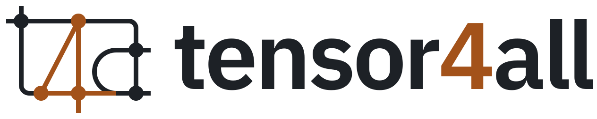

# tensor4all logo (proposal)

<picture>
  <source media="(prefers-color-scheme: dark)" srcset="svg/tensor4all-wordmark-dark.svg">
  
</picture>

Status: proposal, not yet adopted.

## Concept

The mark is **T∀** drawn as tensor diagrams: bonds with round ends and solid nodes. Next to it the wordmark reads **tensor4all**, with *tensor* in ink and *4all* in copper.

- T, in ink, is a tensor with three legs and stands for *tensor*.
- ∀, in copper, is the mathematical "for all" and stands for *4all*. It is drawn as a triangle of three tensors with two open legs.
- The copper of ∀ is the copper of *4all* in the wordmark, so the mark reads "tensor for all".
- Line art in ink and copper only, matching the tenferro and colmat logos.

The design comes from Xavier's T4∀ idea and Jan's earlier circuit mark; this form is Jan's. Favicons use the whole T∀ down to 32 px, and ∀ alone at 16 px.

## Files

| File | Use |
| --- | --- |
| `svg/tensor4all-mark.svg` | Mark for light backgrounds, transparent |
| `svg/tensor4all-mark-dark.svg` | Mark for dark backgrounds, transparent |
| `svg/tensor4all-mark-auto.svg` | Mark that follows `prefers-color-scheme` |
| `svg/tensor4all-wordmark.svg` | Horizontal logo for light backgrounds, text outlined |
| `svg/tensor4all-wordmark-dark.svg` | Horizontal logo for dark backgrounds, text outlined |
| `svg/tensor4all-avatar.svg` | Square avatar on the site background, safe for circular crops |
| `svg/tensor4all-avatar-dark.svg` | Square avatar, dark |
| `svg/favicon.svg` | Favicon: T∀ with heavier strokes, follows `prefers-color-scheme` |
| `svg/tensor4all-icon-small.svg` | Opaque T∀, source for the 32 and 48 px PNG favicons |
| `svg/tensor4all-icon-16.svg` | Opaque 16 px icon, the copper ∀ only |
| `png/tensor4all-avatar-{512,1024}.png` | GitHub organization avatar, social cards |
| `png/favicon-{16,32,48}.png`, `png/apple-touch-icon.png` | Raster favicons for browsers that do not use SVG |

## Print

The mark is drawn to survive screen printing and embroidery on clothing, where fine lines break up and small holes fill in. Common printer minimums are about 0.3 to 0.5 mm for a printed line and 1 mm for a gap; embroidery needs about 1.3 mm for a line.

- Bonds are 15 units wide on a cap height of 155 (the letters are about as tall as wide), and nodes are solid dots with a radius of 1.6 bond widths. Hollow rings are avoided because their holes close up.
- With the whole wordmark 80 mm wide (a left-chest print), bonds are about 1.0 mm and node dots about 3.3 mm.

For embroidery, use the mark alone at 30 mm or wider, or the wordmark at 100 mm or wider.

## Colors

The family palette, taken from the tensor4all.org site and shared with tenferro and colmat.

| Role | Light | Dark |
| --- | --- | --- |
| Ink: bonds, nodes, wordmark text | `#1d2126` | `#e6e8eb` |
| Copper: ∀ in the mark, *4all* in the wordmark | `#b7510b` | `#f0a46b` |
| Avatar background | `#fbfaf7` | `#14171b` |

The wordmark is set in IBM Plex Sans SemiBold (SIL Open Font License 1.1) with tracking of -0.03 em and kerning, converted to outlines. All tensor4all logos use the same type.

## Usage

GitHub README, switching with the viewer's theme:

```html
<picture>
  <source media="(prefers-color-scheme: dark)" srcset="https://raw.githubusercontent.com/tensor4all/tensor4all-meta/main/branding/logo/svg/tensor4all-wordmark-dark.svg">
  
</picture>
```

Website favicon:

```html
<link rel="icon" href="/favicon.svg" type="image/svg+xml">
<link rel="icon" href="/favicon-32.png" sizes="32x32" type="image/png">
<link rel="apple-touch-icon" href="/apple-touch-icon.png">
```

## Regenerating

Every logo is generated by [`../tools/export_logos.py`](../tools/export_logos.py); see [`../README.md`](../README.md).
