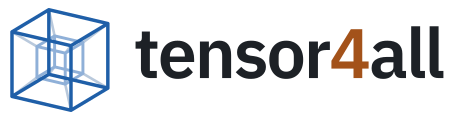

# tensor4all logo (proposal)

<picture>
  <source media="(prefers-color-scheme: dark)" srcset="svg/tensor4all-wordmark-dark.svg">
  
</picture>

Status: proposal, not yet adopted.

## Concept

The mark is a tesseract, a four-dimensional hypercube drawn as a cube inside a cube with the fourth axis joining them.

- tensor4all covers tensor computation as a whole (strided kernels, contraction, batched linear algebra, autodiff, and tensor network methods on top), so the mark shows a tensor itself rather than a network diagram.
- A rank-4 tensor is an everyday object in the field, and the fourth dimension carries the **4** in the name.
- It is line art in two blues. Filled isometric blocks were avoided on purpose because they read as NumPy.

The mark has no accent color. The warm accent is used only for the **4** in the wordmark.

## Files

| File | Use |
| --- | --- |
| `svg/tensor4all-mark.svg` | Mark for light backgrounds, transparent |
| `svg/tensor4all-mark-dark.svg` | Mark for dark backgrounds, transparent |
| `svg/tensor4all-mark-auto.svg` | Mark that follows `prefers-color-scheme` |
| `svg/tensor4all-wordmark.svg` | Horizontal logo for light backgrounds, text outlined |
| `svg/tensor4all-wordmark-dark.svg` | Horizontal logo for dark backgrounds, text outlined |
| `svg/tensor4all-avatar.svg` | Square avatar on the site background, safe for circular crops |
| `svg/tensor4all-avatar-dark.svg` | Square avatar, dark |
| `svg/favicon.svg` | Favicon with heavier strokes, follows `prefers-color-scheme` |
| `svg/tensor4all-icon-small.svg` | Opaque small icon, source for the PNG favicons |
| `png/tensor4all-avatar-{512,1024}.png` | GitHub organization avatar, social cards |
| `png/favicon-{16,32,48}.png`, `png/apple-touch-icon.png` | Raster favicons for browsers that do not use SVG |

## Colors

Taken from the tensor4all.org site palette.

| Role | Light | Dark |
| --- | --- | --- |
| Outer cube | `#1f5fa8` | `#79b0ee` |
| Inner cube | `#8fb0d8` | `#4a6f99` |
| Fourth-axis edges | `#b9c9dc` | `#34506f` |
| Wordmark text | `#1d2126` | `#e6e8eb` |
| Wordmark **4** | `#a3521a` | `#f0a46b` |
| Avatar background | `#fbfaf7` | `#14171b` |

The wordmark is set in IBM Plex Sans SemiBold (SIL Open Font License 1.1) with tracking of -0.03 em, converted to outlines.

## Usage

GitHub README, switching with the viewer's theme:

```html
<picture>
  <source media="(prefers-color-scheme: dark)" srcset="https://raw.githubusercontent.com/tensor4all/tensor4all-meta/main/branding/logo/svg/tensor4all-wordmark-dark.svg">
  
</picture>
```

Website favicon:

```html
<link rel="icon" href="/favicon.svg" type="image/svg+xml">
<link rel="icon" href="/favicon-32.png" sizes="32x32" type="image/png">
<link rel="apple-touch-icon" href="/apple-touch-icon.png">
```

## Regenerating

All files are generated by `tools/export_logo.py`. It needs `fontTools` and a copy of IBM Plex Sans SemiBold (`.ttf` or `.woff`); PNGs are rendered with `rsvg-convert`.

```bash
python3 tools/export_logo.py path/to/IBMPlexSans-SemiBold.ttf svg
```

Geometry (projection angles, inner cube scale, stroke weights) is set at the top of the script.
