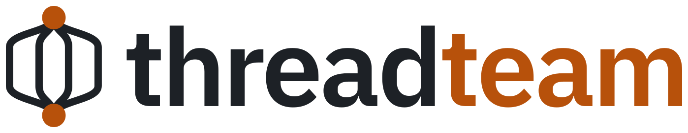

# threadteam logo (proposal)

<picture>
  <source media="(prefers-color-scheme: dark)" srcset="svg/threadteam-wordmark-dark.svg">
  
</picture>

Status: proposal, not yet adopted.

## Concept

The mark is a fork-join diagram drawn as line art: one pool opens a parallel region, four threads run side by side, and the region closes again.

- [threadteam-rs](https://github.com/tensor4all/threadteam-rs) is the only place in the tensor4all stack where parallel tasks start. The caller builds one pool, and every call receives a budget of its threads.
- The two copper nodes are where a parallel region opens and closes. The threads are in ink.
- The threads leave each node vertically and then bend outwards, so they do not crowd together near the nodes. With straight lines the outline would be a hexagon, too close to the tenferro nut.

In the wordmark, **team** is in copper, as **ferro** is in tenferro.

## Print

Bonds are 15 units wide in a mark about 200 units across, with solid nodes of radius 1.6 bond widths, the same rules as the tensor4all mark. With the wordmark 80 mm wide (a left-chest size), the threads are about 0.9 mm, the nodes about 2.8 mm, and the clear gap between neighbouring threads about 2.6 mm.

For embroidery, use the mark alone at 20 mm or wider, or the wordmark at 120 mm or wider.

## Files

| File | Use |
| --- | --- |
| `svg/threadteam-mark.svg` | Mark for light backgrounds, transparent |
| `svg/threadteam-mark-dark.svg` | Mark for dark backgrounds, transparent |
| `svg/threadteam-mark-auto.svg` | Mark that follows `prefers-color-scheme` |
| `svg/threadteam-wordmark.svg` | Horizontal logo for light backgrounds, text outlined |
| `svg/threadteam-wordmark-dark.svg` | Horizontal logo for dark backgrounds, text outlined |
| `svg/threadteam-avatar.svg` | Square avatar on the site background, safe for circular crops |
| `svg/threadteam-avatar-dark.svg` | Square avatar, dark |
| `svg/favicon.svg` | Favicon with heavier strokes, follows `prefers-color-scheme` |
| `svg/threadteam-icon-small.svg` | Opaque small icon, source for the 32 and 48 px PNG favicons |
| `svg/threadteam-icon-16.svg` | Opaque 16 px icon, source for `favicon-16.png` |
| `png/threadteam-wordmark{,-dark}-240h.png` | Raster wordmark, 240 px high |
| `png/threadteam-avatar-{512,1024}.png`, `png/threadteam-avatar-dark-512.png` | Avatars, social cards |
| `png/favicon-{16,32,48}.png`, `png/apple-touch-icon.png` | Raster favicons for browsers that do not use SVG |

## Colors

The family palette shared with tensor4all, tenferro and colmat.

| Role | Light | Dark |
| --- | --- | --- |
| Threads, wordmark **thread** | `#1d2126` | `#e6e8eb` |
| Fork and join nodes, wordmark **team** | `#b7510b` | `#f0a46b` |
| Avatar background | `#fbfaf7` | `#14171b` |

The wordmark is set in IBM Plex Sans SemiBold (SIL Open Font License 1.1) with tracking of -0.03 em and kerning, converted to outlines, like every tensor4all logo.

## Usage

GitHub README, switching with the viewer's theme:

```html
<picture>
  <source media="(prefers-color-scheme: dark)" srcset="https://raw.githubusercontent.com/tensor4all/tensor4all-meta/main/branding/threadteam/svg/threadteam-wordmark-dark.svg">
  
</picture>
```

## Regenerating

Every logo is generated by [`../tools/export_logos.py`](../tools/export_logos.py); see [`../README.md`](../README.md).
