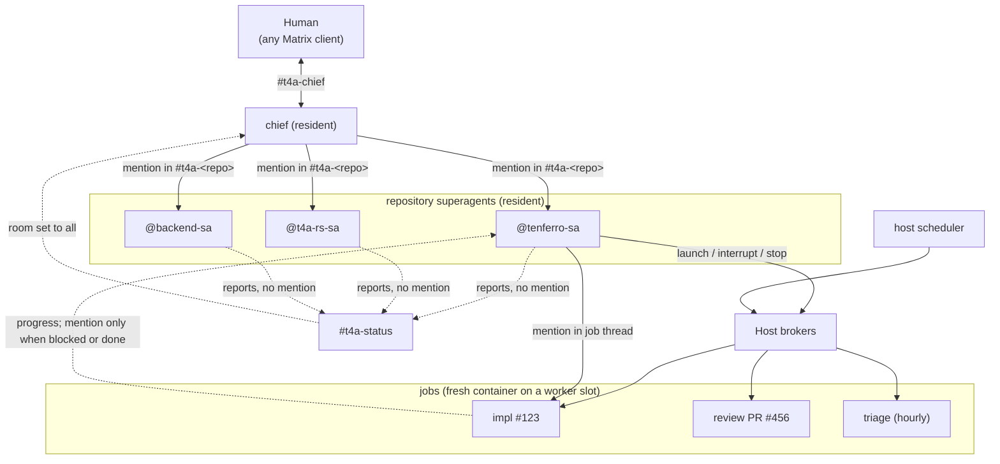
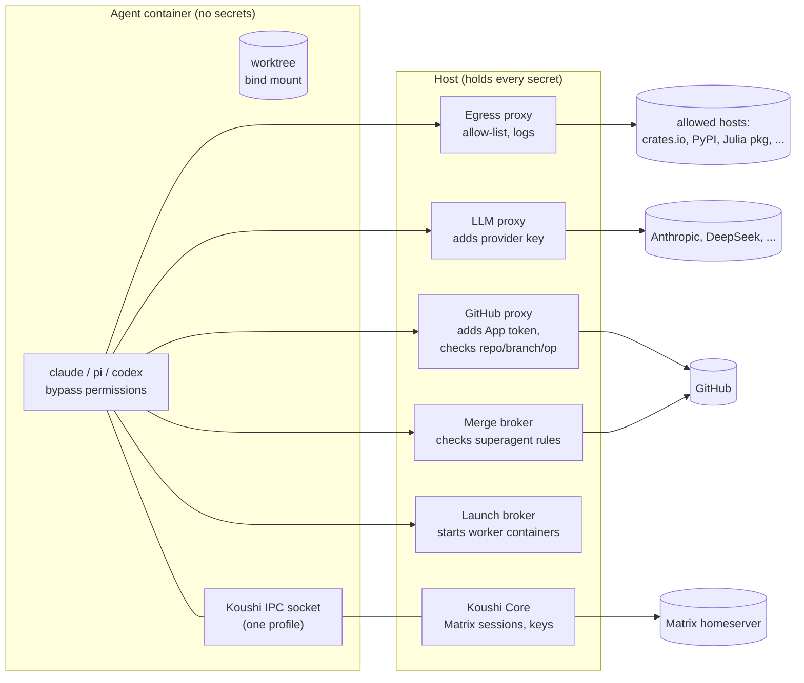

# A swarm of repository superagents, coordinated over Matrix

Status: proposal for review (2026-11). Nothing here is implemented. The fleet
that runs today is described in
[`tensor4all-agent-rules/docs/agent-fleet`](https://github.com/tensor4all/tensor4all-agent-rules/blob/main/docs/agent-fleet/README.md),
and the rules every superagent follows are in
[`rules/common/superagent.md`](https://github.com/tensor4all/tensor4all-agent-rules/blob/main/rules/common/superagent.md).
Those stay authoritative until the cutover described in "Build order and cutover".

## The problem

Today one orchestrator, a single Claude Code session on a laptop, supervises the
whole tensor4all ecosystem. It reads every agent's screen through herdr, patrols
every repository, reviews and merges.

- **It does not scale.** Every repository's issues, pull requests and agent
  screens pass through one context window. As repositories and agents are added,
  rounds get longer, context fills sooner, and handoffs become more frequent.
- **It is a single point of failure.** Its scheduled rounds live in one process
  on one laptop and expire after 7 days.
- **Agents run on bare hosts with real secrets.** Each machine holds a GitHub
  token in `gh`'s config or `GH_TOKEN`, provider API keys in
  `~/.pi/agent/auth.json` or the environment, and Claude Code logins. Agents run
  in bypass-permissions mode and read untrusted text all day: issues and
  comments from outside contributors, web pages, CI logs. One successful prompt
  injection can read and send every one of those secrets.

## The proposal in one paragraph

Give each repository (or small group of repositories) its own resident
**superagent**, and put one **chief** above them. Residents have their own Matrix
accounts, hosted by Koushi Core, and talk in Matrix rooms instead of through
screen scraping. Workers are short-lived jobs that residents start through a
host-side broker. Every agent, resident or worker, runs in a container that holds
**no secrets**: GitHub, LLM-provider and Matrix credentials stay on the host,
behind proxies that add them to requests the policy allows. Each host's broker
owns that host, so a benchmark can lease a quiet mini PC exclusively. The human
talks to the chief, and can read or join any room.

## One kind of agent, two lifetimes

Superagents and workers must be told apart, but making them two different
systems would double everything. Instead there is one kind of agent, described
by a **profile**, and profiles differ along two axes only:

- **Lifetime.** A **resident** runs continuously, has its own Matrix account,
  and is woken by Koushi. A **job** is started for one task or one scheduled run
  in a fresh container on a worker slot, and ends; its result is what it left on
  GitHub plus its Matrix thread.
- **Scope.** Which repositories it may touch, which GitHub operations the proxy
  allows it, which hosts it may reach, and which judgment pack it reads.

Everything else is the same: the same image, the same harnesses (Claude Code,
Codex, pi, DeepSeek Harness), the same container rules, the same proxies. A
profile is a small file:

```toml
# profiles/tenferro-sa.toml
lifetime = "resident"
matrix_account = "@tenferro-sa:example.org"
repos = ["tensor4all/tenferro-rs", "tensor4all/tenferro-sci-rs"]
github = "superagent"        # capability set in the GitHub proxy
egress = "none"              # only the LLM proxy
harness = "claude"
model = "opus"
pack = "tensor4all"          # judgment pack, mounted read-only
may_launch = ["impl", "review", "bench", "triage"]

# profiles/impl.toml
lifetime = "job"
github = "impl"              # push agent/* branches, open PRs; repo set per job
egress = "build"
harness = "claude"
model = "sonnet"
```

Who is what:

| Agent | Lifetime | Typical profile |
| --- | --- | --- |
| chief | resident | all repositories read-only; may mention superagents |
| repository superagent | resident | its repositories; dispatch, label, review, merge through the broker |
| impl / review / bench worker | job | one repository and one issue or PR, set when it is launched |
| stateless patrols (issue triage, red-PR watch, CI digest, upstream watch) | job, on a schedule | one repository, read plus labels and comments |



Why this split, and not more:

- **Only residents carry state, and as little as possible.** A superagent does
  not keep task status in a ledger it has to update. It derives the status of
  each task on every wake from the facts that already exist: GitHub (PR, draft,
  CI, review labels, merge, issue closed) and the broker's list of running jobs.
  It stores only what cannot be derived: which job it started for which task,
  and what it is waiting for. Ledgers that someone must remember to update drift
  from the truth; derived state does not.
- **Patrols are stateless jobs.** Issue triage (label, close what a merged PR
  fixed, fold duplicates) reads GitHub from scratch each run and writes nothing
  but its GitHub actions and a four-number report (closed, labelled, folded, net
  change). It needs no memory, so it is a scheduled job,
  not a resident. Splitting triage from dispatch is what keeps either from being
  starved of attention.
- **Workers talk over Matrix through slots, not accounts of their own.**
  Creating and verifying a Matrix account per job is too heavy (a person
  verifies each account once). Instead each host has a few long-lived **worker
  slot** accounts (`@host-a-w1`, `@host-a-w2`, ...). A job runs in a fresh
  container bound to one slot for its lifetime; the next job on that slot gets a
  fresh container. See "Worker slots".
- **A profile can change lifetime.** If one repository's triage grows into real
  ongoing work, its profile becomes a resident with an account. Nothing else
  changes.

### Host brokers

Today the orchestrator drives herdr directly: it can start an agent in any pane,
read any screen, type into any pane. Handing that to an agent in a container
would give it every other agent on the machine. Instead every host runs one
**host broker**, a small service that is the only way to start, stop or
interrupt an agent there:

| Call | Meaning |
| --- | --- |
| `launch(profile, repo, task)` | start a job container on a free slot of a matching host; the broker chooses image, mounts, runtime, egress and GitHub capabilities from the profile, never from the caller |
| `list()` | jobs this caller started, with state (`queued`, `running`, `done`, `failed`) and a heartbeat |
| `interrupt(job)` / `stop(job)` | only for jobs this caller started |
| `lease(host, exclusive)` | see "Placement and exclusive leases" |

An agent reaches only its own host's broker, through a socket mounted into its
container. Brokers talk to one another over the tailnet with host keys, so a
superagent on the laptop can launch a job on a remote mini PC without any
network access of its own: its local broker forwards the call.

Scheduled patrols are launched by the host scheduler (systemd timers or launchd)
through the same broker, so they get the same containers and the same audit
trail. This also removes the 7-day expiry of session-bound scheduled tasks.

### Worker slots

Once every agent is on Matrix, a worker is instructed and heard the same way a
superagent is:

- Each host has one room, `#t4a-host-<name>`, whose members are that host's slot
  accounts, the superagents, and the human. Each job is one thread in it.
- The superagent assigns and steers a job by mentioning the slot in the job's
  thread. A slot is woken only by a mention from a superagent or the human.
- The worker posts progress in the thread **without** mentions, and mentions its
  superagent only when it is blocked on a decision and when it is done. A
  superagent's reply to "done" does not mention the slot unless it assigns more
  work, so no loop starts.
- The human can read any job's thread from a phone and step in with a mention.
  That replaces looking at a herdr pane.

The cost is a handful of extra accounts per host, each verified once, and a
Koushi host (the headless daemon, #2109) on every Linux machine.

### One Matrix device per account, reused forever

Containers never sign in to Matrix. Koushi Core on the host holds each account's
single session, and a container only talks to Core over the IPC socket. So:

- **devices = accounts**, one each, no matter how many jobs or containers run.
  With a chief, five superagents and three hosts with two slots each, that is 12
  accounts and 12 devices;
- a fresh container on a slot reuses the slot's device; so does a restart of
  Koushi, which keeps the device ID and keys in its encrypted store and never
  recreates crypto under a saved device ID (missing or wrong state fails closed
  instead);
- each device is verified once, when the account is first signed in on its host;
- signing an account out through Koushi removes its device on the homeserver, so
  retiring a slot leaves nothing behind.

A new device appears only if a host's Koushi store is lost and the account is
signed in again. The old device should then be removed on the homeserver; that is
part of the host-rebuild checklist.

### Do we still need herdr?

No. Each thing herdr does today has a replacement:

| herdr today | Replaced by |
| --- | --- |
| start an agent in a pane; keep it alive after SSH ends | host broker and container runtime (systemd keeps the broker up) |
| `agent prompt` | a mention in Matrix, delivered by Koushi's wake feed |
| `agent read` (screen scraping) | the job's Matrix thread, plus the harness session log for detail |
| `agent wait` (idle, blocked, done) | broker heartbeat and container state; inside the sandbox there are no approval dialogs to get stuck on |
| `send-keys esc` | `interrupt(job)` |

The swarm does not use herdr at all. There is no interim phase in which the
broker drives herdr panes: the swarm starts only once Koushi can host agents on
the Linux machines and wake every harness we use (see "Build order and
cutover"). For debugging, the human can attach to a job's container.

## Placement and exclusive leases

Benchmarks need a quiet machine: nothing else running, boost off, the Docker
daemon off the measured cores. Today this is a convention the orchestrator has to
remember. It should be a mechanism.

### Hosts declare labels, jobs declare needs

```toml
# hosts/minipc-1.toml
labels = ["linux", "x86_64", "quiet"]
measured_cpus = "0-7"
slots = 2

# profiles/bench.toml
lifetime = "job"
needs = { labels = ["quiet"], exclusive = true }
```

A superagent never names a machine. It asks for a profile; its broker forwards
the request to a host whose labels match.

### The host broker owns its host's lease

There is no central scheduler. Each broker is the only authority over its own
host, so exclusivity is a local lock, not a distributed one:

1. An exclusive request is queued on the host. The broker stops admitting new
   jobs there.
2. Running jobs may finish up to a deadline set by priority; after it,
   lower-priority jobs are interrupted and requeued.
3. The broker runs the host's quiet checks (boost off, no other containers,
   Docker daemon CPU affinity, load average) and refuses the lease if any fails.
4. The job runs with `--cpuset-cpus` set to the measured cores. The lease has a
   heartbeat and a time limit, so a crashed holder cannot lock the machine
   forever.
5. On exit the broker releases the lease and admits queued jobs again.

People see the lease too: the broker posts "minipc-1 exclusive for tenferro
bench #491 until 14:30" in the host room.

### Should benchmarks use GitHub Actions self-hosted runners?

A self-hosted runner is the same pattern, run by GitHub: the machine pulls jobs
(no inbound ports), jobs are matched by labels, one runner process runs one job
at a time (exclusive for free), and the queue, logs and results are tied to a
commit.

For **measurements** (a scripted, repeatable run, like the weekly full CPU
benchmark) it is a good fit:

- the benchmark is a checked-in workflow, not something an agent improvises, so
  runs are comparable;
- an agent triggers it with `gh workflow run` (`actions: write` through the
  GitHub proxy) and reads the result like any other CI;
- there is no coordinator to write.

It needs care:

- GitHub advises against self-hosted runners on public repositories, because a
  fork pull request can run code on the machine. Register the runner only to a
  runner group restricted to the benchmark repositories, trigger only on
  `workflow_dispatch` and `schedule`, never on `pull_request`, and use ephemeral
  runners that run each job in a container with no secrets.
- Two schedulers on one machine need one lock. The runner's job-started hook
  (`ACTIONS_RUNNER_HOOK_JOB_STARTED`) asks the host broker for an exclusive
  lease, and the job-completed hook releases it, so agent jobs and runner jobs
  never overlap.

For **agent work** that needs the quiet machine (profiling, bisecting a
regression, trying variants), a runner is the wrong shape: an Actions job is not
interactive and cannot be steered. That stays an agent job with an exclusive
lease.

If the number of machines grows well beyond a handful, a batch scheduler (Slurm's
exclusive allocation and node features do exactly this) can take over placement
from the brokers. It is not needed at the current size.

### Judgment packs

The rules and judgment a superagent applies (when to label `ai-ready`, what
counts as a good PR, the maintainer's preferences) are kept per project in a
private **judgment pack**, separate from the mechanism. The pack is mounted
read-only into the container. Agents propose changes to it; only the human
accepts them. Keeping it read-only also means that a taken-over agent cannot
rewrite the rules the next agent will follow.

## Communication over Matrix

This builds on Koushi's "agents on their own Matrix accounts" plan
([shinaoka/koushi-matrix#2140](https://github.com/shinaoka/koushi-matrix/issues/2140),
epic #2124, canon #2125). In that plan Koushi Core keeps each agent's verified
session and encryption keys, decides when the agent is woken, and pushes a wake
row over a local IPC socket to a thin plugin inside the agent's harness. An agent
is woken by every DM message, by an `m.mentions` mention elsewhere, or by every
message in a room the owner set to `all`, always only from a sender on its
allow-list.

### Rooms

| Room | Members | Who is woken |
| --- | --- | --- |
| `#t4a-chief` | human, chief | chief, by every message (DM rule) |
| `#t4a-status` | chief, all superagents, human | chief, by every message (room set to `all`) |
| `#t4a-<repo>` | human, chief, that repository's superagent | the superagent, by a mention from the human or the chief |
| `#t4a-<repo>-ci` (optional) | CI bot, superagent | the superagent, by every message (room set to `all`) |

All rooms are invite-only and end-to-end encrypted. A person accepts every
invite for an agent account; agents cannot join rooms by themselves (#2124).

### No reply loops

A Matrix reply carries the replied-to sender in `m.mentions`, so two agents that
may wake each other loop. Koushi's default allow-list already excludes agent
accounts for this reason. The swarm needs agents to wake each other, so it uses
a direction instead:

- The chief may wake a superagent: the chief is on each superagent's allow-list.
- A superagent never wakes the chief by mention. It reports by posting to
  `#t4a-status` with an empty `m.mentions`; the chief is woken because that room
  is set to `all` for it.
- Superagents are not on each other's allow-lists. Cross-repository work goes
  through the chief.

This needs one thing Koushi does not yet promise: a send or reply tool that lets
the caller set `m.mentions` explicitly, so that replying in a thread does not
mention the original sender. Until it exists, superagents post to
`#t4a-status` as new messages, not replies. A per-room hop budget in Core (for
example, at most N wakes of one account per room per 10 minutes) would be a
second guard; that is also a request to Koushi.

### What stays on GitHub

Matrix carries coordination: instructions, reports, escalations. GitHub stays
the record for code: issues, pull requests, reviews, the `ai-ready`,
`human-approve-required`, `xreview:*` labels and the hold-is-a-draft rule. A
decision made in Matrix that matters later is copied to the issue or pull
request it concerns.

## Security

### Threat model

Every agent reads untrusted text: issues and comments from anyone, pull requests
from outside the organization, web pages, CI logs, and Matrix messages. We
assume that some of it will contain instructions aimed at the agent, and that
sooner or later an agent will follow them. The design goal is that an agent that
has been taken over can do little harm:

- it cannot read any long-lived secret (GitHub tokens, provider API keys, Matrix
  session tokens and keys, the crates.io token, SSH keys);
- it can write only to the repository and branch it was given;
- it cannot merge, release or change repository settings unless a check outside
  the agent agrees;
- it can reach only the hosts its role needs.

The three conditions that together make an agent dangerous are access to
private data, exposure to untrusted content, and a way to send data out
([the "lethal trifecta"](https://simonwillison.net/2025/Jun/16/the-lethal-trifecta/)).
Workers always have the second, so the design removes the first (no secrets
inside) and narrows the third (deny-by-default egress).

**Workers need the container more than residents do.** A resident mostly reads
GitHub and Matrix and talks to the LLM. A worker checks out code that may come
from outside the organization, runs `cargo build` (with every dependency's
`build.rs`), `pip install`, test suites and benchmarks, and reads arbitrary web
pages. That is arbitrary code execution by design, not only prompt injection.
So every job runs in a container, and a fresh one per task, thrown away at the
end; no worker runs on the bare host, including on the benchmark and GPU
machines.

### Confine every agent in a container: yes, but Docker alone is not the boundary

A plain container that mounts `~/.ssh` or has open egress bounds almost nothing.
The boundary is the combination below, and the container is only its first
layer.



**1. Isolation layer.** Anthropic's
[secure-deployment guide](https://code.claude.com/docs/en/agent-sdk/secure-deployment)
rates plain Docker as "setup dependent" and gVisor or a VM as strong, because a
container shares the host kernel. Proposal:

- Linux hosts: rootless Docker (as in
  [`rules/docker/rootless.md`](https://github.com/tensor4all/tensor4all-agent-rules/blob/main/rules/docker/rootless.md))
  with the gVisor runtime `runsc` as the default for every agent. gVisor's
  `nvproxy` supports CUDA, so the GPU host can use it too; measure first, and if
  a GPU or benchmark workload does not work under gVisor, run that one role
  under `runc` with the same no-secrets and no-egress rules.
- macOS (the laptop): Docker Desktop, or Docker Sandboxes, which runs each agent
  in its own microVM with only the workspace mounted
  ([Docker blog, 2026-01](https://www.docker.com/blog/docker-sandboxes-run-claude-code-and-other-coding-agents-unsupervised-but-safely/)).
- Every container: non-root user, all capabilities dropped,
  `no-new-privileges`, read-only root filesystem with a `tmpfs` for scratch,
  memory/CPU/PID limits, and `--cpuset-cpus` on hosts that also benchmark.

**2. Filesystem.** Mount only the task's worktree, read-write. Never the home
directory, `~/.ssh`, `~/.config`, `~/.cargo/credentials*`, `~/.git-credentials`,
`.env` files, or the Docker socket. Package caches (`~/.cargo/registry`,
`~/.julia`, pip/uv) live in a named volume per repository, not one shared
writable cache, so one poisoned task cannot plant code for every other
repository.

**3. Network.** The container has no route to the internet. Its only exits are
the host proxies, reached over Unix sockets or an internal Docker network:

- **Egress proxy**: an allow-list per role, logging every request. A build role
  gets package registries and toolchain mirrors only. A research role gets
  general web reads but no GitHub write access (see "Roles" below). Within an
  allow-list an agent can still send data to an allowed host, so the list stays
  short.
- **LLM proxy**: Claude Code reaches it through `ANTHROPIC_BASE_URL`, pi and
  Codex through their provider base URL settings. The proxy adds the API key.
- **GitHub proxy** (git smart HTTP and the REST/GraphQL API): the container gets
  a per-task placeholder credential. The proxy checks the placeholder, the
  repository, the operation and, for pushes, the branch, then adds a real token.
  This is the pattern Anthropic uses for Claude Code on the web
  ([engineering post](https://www.anthropic.com/engineering/claude-code-sandboxing)).

**4. Credentials stay on the host.**

| Secret | Where it lives | How an agent uses it |
| --- | --- | --- |
| GitHub | a GitHub App private key on the host; the proxy mints installation tokens (valid 1 hour) scoped to one repository | through the GitHub proxy only |
| LLM provider keys | host proxy configuration | through the LLM proxy only |
| Matrix session, E2EE keys | Koushi Core (macOS Keychain; Linux per Koushi's open decision) | through the Koushi IPC socket, bound to one profile and one account |
| crates.io token | the human's laptop only, as today | never |
| SSH keys | the human's laptop only | never |

The Koushi IPC socket is mounted into the container. It is authenticated and
profile-bound, so it lets the container act only as its own Matrix account, and
Koushi never hands a session token or key to the client. That is the property
the swarm relies on.

**5. Consequential actions go through brokers that enforce the rules in code.**
Today "only the orchestrator merges" is enforced by GitHub rulesets plus a human
account on the laptop. With superagents merging, the rule moves into a **merge
broker** on the host: the superagent asks it to merge pull request N at head SHA
S, and the broker re-reads the pull request and merges only if the rules in
`superagent.md` hold (not a draft; no `human-approve-required`; `xreview:done`
for that SHA by a different provider; a `Model:` line; CI green; no review or
steering comment newer than the last review). The superagent's GitHub identity
cannot merge on its own; only the broker's can. Releases and repository settings
are not exposed to any agent.

Starting jobs works the same way through the host broker (see "Host brokers"):
no agent has the Docker socket, and the caller cannot
choose mounts, network or credentials.

### Capability sets

The `github` and `egress` fields of a profile name one of these sets.

| Set | GitHub (through proxy) | Egress | Matrix |
| --- | --- | --- | --- |
| chief | read all repositories, comment | none beyond LLM | its rooms |
| superagent | its repositories: issues, labels, PR comments, draft/ready; merge through broker | none beyond LLM | its room, `#t4a-status` |
| impl | push to `agent/<issue>-*` branches, open PRs, in one repository | build allow-list | its slot, the host room |
| review | read, comment, add `xreview:done` | build allow-list | its slot, the host room |
| bench | read; push to the benchmark data branch | build allow-list | its slot, the host room |
| research | read-only, no push | web reads, logged | its slot, the host room |
| triage | one repository: labels, comments, close an issue that a merged PR closes | none | its slot, the host room |

The chief and superagents need no egress beyond the LLM proxy: anything that
needs the web or a build is a job.

### What the container does not solve

- An agent can still damage what it is allowed to touch: a bad push to its own
  branch, a misleading comment, a wrong label. Review and the merge broker are
  what catch that.
- Data the agent can read inside the sandbox (the repository, other agents'
  messages in its rooms) can leave through an allowed host. Keep private
  repositories and private rooms away from research roles.
- Claude Code with a subscription login keeps an OAuth credential in the
  container. Whether Claude Code can run against an `ANTHROPIC_BASE_URL` proxy
  with a subscription, or must use an API key held by the proxy, has to be
  checked before the cutover. Until then, treat that credential as exposed and give
  it to no role that reads untrusted content without a short expiry.

## The agent image

One image family, built in CI, pinned by digest, rebuilt weekly:

- `t4a-agent-base`: Ubuntu 24.04, git, `gh`, build tools, the Rust toolchain
  from each repository's `rust-toolchain.toml` installed on demand into the
  per-repository volume, Julia (juliaup), Python with `uv`.
- `t4a-agent-cpu`: base plus PyTorch (CPU), JAX (CPU), the reference libraries
  the tests compare against.
- `t4a-agent-cuda`: base plus the CUDA runtime, PyTorch and JAX with CUDA.
- Harnesses in every variant at pinned versions: Claude Code, pi, Codex, and the
  Koushi harness plugins.

The image is the only way tools change. Agents no longer run `claude update`,
`pi update` or `pip install` against the open internet; the weekly rebuild does
that, and its diff (versions, digests) is the place to review supply-chain
changes. An image that holds every tool is large; that is fine, because it is
pulled once per host and shared read-only.

## Build order and cutover

We go to the end state in one step, without running the old orchestrator and
the swarm side by side, and without an interim herdr-based broker.

**Prerequisites (Koushi).** Agent accounts with the wake feed and the IPC
(Release 1: #2125, #2126, #2130–#2132), the pi and Codex plugins (Release 2:
#2127, #2128; DeepSeek Harness #2129 if we use it), the Linux headless daemon
(Release 3: #2109), and the requests in "Requests to Koushi" below. Until these
land, the current fleet keeps running unchanged.

**Build, in this order, while the current fleet keeps running:**

1. The agent image family and its weekly rebuild.
2. The host proxies (egress, LLM, GitHub) and the GitHub App; the subscription
   versus API-key question for Claude Code is settled here.
3. The host broker: profiles, slots, launch/interrupt/stop, forwarding over the
   tailnet, exclusive leases and quiet checks.
4. The merge broker, enforcing `superagent.md`.
5. The ephemeral self-hosted runner for scheduled measurements, taking its lease
   through the job hooks.
6. Matrix: the chief, superagent and slot accounts, signed in and verified on
   their Koushi hosts; the rooms and allow-lists.

Each piece is tested on its own against a disposable repository and a test
homeserver before the cutover; nothing above touches the live repositories.

**Cutover (one day).** Stop the orchestrator's scheduled rounds. Let running
herdr agents finish or stop them, and write their state into the issues and pull
requests they were on. Revoke the personal GitHub tokens and provider keys on
the agent machines, and remove the agents' GitHub account's write access in
favour of the App. Start the chief and the superagents. The new superagents
derive their state from GitHub, so no ledger has to be migrated.

**Rollback.** Keep the old orchestrator's instructions and the herdr setup on
disk for a few weeks. Rolling back means re-issuing tokens, which is the point:
the old setup is the one that holds secrets on the hosts.

## Requests to Koushi

Most of what the swarm needs is already in the #2124 plan. Missing or open:

1. **Explicit `m.mentions` on send and reply**, so an agent can reply without
   waking the sender (see "No reply loops").
2. **A wake budget per account and room** in Core, as a loop guard independent
   of agent behaviour.
3. **The IPC socket inside a container**: a per-profile socket path that can be
   bind-mounted, and a check that the socket works across the Docker Desktop VM
   boundary on macOS and under gVisor on Linux.
4. **Per-profile send restrictions**: a profile may send only in the rooms its
   role names, so a taken-over superagent cannot post elsewhere as its account.
5. The open decisions already recorded in #2140 matter here too: cursor
   acknowledgement for the push subscription (#2132) and store-key storage on a
   headless Linux host (#2109).

## Open decisions

1. The split of repositories among superagents, and which patrols are jobs of
   their own from the start (issue triage is the first candidate).
2. Whether the chief runs on the laptop (as today) or on a Linux host under the
   headless daemon.
3. gVisor for GPU and benchmark roles, or `runc` with the other layers only.
   Decide after measuring.
4. How Claude Code authenticates inside a container (subscription login versus
   an API key held by the LLM proxy).
5. Whether review workers may add `xreview:done` themselves (as the rules say
   today) or the merge broker verifies the review comment instead of trusting
   the label.

## References

- Anthropic, [Securely deploying AI agents](https://code.claude.com/docs/en/agent-sdk/secure-deployment):
  isolation options, credential-injecting proxy, egress only through the proxy,
  mounts to avoid.
- Anthropic, [Making Claude Code more secure and autonomous with sandboxing](https://www.anthropic.com/engineering/claude-code-sandboxing):
  filesystem and network isolation, the git proxy with a scoped credential.
- Anthropic, [Claude Code sandbox environments](https://code.claude.com/docs/en/sandbox-environments):
  the reference dev container with a default-deny firewall.
- Docker, [Docker Sandboxes](https://www.docker.com/blog/docker-sandboxes-run-claude-code-and-other-coding-agents-unsupervised-but-safely/):
  one microVM per agent, only the workspace mounted.
- S. Willison, [The lethal trifecta for AI agents](https://simonwillison.net/2025/Jun/16/the-lethal-trifecta/).
- Koushi, [Umbrella: AI agents on their own Matrix accounts](https://github.com/shinaoka/koushi-matrix/issues/2140).
