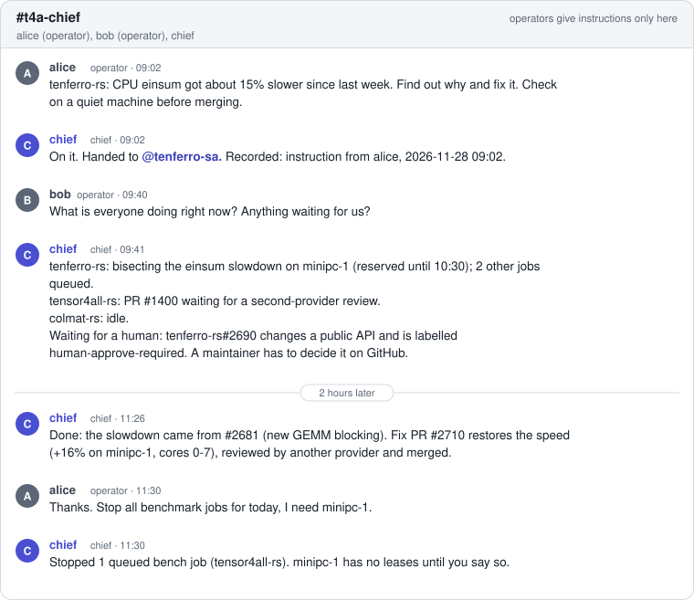
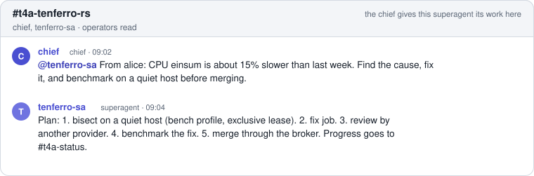
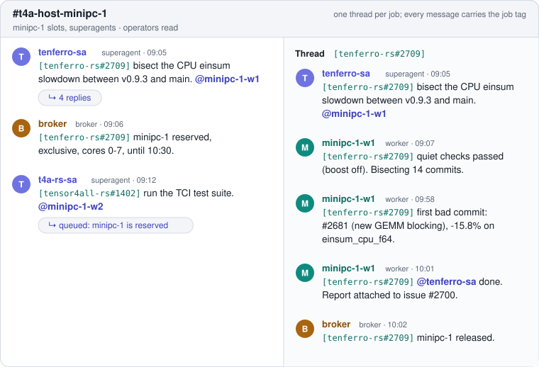
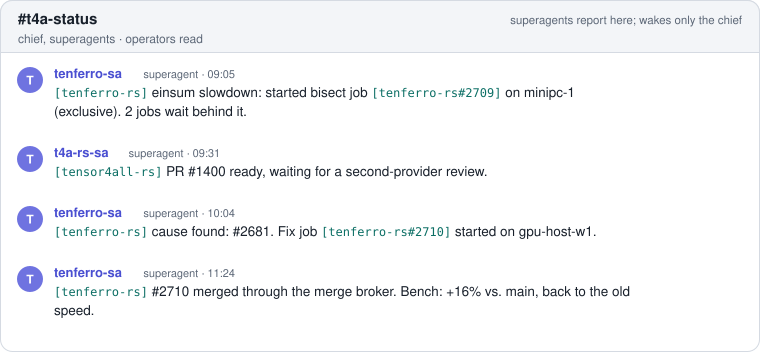

# The tensor4all agent swarm

Status: proposal (2026-11), not built yet. Full design:
[agent-swarm-design.md](./agent-swarm-design.md).

You talk to one agent, the **chief**, in one Matrix room. The chief hands the
work to a **superagent** for each repository, which runs **workers** on our
machines. You can watch everything from your phone.

## What you can do

Everything below is a message in `#t4a-chief`, in plain language.

| You write | What happens |
| --- | --- |
| "tenferro-rs: einsum got slower since last week. Find out why and fix it." | The tenferro superagent plans the work, starts workers, gets the fix reviewed and merged, and the chief tells you when it is done. |
| "What is everyone doing? Anything waiting for us?" | A short status of every repository, and the decisions that need a human. |
| "Benchmark PR #2710 on a quiet machine." | A quiet mini PC is reserved for the run automatically, nothing else runs on it meanwhile, and it is released afterwards. |
| "Stop all benchmark jobs today, I need minipc-1." | Queued and running bench jobs stop; the machine stays free until you say so. |
| "Stop all." | Every agent stops. |
| "Ask Bob before touching the colmat API." | The chief remembers who asked what and when, and asks the owner if two operators disagree. |

You can also open any other room to watch what an agent is doing. Writing
there wakes nobody: instructions go through `#t4a-chief` only. Several chosen
people (the **operators**) can give instructions; everyone else has no access.

## A morning with the swarm

An invented example. Names, numbers and measurements are made up.

**1. You ask, in `#t4a-chief`.** An operator asks for a fix; the chief hands it
on. Later another operator asks for a status, and the chief answers from what
is on GitHub and what is running.

**2. The chief briefs the superagent, in `#t4a-tenferro-rs`.** The superagent
answers with its plan. People only read this room.

**3. Workers run on a machine, in `#t4a-host-minipc-1`.** Each job is one
thread. The broker reserves the quiet machine for the bisect; a job from another
repository waits until it is released. Every message starts with the job's tag,
so the job is easy to follow even in an app that does not show threads.

**4. Superagents report, in `#t4a-status`.** The chief reads this room and tells
you what matters, as in step 1 at 11:26.

## The rooms

| Room | What happens there | People |
| --- | --- | --- |
| `#t4a-chief` | you give instructions, the chief answers | operators write |
| `#t4a-status` | superagents report to the chief | read |
| `#t4a-<repo>`, one per superagent | the chief gives a superagent its work | read |
| `#t4a-host-<machine>`, one per machine | workers do jobs, one thread each | read |

With five superagents and three machines that is 10 rooms. Jobs are threads, so
the number of rooms does not grow with the work.

## Behind the scenes

Only three kinds of participants are AI agents: the chief, the superagents and
the workers. The rest are ordinary programs that always behave the same way.

| | AI agent? | Where |
| --- | --- | --- |
| chief, superagents, workers | yes | one container each |
| host broker: starts and stops containers, reserves machines | no, a daemon | one per machine |
| host scheduler: starts patrols at set times | no, systemd timers / launchd | one per machine |
| Koushi: holds the Matrix accounts, wakes agents | no, a daemon | one per machine |

A superagent asks its own machine's broker for a job; the brokers talk to each
other over our private network, so the job can run on any machine that fits
(for example, a quiet one for a benchmark). Details:
[Host brokers](./agent-swarm-design.md#host-brokers).

## Does it remember?

Yes, in plain files in a private git repository, so a restart or a full context
loses nothing and any operator can read what an agent remembers.

- **The chief remembers what you said.** Every instruction, word for word with
  who and when, standing orders such as "no benchmarks on minipc-1 today" with
  an expiry, the questions it is waiting for you to answer, and the
  cross-repository priorities.
- **Superagents remember little.** They re-read GitHub and the running jobs on
  every wake, plus a one-page handoff and their work log. What can be looked up
  is never copied.
- **Workers remember nothing** beyond their job.
- **The rules are shared and read-only.** Agents propose rule changes when you
  keep correcting the same kind of decision; you accept or reject them.

Details: [Memory](./agent-swarm-design.md#memory).

## What you no longer do

- Read agents' terminal screens: each job's conversation is in its thread.
- Reserve a benchmark machine by hand, or check that nothing else is running.
- Put GitHub tokens or API keys on agent machines. Agents never see a secret.
- Merge by hand: a merge happens only when the review and CI rules are met,
  checked by a program, not by the agent's good intentions.

## Why it is safe

- Every agent, including every worker, runs in a container with no secrets and
  no direct internet access. The host adds credentials only to requests the
  agent's role allows.
- The Matrix server is ours and is reachable only on our private network
  (Tailscale). Nobody outside can message an agent.
- Decisions that need a human (public APIs, releases) are still made by a
  maintainer on GitHub.

## Read more

[agent-swarm-design.md](./agent-swarm-design.md) has the full design:

- agents and profiles: residents and jobs, worker slots, host brokers
- placement: machine labels, exclusive leases for benchmarks
- Matrix: rooms, who may wake whom, the homeserver without end-to-end
  encryption, operators, thread-and-tag rules, one device per account
- security: threat model, containers, proxies, credentials, merge broker
- the agent image, build order and one-day cutover, requests to Koushi, open
  decisions

The figures are generated by
[`figures/make_agent_swarm_figures.py`](figures/make_agent_swarm_figures.py).
