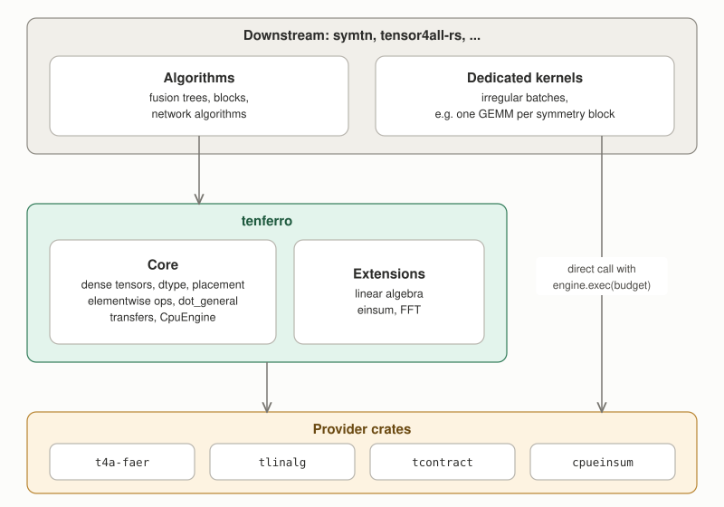
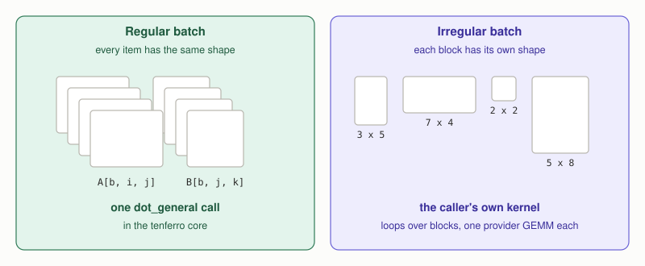
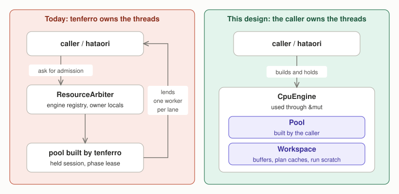
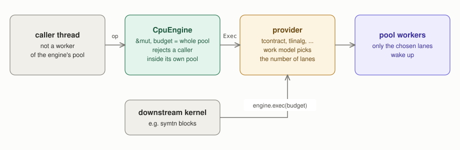
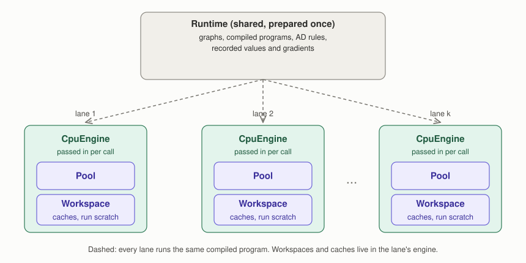
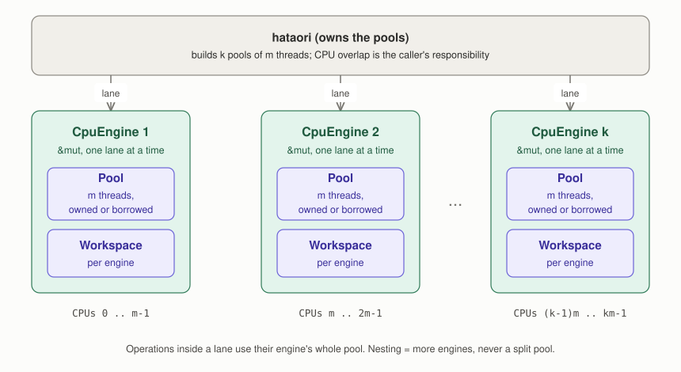
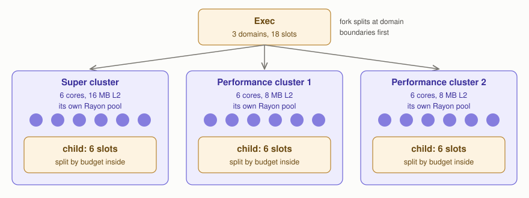

# tenferro core boundary and execution ownership

**Status:** Proposed future design. Target: implementation starts around 2026-10-27.
**Scope:** tenferro-rs, the provider crates (tcontract, cpueinsum, tlinalg, t4a-faer), hataori-rs, and downstream libraries that write their own kernels (symtn, tensor4all-rs).
**Checked against:** tenferro-rs main `14bc1ab9`, tcontract-rs main, symtn main `88e5895b` (2026-10-20).

This document fixes three cross-repository decisions. The first is what belongs
in the tenferro core and what users of tenferro build themselves. The second
is who owns CPU threads and GPU streams. The third is who owns the mutable state used while
executing. Repository-internal details (type names, migration
steps) belong in tenferro-rs issues and `docs/design/`.

## 1. Policy in one sentence each

1. The tenferro core stays small. Batches whose items do not share one shape
   are handled by the caller, with a dedicated kernel written against the
   provider crates.
2. The caller owns the threads. Every layer, tenferro included, uses the
   pool it is given and never decides how the machine is partitioned.
3. The caller owns the execution resources. Runtimes keep the computation
   (graphs, compiled programs, plans, values and gradients); the memory and
   scratch that execution writes travel with the engine the caller passes in.

## 2. Layers



Downstream kernels may call the provider crates directly (the arrow on the
right). A symtn kernel that
runs one GEMM or one factorization per block does exactly that, so the
providers' borrowed execution tokens (`tcontract_exec::Exec`, the tlinalg
`Parallel` token) are part of the boundary, not an internal detail.

### Batch axes

A batch axis appears in both operands and survives into the output without
being summed:

```text
C[b, i, k] = sum_j A[b, i, j] * B[b, j, k]      (b is a batch axis)
```



A batch axis is never required: one can call the contraction once per value
of `b`. It exists so that a regular batch runs as one fast call. The core
supports regular batches through `dot_general` and the batched linear algebra
entry points. Irregular batches (different shapes per item, as with symmetry
blocks) are out of scope for the core.

## 3. CPU execution ownership

### Principle

tenferro is handed a thread pool and computes on it; that is the whole
model. Threads and scratch memory come from objects the caller creates and
holds. No layer starts a hidden global pool, keeps a process wide registry of
engines, or arbitrates between callers. This is the rule the provider crates
already follow, extended to tenferro.



On the left, tenferro decides who may use which worker and must check those
decisions at run time. On the right, there is nothing to check: whoever holds
the engine uses its pool.

### Background for readers new to the CPU stack

This section explains the words used below without assuming knowledge of
tenferro's internals.

* **Thread pool and worker.** A thread pool is a fixed set of threads, its
  *workers*, that wait for parallel work.
  tensor4all uses its own pool type, `strided_exec::Pool`, which runs on
  [Rayon](https://docs.rs/rayon) internally. No Rayon type appears in a
  public signature, so the scheduler behind `Pool` can change without
  changing any caller. Creating a pool is cheap compared with a large
  computation but not free, and how many pools exist and on which CPU cores
  they run decides how the machine is shared.
* **Workspace.** The memory a computation writes while it runs and keeps for
  the next call: recycled buffers and scratch areas. A workspace is mutable
  and is only safe to use from one computation at a time.
* **Plan.** A decision worked out once and reused, such as how to split a
  contraction or which kernel to use for a matrix-multiplication shape. A
  plan is never changed after it is made, so any number of computations can
  read it at the same time.
* **Engine.** A `CpuEngine` bundles one pool with one workspace. It is the
  unit of "computing power plus memory" that one caller uses at a time, and
  it is what every operation takes as its argument. A GPU engine bundles a
  device stream with its memory pools in the same way. There is no separate
  session object (see "One concept: the engine" below).
* **Runtime.** tenferro's eager runtime (immediate execution with automatic
  differentiation) and its traced runtime (record a graph, compile it once,
  run it many times). A runtime stores what was *prepared*: graphs, compiled
  programs, differentiation rules, gradients being accumulated.

An analogy that matches the design: a runtime holds recipes, an engine is a
kitchen with its staff (the pool) and its counters and utensils (the
workspace). Several kitchens can cook from the same recipe book at the same
time. A recipe book that owned one kitchen would force everyone to queue for
it, and a kitchen whose staff were hired and assigned by the recipe book
would leave the restaurant owner unable to decide how many cooks work where.
Today tenferro does both; this design undoes both.

### One engine

The basic case is one pool and one engine, and it is simple: the caller
builds a thread pool (`Pool`) and hands it to tenferro, tenferro wraps it into
a `CpuEngine`, and every operation on that engine computes on that pool.
tenferro does not create the threads, choose their number, or decide who
else may use them. Everything else in this section builds on this case.

Sketch (names are not final):

```rust
let pool = Pool::builder().threads(4).build()?;  // strided_exec::Pool, re-exported
let mut engine = CpuEngine::new(pool);             // takes the pool; uses all 4 threads
let mut serial = CpuEngine::serial();              // no pool at all

let c = dot_general(&mut engine, &a, &b, &dims)?;          // eager operation
let grads = loss.backward_in(&mut engine)?;                // backward pass on the same engine
let out = runtime.run(&mut [&mut engine], &prepared, &inputs)?; // prepared graph, same engine
let d = dot_general(&mut serial, &a, &b, &dims)?;          // same code, serial engine
```

A `CpuEngine` is a plain value:

| Part | Content |
| --- | --- |
| pool | a `Pool` built by the caller and handed over to the engine, or none for a serial engine |
| workspace | buffer pool, N-ary contraction scratch, graph execution scratch, and accounting of memory still in use by unfinished work |

Plans (contraction plans, matrix-multiplication analysis, extension plans
such as FFT plans) are immutable, so they can be shared. A prepared program
carries the plans it needs. Operations called directly on an engine find
their plans in a `PlanCache`, a value of its own that an engine refers to:
by default each engine gets a private one, and a caller that wants several
engines to share planning gives them the same `PlanCache`. A lookup hands
out a shared, read-only plan and releases the cache before the computation
starts, so engines sharing a cache never wait for each other's work. The
cache keeps today's bounds, statistics and clearing. Plans tied to one
engine's device handles (for example cuTENSOR plans on a GPU) stay in that
engine.

tenferro never builds threads. There is one way to make a parallel engine,
from a pool the caller built and hands over, and one way to make a serial
engine, with no pool at all. The engine takes the pool by value, so one pool
can never back two engines; `engine.pool()` gives the caller read access to
it, for example to ask its size. A serial engine runs everything on the calling thread and never
starts a process-global pool, so it is safe to use from inside any other pool
(for example inside a task of the caller's own scheduler).

The pool builder takes the thread count, a thread name, a worker stack size
and a start hook that runs on each worker as it starts, where the caller may
pin it to a core. The stack size defaults to what the linear algebra
providers need (deep recursion in some LU implementations overflows Rayon's
default stack). The builder is the only way to make a pool; there is no
second construction mode and no way to wrap a pool that was built with Rayon
directly.

Rules:

1. **The engine is passed to every execution.** Runtimes and tensors never
   store an engine. Eager operations, the backward pass and traced program
   runs all take `&mut` of the engine they should run on. A run that
   needs several engines (for example CPU and GPU with transfers between
   them) receives all of them for that call.
2. **One computation per engine at a time.** The engine is used through
   `&mut`, so Rust's borrow rules guarantee this without run time locks. The
   one exception is buffer return: a tensor may be dropped on any thread, and
   its memory then goes back to the buffer pool of the engine that allocated
   it under a small internal lock. On the CPU, if that engine no longer
   exists, the memory is simply freed. On a GPU, memory that unfinished work
   may still use is never freed or reused early; section 4 gives the rule.

   **Unfinished work is bounded.** On a GPU, work may still be running after
   a call returns (see "When run returns"). The engine counts the memory
   that its unfinished work holds: temporaries, outputs being written, and
   memory waiting for transfers to finish with it. This is separate from
   tensors the caller still holds and from idle recycled memory. Before it
   submits new work, the engine checks whether the count plus what the new
   work will retain would exceed a limit the caller can set; if so, it first
   waits for the work that holds memory until the new work fits. A single operation that needs more than the limit by itself is
   rejected before it is submitted.

   **Broken engines and broken devices.** If an operation panics, the engine
   marks itself broken: later operations on it return an error, while
   waiting for and cleaning up its earlier work still happens. The caller
   replaces the engine. Some GPU errors (an illegal memory access, a failed
   device assertion) break the GPU's driver context itself; opening the same
   GPU again in the same process is then not a recovery, and recovering may
   need a new process.
3. **Every operation may use the whole pool of its engine.** Throttling for
   small work happens inside the providers, which already choose how many
   workers to wake from a work model, up to the budget they are given. A caller that
   wants fewer threads builds a smaller pool. An operation starts on the
   calling thread and hands work to the pool only after a provider has
   chosen more than one worker for it, so a small operation on a parallel
   engine costs about the same as on a serial engine. (Some paths today
   enter the pool before deciding, or give a single small item the whole
   budget; they are changed to decide first.)
4. **The engine hands out the provider token for its pool** (sketch:
   `engine.exec(budget) -> tcontract_exec::Exec<'_>`). The token is a
   borrowed permission to run provider code on the engine's pool and
   workspace, and its budget is the largest number of workers that code may
   use. A downstream kernel that calls a provider directly passes this token,
   so it uses the same threads and the same budget as tenferro. Getting the
   token takes `&mut engine` and applies the check of rule 5; what the kernel
   then does with the token is that kernel's responsibility, as with any
   direct provider call.
5. **An operation must not be called from one of its engine's own workers.**
   For example, `pool.install(|| dot_general(&mut engine, ...))`, where
   `engine` was built from `pool`, is an error. In that call the operation
   runs on one of the pool's own workers, and some provider strategies
   cannot start from there: a strategy that needs every worker of the pool
   at once (a team that meets at a barrier) is refused, while others would
   run with less parallelism than rule 3 promises. Rather than let the
   outcome depend on which strategy a provider picks, tenferro checks this
   case at the start of the operation and returns an error. Calling from a
   worker of a *different* pool is allowed, with one caveat described under
   "The calling thread" below, and a serial engine has no pool to check.

How one operation runs:



A downstream kernel takes the same path from the third step on, by calling
`engine.exec(budget)` itself.

### One concept: the engine

Code that runs work names exactly one kind of object, the engine. Generic
code takes `&mut dyn Engine` (or `&mut E` with `E: Engine`), a
backend-neutral trait that `CpuEngine` and the GPU engines implement.

tenferro used to have a second concept, the session: a handle opened from a
backend for the duration of a closure, through which every operation ran.
Its main reasons to exist are removed by this design:

* admission against the process wide arbiter, and the reentry and
  contention errors that came with it;
* narrowing the calling thread's CPU mask while the closure ran and
  restoring it afterwards;
* holding an exclusive lease on a backend that several callers could reach.

Without those, a session would only repeat what the engine already gives:

* **Exclusivity** comes from `&mut engine`. A caller that really wants to
  share one engine between threads wraps it in a `Mutex`; the guard is then
  the lease, written in ordinary Rust.
* **The check of rule 5** (caller not a worker of the pool) runs at the
  start of each operation. It is one thread-local read, negligible against
  any operation that reaches a provider.
* **Provider state that should live across operations** (the
  `tcontract_exec::Pool` wrapper with its arena and its SPMD gate) is owned
  by the engine, which builds it once around the pool it owns. Nothing has
  to be rebuilt per operation or per closure.
* **GPU work boundaries.** A GPU engine owns its stream. Submitting queued
  work and waiting for the device are explicit engine methods (sketch:
  `engine.flush()`, `engine.synchronize()`), and dropping the engine
  synchronizes. These are points in time, not a scope, so they need no
  closure.

The session also did cleanup at the end of its scope, and that cleanup
stays, attached to a narrower scope instead of a public object:

* **Recovery after a panic.** Buffer accounting is restored when an
  operation unwinds. This becomes a guard around each operation.
* **Unfinished GPU work.** Work that a run queued but the GPU has not
  finished, with the temporary memory and transfer buffers it still uses,
  is kept by the engine until it completes, including after an error or a
  panic. (There is no separate deferred-run object any more; see "Running a
  compiled graph".)
* **GPU context restoration.** Native GPU code that changes the device
  context restores it on exit, including on unwind. This becomes a guard
  around each such call.

**GPU engine drop.** Dropping a GPU engine may block while its queued work
is retired, and it cannot report an error; if retirement fails, the memory
that might still be in use is kept rather than freed, as today. A caller
that needs to know the work finished, or wants its error, calls
`synchronize()` first.

A run that needs several engines (CPU and GPU with transfers, rule 1)
receives them as a set of borrowed engines for that one call. That set is
an argument, not a stored object, and it is not called a session.

### Several engines

tenferro makes one engine from one pool it is given. A caller with several
pools makes several engines, one from each. tenferro does not know how many
engines exist, how the caller distributes work over them, or which thread
uses which engine; it never subdivides a pool and has no notion of parallel
tasks above the engine. Parallelism above one operation is therefore
expressed by holding more engines, and coordinating them is the caller's
job (see "Responsibilities of the caller"). An example is at the end of this section.

Say the caller wants `k` computations at the same time, each on its own
pool of `m` threads. Using `k` engines at the same time takes `k` calling
threads, one per engine, and none of them may be a worker of a compute pool it calls into
(rule 5). The calling threads are usually a pool of the caller's own, for
example `k` threads that run the caller's tasks; that pool is separate from
the `k` compute pools, and tenferro never sees it. The process then has `k`
calling threads plus `k * m` workers. A calling thread mostly waits while its
operation runs on the workers, but it does run the serial parts of an
operation (see "The calling thread" below).

### Runtimes hold what was prepared, engines hold what is mutable



Compiling a traced graph or setting up automatic differentiation is expensive
and gives the same result for every engine, so it should happen once and be
shared. Executing needs scratch memory and caches that change on every run,
so those must not be shared. The design therefore splits every runtime into
two parts:

* **Kept in the runtime and shared:** what describes the computation and its
  results: graphs, compiled programs and their cache, prepared programs with
  their plans, differentiation rules, recorded values and gradients. (Plans
  for operations called directly on engines live in `PlanCache` values,
  which several engines may share; see "One engine".) None of this depends on which engine runs
  the work. (The eager graph grows and gradients accumulate as operations
  run; how concurrent updates to them are synchronized is a property of the
  runtime and is not changed by this design. Separate engines do not give
  separate gradients.)
* **Moved to the engine:** what execution writes: buffers, scratch, the
  slots a compiled graph uses while it runs, and plans that are tied to the
  engine's own device handles.

With this split, several callers run the same compiled program at the same
time, each on its own engine, and the program is compiled once. Today a
runtime keeps one copy of the execution resources behind a lock, so runs on
one runtime cannot overlap: a second run either waits or is rejected as busy.
Callers that want to run in parallel must each build and compile their own
runtime.

Engines that share prepared programs or a `PlanCache` do not repeat the
work of planning; each engine warms up its own buffers and scratch, and any
plans tied to its device handles (see section 6).

### Running a compiled graph: compile, prepare, run

The traced runtime turns a recorded computation into something that can be
run many times. This happens in three steps, and each step exists for a
different reason:

| Step | Input | Output | Done how often |
| --- | --- | --- | --- |
| **compile** | a recorded graph | a `CompiledGraph`: the computation in a hardware-independent form, keeping the shape constraints that were recorded (fixed sizes stay fixed; only symbolic sizes may vary) | once per computation |
| **prepare** | a compiled graph, the inputs' shapes, types, layouts and kinds of memory, and a description of the engines it will run on | a prepared program: an execution plan for those inputs, including fusion chosen for the target hardware, and the requirements an engine must meet to run it (device, memory kind, supported operations) | once per input signature and set of targets |
| **run** | a prepared program, the engines and the inputs | the outputs | as often as needed |

Prepare has to know what it is preparing for: which kind of engine runs
each part, on which device, with which capabilities. It cannot always tell
from the inputs (a graph may have no inputs, or move data between a CPU and
a GPU), so the caller passes a description of the target engines. Every
engine can produce such a description, `engine.target()`: an immutable value
naming the provider, the device, the memory the engine can read and the
operations it supports. It holds no threads, streams or memory.

Prepare gives each target a numbered slot, decides which slot runs each
part of the program and which transfers move data between slots, and
checks that the memory each slot will read is compatible. A prepared program
is specialized for its input signature together with these target
requirements. It records requirements, not engines: it keeps no stream,
event or memory of the engines that will run it.

Prepare does the expensive checks and decisions once, so that run only
checks that the inputs still match (shapes, types, strides, alignment and
memory domain, as today) and that the engines it is given match the
prepared targets, binding slot `i` to the `i`-th engine in the list. Any engine
whose description matches the target, with the same capabilities and
compatible memory, may run it, so several callers can run one prepared
program at the same time, each on its own engine.

There is exactly one way to prepare and one way to run:

```rust
let prepared = runtime.prepare(&compiled, &inputs, &[engine.target()])?;
let outputs = runtime.run(&mut [&mut engine], &prepared, &inputs)?;
```

`run` takes the engines as a list because a prepared program may span
several of them, for example a CPU engine and a GPU engine with transfers
between them; a program on one engine gets a list of one.

**Inputs and outputs.** Inputs are borrowed views of tensors. Each output
is one of two kinds:

```rust
enum Output<'a> {
    Owned(Tensor),            // a new tensor, stored compactly
    Borrowed(TensorView<'a>), // an input, or a view of one, without a copy
}
```

An output computed by the graph is a new tensor with a compact layout: for
`transpose(neg(x))` the result is materialized in its transposed order, not
kept as a lazy view. An output that is just an input, or a view of one (for
example `transpose(x)`), is returned as a view of that input instead of a
copy; Rust's borrow rules then keep the input alive as long as the output
is used. A caller that needs an owned tensor converts the output, which
copies only in the borrowed case.

**When run returns.** On the CPU, run returns when the work is done. On a
GPU, run returns once the work is queued on the engine's stream and once it
no longer reads memory that the caller could change or free (for example,
host data being uploaded). The GPU may still be computing. Outputs can be
used right away by later operations on the same engine, because the stream
runs work in order; reading them on the host, or calling
`engine.synchronize()`, waits for the work. Moving them to another engine
(the CPU, or another opened GPU) is an explicit transfer, which orders
itself (section 4).

**What this replaces.** tenferro had several entry points for this: one-shot
variants that entered preparation on every call, a variant that kept lazy
views in its outputs, a variant for borrowed inputs, a variant where the
runtime opened sessions itself and one where the caller supplied a session,
a deferred variant that batched runs and waited at the end, and a detached
submission on a background thread. They differed in who owned the session,
when completion was awaited and how outputs were returned. With engines
passed per call, completion handled by the engine's stream, and one output
type, those differences disappear.

### Why the caller, not tenferro, owns the threads

The programs that use tenferro already have a scheduler: hataori distributes
work over MPI ranks and over parallel tasks inside a rank, and tensor4all-rs fans out
over patches and tree nodes. Only that scheduler knows how many tasks run at
once and how the machine should be split between them. When tenferro also
builds and arbitrates threads, two schedulers compete for the same cores, and
tenferro has to rent workers back to the real scheduler under rules it can
verify at run time. That is where the arbiter, the held sessions, the phase
lease and the child tickets listed in section 5 came from. Each was a
reasonable fix; together they are the cost of the ownership being upside
down, not of numerical work.

When the caller owns the threads, none of those rules are needed: the caller
gives each task its own engine, and an engine is used by whoever holds it.

### Responsibilities of the caller

* **Machine layout.** Whether the pools of different engines overlap on CPUs,
  whether the total thread count oversubscribes the machine, and whether
  workers are pinned to cores are the caller's decisions. tenferro does not
  check them.
* **One pool per engine** is enforced by the type: the engine takes its pool
  by value. (The provider crates keep per-pool coordination state inside the
  engine, so two engines on one pool would not see each other; taking the
  pool by value rules this out.)
* **Exclusion between engines.** Inside one thread, `&mut` keeps an engine
  to one computation. Which of the caller's threads or tasks holds which
  engine, and that two of them never hold the same engine at once, is
  decided by the caller's scheduler. A caller that shares an engine between
  threads wraps it in its own lock.
* **The calling thread.** Parts of an operation, including vendor BLAS and
  LAPACK calls, run on the thread that called it. Its CPU affinity and stack
  size are the caller's, exactly like the pool's.
* **Calling threads that are pool workers.** When a worker of one pool
  calls an operation on another pool's engine, the scheduler lets that worker
  run other jobs of its own pool while it waits. A second task can then
  start on the same thread before the first operation returns. That is
  harmless if each task carries its engine as an argument. It deadlocks if
  tasks find their engine through a lock that the waiting task already
  holds, and it fails if they look it up per thread. Plain threads, or a
  scheduler that gives each task its engine explicitly, avoid this.
* **Asynchronous execution.** tenferro does not start background threads to
  run work later. A caller that wants a computation in the background starts
  its own thread and runs it there.
* Threads started by a vendor BLAS or LAPACK are outside tenferro's control,
  as before.

### Where placement is decided

One borrowed token decides where CPU work runs and how many tasks may run at
once: `strided_exec::Exec`, a pool reference plus a non-zero thread budget.
Holding an `Exec` with budget `b` means holding `b` slots of that pool. The
token cannot be copied, every entry that runs work in parallel consumes it, and
a split gives each child a token on the same pool whose budgets add up to the
parent's. The number of tasks that run at once under one token is therefore
bounded by its budget by construction, at every nesting depth, instead of by a
convention that each layer has to follow. A walkthrough with figures is in
[cpu-placement-token.md](./cpu-placement-token.md).

```rust
pub struct Exec<'p> { /* pool: Option<&'p Pool>, budget: NonZeroUsize */ }
// Exec is neither Clone nor Copy, and exposes no pool reference.

impl<'p> Exec<'p> {
    pub const fn serial() -> Exec<'static>;
    pub fn new(pool: &'p Pool, budget: usize) -> Result<Self>;      // clamps once
    pub fn budget(&self) -> NonZeroUsize;                             // read only, for policy
    pub fn is_serial(&self) -> bool;                                  // budget == 1

    // Sequential phases and narrowing. Neither creates a slot.
    pub fn reborrow(&mut self) -> Exec<'_>;
    pub fn limit(self, max: NonZeroUsize) -> Exec<'p>;

    // The parallel entries. Each one consumes the token.
    pub fn fork(self, jobs: usize, f: impl Fn(usize, Exec<'_>) + Sync);
    pub fn for_ranges(self, len: usize, grain: NonZeroUsize, f: impl Fn(Range<usize>) + Sync);
    pub fn external<R: Send>(self, f: impl FnOnce(NonZeroUsize) -> R + Send) -> R;
    pub fn broadcast(self, f: impl Fn(usize) + Sync) -> Result<(), Refused>;
}
```

* `reborrow` gives a token with the same pool and budget while the parent is
  exclusively borrowed, so one token drives several parallel phases in
  sequence (a fill, then a copy). `limit` narrows the budget to
  `min(budget, max)`; the dropped slots stay unused. Policy narrows with
  `limit` before an entry, for example to the team size a work model chose for
  `broadcast` or `external`.
* `fork` runs `jobs` jobs on `t = min(jobs, budget)` tasks. The budget is
  divided among the tasks in shares that differ by at most one and add up to
  the budget; each job receives a child token holding its task's share and may
  call any operation that takes an `Exec`, including another `fork`. When
  `jobs > budget`, the `t` tasks take job indices from a shared counter, so the
  bound holds and the load still balances. Results go into caller-owned
  disjoint outputs; `fork` itself allocates nothing per job.
* `for_ranges` is the data-parallel loop: `0..len` is cut into ranges of at
  least `grain` elements, and at most `budget` tasks take ranges from a shared
  counter. Each range runs sequentially.
* `external` is the only place where a bare width exists. It consumes the
  token, enters the pool (or runs in place when the caller is already one of
  its workers), and hands the budget as a plain width to a library outside
  tensor4all, such as faer or a vendor BLAS. `strided-exec` does not know
  which library receives it (rule 5).
* `broadcast` is the co-scheduling entry for barrier-bearing kernels: every
  `t < budget` runs concurrently on a distinct worker, or the call is refused
  before anything runs. It is accepted only for a token that owns its slots
  outright: one from `new`, or derived from one by `reborrow` or `limit`. A
  token produced by `fork`, or derived from one, is refused
  (`Refused::ForkChild`), because its slots may share workers with its
  siblings; so is a call from a worker of the same pool
  (`Refused::CallerInPool`), because the caller would occupy a participant.
  The team size is the budget, narrowed with `limit` beforehand, so there is
  no width argument to exceed, and a shortfall is never absorbed by running
  fewer participants. A caller that is refused takes its barrier-free path; a
  barrier-bearing callback must not panic.
* A serial token, a budget of one, or `t == 1` runs inline on the calling
  thread and enters no pool. Otherwise an entry runs inline when the caller is
  already a worker of the token's pool, and enters the pool once when it is
  not.

**Why the bound holds.** Slots are created only by `new`, which needs the pool
itself, so only the pool's owner (the engine) can create them; a token never
gives its pool back out. Each parallel entry consumes its token, starts at most
`budget` tasks, and gives each task a share of the parent's slots and never
more. A parent that waits for its children keeps no slot of its own. Rayon may
let that waiting thread run one of the children, but that child is one of the
tasks already counted. Because no other code can start tasks on the pool
(rule 1), at most `budget` tasks of one token run at any moment.

Six rules make the ownership in this section checkable instead of merely
documented. Each names its mechanical check.

1. **Dependency boundaries.** Each consumer keeps one `cargo deny`
   configuration with three boundaries: `rayon` only through `strided-exec`
   and the vendor crates that need it (faer, gemm, spindle), listed as
   `wrappers`; `spindle` only through `t4a-faer`; and neither faer nor spindle
   in `strided-exec`. `cargo public-api` of `strided-exec`, `tcontract-exec`
   and `tenferro-cpu` contains no `rayon::`, so the scheduler behind `Pool` can
   be replaced inside `strided-exec` alone. Kernel crates list
   `std::thread::spawn` and `std::thread::scope` in clippy
   `disallowed-methods`. As a result only `strided-exec` starts tasks on a
   pool, and only t4a-faer opens a spindle region.
2. **The type carries the budget.** A token is neither `Clone` nor `Copy`, is
   made from `&Pool` by the pool's owner (the engine, or a resource wrapper such
   as `tcontract_exec::Exec`), and is consumed by every parallel entry. `fork`
   and `for_ranges` divide it, `limit` narrows it, and `reborrow` lends it while
   the parent is borrowed; nothing re-derives, raises or re-clamps a budget.
   Plans, caches and prepared kernels never store a token, and no API turns a
   token back into a pool, so a nested job cannot reach a pool its caller did
   not choose. Checks: a compile-fail doctest that `Exec` is not `Clone` or
   `Copy`, and a property test that the shares of every split add up to the
   parent's budget.
3. **No ambient pool, and decide before entering.** A token without a pool is
   serial and runs on the calling thread; nothing falls back to the global
   Rayon pool. Policy chooses `jobs` and `grain` from `budget()` and never
   enters a pool to find out whether parallelism pays: a 1 KiB elementwise call
   stays near 40 ns, and an eager `install` costs 4 to 14 µs. Check: each
   consumer runs `strided_exec::ledger::global_pool_unstarted()` (feature
   `ledger`) after its operations, in its own process.
4. **Policy stays with its owner.** The `Pool` and `PoolBuilder` *types* live
   in `strided-exec`, so one builder makes every pool; a pool *instance*, its
   lifetime, the arena and scratch, and the numerical policy (`WorkModel`,
   `BatchPolicy`) stay with the provider crate (`tcontract_exec`) or the
   engine. Placement carries no numerical policy, and policy starts no tasks.
5. **Libraries schedule behind `external`.** A library outside tensor4all
   receives a plain width through `Exec::external`; the adapter in the calling
   crate turns it into the library's own type (`faer::Par::Rayon(w)`, a BLAS
   thread count). Scheduling that belongs to the library stays in it: t4a-faer
   opens spindle's region for the duration of one call, and its `join_raw`
   splits a width into halves that add up to it
   ([tensor4all/faer#55](https://github.com/tensor4all/faer/pull/55)). Vendor
   BLAS and LAPACK keep their own worker teams, outside the budget. A batched
   caller splits its batch with the token (see "faer and spindle").
6. **Claims are measured where they hold.** Under the `ledger` feature,
   `strided-exec` records the peak number of live tasks per root token, and
   every test asserts that it stays within the budget; rule 1 makes this cover
   all tensor4all code. Inside a library, concurrency is measured at the
   kernel's boundary. A worker index or a pool size is not evidence of a
   budget.

**What the token does not bound.** The ledger counts the tasks the token
starts, and nothing more.

* A call into faer or a vendor BLAS is a leaf whose internal concurrency
  belongs to the library. The caller relies on the width it handed over and on
  the pool the library runs in.
* Within one pool there is no reservation: a task's children can run on any
  worker, so a share bounds the tasks a lane starts, not the workers it keeps
  busy. When isolation is required, use separate pools.

### faer and spindle

faer parallelizes through [spindle](https://crates.io/crates/spindle): its
kernels call `spindle::for_each`, and the caller opens a region with
`spindle::with_lock(n)` around them, which holds `n - 1` Rayon workers as a
spinning team. [spindle.md](./spindle.md) explains the mechanism and records
the measurements behind the points below.


* **The region is opened in t4a-faer.** An entry point that receives
  `Par::Rayon(w)` opens `with_lock(w)` when no region is open, for the duration
  of that call (rules 1 and 5).
* **Everything parallel inside a region goes through spindle.** The team's
  workers sit in spindle's loop, so plain Rayon code inside a region runs on
  one thread. faer's matrix product on aarch64 goes through the `gemm` crate,
  which uses Rayon directly; t4a-faer is to replace it (open question 2).
* **Batches are split with the token.** A batched caller such as tlinalg gives
  every slot to the batch, with `Par::Seq` items, when the batch is at least
  the budget. Otherwise it forks the token over the items and calls t4a-faer
  through `external` once per item, so each call opens its own region sized to
  its share.

### Example: nested parallelism in hataori

This example uses hataori's vocabulary, which tenferro does not share. A
hataori *lane* is one of the `k` streams in which hataori runs its tasks,
one task after another; tasks are its units of work, such as one patch.
hataori runs its lanes on `k` threads of its own, separate from the
compute pools. It builds `k` compute pools of `m` threads, makes one engine
from each, and gives each lane thread its own engine for the whole run. An
operation inside a task is called from the lane thread and may use all `m`
workers of that lane's engine. The lane thread is not a worker of that
pool, so the caveat above about calling threads that are pool workers does
not apply.



Keeping the CPU sets disjoint, as drawn, is hataori's choice; tenferro
neither enforces nor checks it. From tenferro's side this is simply `k`
engines used at the same time by different threads.

Splitting at this level, across tasks, is done with pools because each lane
needs its own engine. Splitting inside one operation does not need new pools:
an operation that has independent parts, for example two branches of a graph
or the items of a batch, calls `exec.fork(2, ...)` on its token, and each part
receives a child token with half of the budget that it can pass on to any
kernel. The bound in "Where placement is decided" holds at every depth of such
nesting.

## 4. GPU execution ownership

The GPU side follows the same model: the caller creates and holds what runs
the work, operations take `&mut` of an engine, and nothing is stored in
runtimes or opened as a session. This section explains what differs.

### Background: devices and streams

* **Device.** One GPU. Opening it sets up a driver context and the memory
  that tensors on that GPU live in.
* **Stream.** A GPU does not run work when the program asks for it; the
  program puts work into a queue, the *stream*, and the GPU runs the queue in
  order.
* **GPU engine.** A `CudaEngine` is one opened GPU together with one stream
  and its workspace (vendor library handles, device-bound plans, scratch,
  queues of memory waiting to be released). It plays the role of a
  `CpuEngine`: the stream is the GPU counterpart of a thread pool.

| CPU | GPU | role |
| --- | --- | --- |
| `CpuEngine::new(pool)` | `CudaEngine::open(ordinal)` | what operations run on, used through `&mut` |
| workers of the pool | the engine's stream | where the work runs |

```rust
let mut gpu = CudaEngine::open(0)?;               // GPU 0, one stream
let c = dot_general(&mut gpu, &a, &b, &dims)?;     // queued on the stream
let d = dot_general(&mut gpu, &c, &b, &dims)?;     // runs after c, in stream order
gpu.synchronize()?;                                // wait for the work and report errors
```

### Engines do not share GPU memory

In the first version each GPU engine has its own memory and one stream, and
its tensors are used only by that engine. All work on that memory therefore
goes through one stream, and a stream runs its work in order: nothing can
read memory before it is written or reuse memory that is still being read.
The order of the program is the order on the GPU, and no tracking is needed.

Opening the same GPU twice gives two independent engines. Their work may run
side by side or one after another, depending on how the GPU runtime maps
their streams, but they never share tensors: using one engine's tensor on
the other is rejected, and data moves between them only by an explicit
transfer (rule 3).

Sharing tensors between engines on one GPU waits for a real need. The one
request so far, sharing buffers between runtimes on one GPU in order to
submit many small block operations from several threads, is addressed by
batching the blocks of each step (see "Downstream GPU kernels" below). If sharing is ever needed, it
will be added together with tenferro's own GPU runtime layer (below), whose
memory allocator can track which stream uses which memory.

### Rules

1. **One stream per engine; stream order is the safety rule.** Work queued on
   an engine runs in order, and memory freed by a dropped tensor is reused
   only by later work on the same stream. Memory is never reused while
   unfinished work may still use it, even after the engine itself has been
   dropped; if finishing cannot be confirmed (for example after a device
   error), the memory is set aside and never reused.
2. **A raw device address is valid only while it is pinned.** The GPU
   runtime may move live memory to compact its pools unless the memory is
   pinned for use. tenferro's own vendor calls pin every operand for as long
   as they use its address and never keep an address after unpinning it.
   Code that reaches device memory directly (raw CUDA pointers for a
   caller's own kernels) does so through an `unsafe` function whose contract
   states which stream may use the address and until when.
3. **Transfers order both sides.** A transfer between two engines (or
   between a CPU and a GPU) starts only after the source's earlier writes
   have finished, and the source memory is neither overwritten nor reused
   until the transfer has read it. The destination is used only after the
   transfer has written it. A pending download keeps its destination and its
   completion state until it finishes, even if the tensors or the engine
   that started it are dropped.
4. **Flush and synchronize are points in time.** `engine.flush()` hands queued
   work to the GPU; `engine.synchronize()` waits for the engine's stream and
   reports the errors the driver reports there. Neither needs a scope.
   Errors that belong to a particular output buffer still surface when that
   buffer is read.
5. **Dropping an engine waits for its work, best effort.** It may block, it
   cannot report errors, and memory whose completion cannot be proven is kept
   rather than freed. Pending transfers keep their own completion state, so
   a transfer may outlive the engine that started it.
6. **Per operation, an engine only selects its stream.** Driver context
   switches and flushes happen only at the boundaries that need them: raw
   CUDA and vendor library calls (cuBLAS, cuSOLVER, cuFFT, cuTENSOR, a
   caller's own kernels), the hand-over to a caller's own CubeCL kernels,
   and explicit submission, waiting and completion points. Ordinary kernels
   pay neither.

WebGPU follows the same shape: each `WgpuEngine` has its own memory and one
queue.

### Downstream GPU kernels: many small blocks, batched per step

Block-structured algorithms (symmetric tensors, for example) produce
hundreds to tens of thousands of small, independent matrix operations per
step. Sending each one to the GPU separately is the wrong shape: each
submission costs the host several microseconds, far more than the GPU needs
for a small block, so the GPU waits for the host.

The right shape is to batch the blocks of a step: a grouped or batched
vendor routine (for example `cublasGemmGroupedBatched`, batched cuSOLVER
factorizations), or a kernel of the caller's own that reads a table of block
descriptors. Blocks of very different sizes can be grouped by size, which
gives a few calls per step instead of one per block. Such kernels are
irregular batches and therefore belong to the downstream library
(section 2), exactly as on the CPU.

To run them on the same stream and memory as tenferro's own work, a GPU
engine lends a raw execution scope, the GPU counterpart of `engine.exec`:

```rust
unsafe {
    gpu.with_raw(|raw| {
        let a = raw.device_ptr(&tensor_a);  // pinned while the scope lasts
        raw.cuda(|stream| { /* cuBLAS grouped call or own CUDA kernel on `stream` */ });
        raw.cubecl(|client| { /* CubeCL kernel; needs the `cubecl-interop` feature */ });
        raw.cuda(|stream| { /* may read what the CubeCL kernel wrote */ });
    })?;
}
// later work on `gpu` runs after everything submitted in the scope
```

* The scope is a closure on the calling thread, so its cleanup always runs:
  the driver context is restored and queued work is handed to the GPU on
  exit, including on a panic. It is not a separate object that could be
  forgotten.
* Work submitted through `raw.cubecl` is first queued by CubeCL. Every switch
  from CubeCL work to CUDA work inside the scope (and the entry into the
  scope) hands queued CubeCL work to the GPU first, so a CUDA call always
  sees the results of earlier CubeCL kernels. The scope should be entered
  once per step, not once per block.
* Device addresses obtained in the scope are pinned until the scope ends.
  Kernels launched in the scope are ordinary work on the engine's stream:
  later operations on the engine run after them, and memory they used is
  reused only in stream order.
* CUDA kernels and vendor calls depend only on the stream and the
  addresses, so they are unaffected when tenferro later replaces CubeCL's
  runtime layer. CubeCL kernels need CubeCL's own launch types; they are
  available only through the `cubecl-interop` feature, which is the one
  place where CubeCL types appear and which changes when the runtime layer
  is replaced.
* The scope is `unsafe` because the kernels' reads and writes are outside
  tenferro's checks; its contract states the stream and the lifetime of each
  address.

### What is not yet under tenferro's ownership: CubeCL's runtime layer

tenferro's GPU kernels are built with [CubeCL](https://github.com/tracel-ai/cubecl)
(through the `t4a-cubecl` fork). CubeCL has two layers:

* a **code generation layer** that turns `#[cube]` Rust functions into GPU
  kernels, and
* a **runtime layer** that keeps one process wide server per GPU with its own
  thread, chooses streams by thread-local state, and owns the device memory
  pool.

The runtime layer contradicts this design: it is a hidden per-device global
with its own thread. Because GPU engines do not share memory, this does not
affect correctness in the first version, but the engine's stream is a CubeCL
*logical* stream rather than one the engine owns, and every flush hands work
to CubeCL's server thread.

**Direction.** tenferro takes ownership of the GPU runtime layer in stages:

1. *Now (tenferro-rs#2206).* No CubeCL type appears in the public API
   outside the `cubecl-interop` feature. A `CudaEngine` is defined by what
   it owns (a stream, a workspace), so the layer below can change without
   changing that API; only the interop feature changes with it.
2. *Next.* Replace CubeCL's runtime layer with tenferro's own, built on the
   CUDA driver API (through `cudarc`, which tenferro already uses for its
   vendor libraries): a real stream owned by the engine, a stream-ordered
   memory pool, events, and no device server thread. This removes the
   blocking hand-off to the server thread that every flush pays today, and
   it is where sharing tensors between engines would be added if it is ever
   needed.
3. *Later.* Decide separately whether CubeCL stays as a kernel compiler only,
   and what happens to WebGPU, which runs only through CubeCL today.

## 5. What this removes from tenferro

The following exist only to let tenferro own, subdivide or hide threads and
execution state on behalf of its callers, and are removed:

* every constructor that builds threads: thread counts and CPU sets on the
  backend, sizing from `RAYON_NUM_THREADS`, NUMA placement, the worker stack
  setting
* the process global resource arbiter and its CPU set conflict detection
* the per placement engine registry
* owner thread locals used as admission keys, and owner inheritance
* the held CPU session, the per worker phase lease, and the child execution
  ticket, together with their error types
* the session layer itself: opening a session from a backend and running
  operations through a closure; the backend-neutral session trait becomes the
  `Engine` trait implemented by the engines directly
* tenferro's own thread pinning, including narrowing the calling thread's CPU
  mask during a session
* backends and execution state stored inside runtimes, and the locks that
  serialize execution on one runtime
* the detached submission API that runs a compiled graph on a thread tenferro
  starts
* the other ways to run a compiled graph (one-shot, lazy-output, scoped,
  caller-session and deferred variants); only `prepare` and `run` remain
* on the GPU: `CudaBackend` (replaced by `CudaEngine`), the
  scoped and held CUDA sessions with their reservation and statistics, the
  session thread-locals, the per-runtime table that maps streams to vendor
  handles, and backend clones kept by runtimes

The work these served moves to the caller: a scheduler that runs work in
parallel builds one pool and one engine for each parallel part, and each part
may use its whole pool.

## 6. Costs we accept

* Buffers and scratch are per engine, so memory use and warm up grow with
  the number of engines. Each engine has its own retention limit for
  recycled buffers and its own limit on memory held by unfinished work.
  Plans are shared when engines share prepared programs or a `PlanCache`.
* A bad CPU layout shows up as lost performance, not as an error.
* In the first version GPU engines cannot share tensors; moving data between
  two engines on one GPU is a copy (section 4).
* Calling an engine from a worker of its own pool is still possible and is
  detected at run time.
* Every execution names its engine, so code is more explicit than with a
  runtime that hides its backend. This is intended: the engine in the call is
  exactly what decides where the work runs.

## 7. Consistency with other documents

* The [backend developer guide](https://tensor4all.org/tensor4all-meta/stack/backend.html)
  already describes hataori passing each task the pool it may use. This
  design makes tenferro match that description.
* tenferro-rs design documents for the held session, the phase lease, the
  child ticket and the shared execution scope are superseded by this document
  and should be retired when the implementation lands.

## 8. Plan

Work proceeds from the bottom of the stack up. Downstream libraries are not
changed until tenferro and the layers below it are finished.

Each repository's part is developed on one working branch and opened as a
single pull request when it is finished, not as a series of partial ones.

1. Fix the layers below tenferro first: for example, a serial engine must
   not start Rayon's global pool, which needs a change in strided-rs.
2. Implement sections 3 and 4 and the removals of section 5 in tenferro-rs
   ([tenferro-rs#2206](https://github.com/tensor4all/tenferro-rs/issues/2206)),
   without a compatibility layer. Internal details (how an engine proves it
   is compatible with a prepared program, the exact public names) are settled
   there.
3. Only then port the downstream users to engines built from their own
   pools, each in its own change: tensor4all-rs (adaptive interpolation,
   tests, the C API's default engine), the hataori tenferro adapter,
   tenferro-benchmark, gaugefields-rs.
4. Update the backend guide and retire the superseded tenferro design notes.

## Planned work

Not part of the rules above; recorded so that the rules leave room for it.

### One pool per cache domain

A machine often has several shared-cache domains: the cores behind one L3
on a multi-CCD or multi-socket x86 machine, or one L2 cluster on Apple
Silicon (an M5 Max has three: one cluster of 6 Super cores sharing 16 MB of
L2, and two clusters of 6 Performance cores sharing 8 MB each). Inside one
Rayon pool any worker may steal any task, so the children of a task spread
over every worker of the pool. A pool that spans several domains therefore
moves blocked data, such as packed GEMM panels sized for one cache, between
caches.

The plan is to give such a machine one Rayon pool per domain and let a
`Pool` hold all of them:



* `Pool::builder()` gains a domain layout: the caller, or a helper that
  reads the topology (`/sys/devices/system/cpu/cpu*/cache/index3/shared_cpu_list`
  on Linux, `hw.perflevelN.cpusperl2` on macOS), says which workers belong
  to which domain.
* A `fork` on a token that covers several domains splits at domain
  boundaries first: each child receives the slots of one domain, and
  because each domain is a separate Rayon pool, no task of that child can
  run outside its domain at any depth. Inside a domain, splitting divides
  the budget as above.
* Domains with cores of different speed (Super and Performance on Apple
  Silicon) receive work in proportion to their speed, which needs weighted
  shares in `fork`. Work across domains does not balance itself; how a large
  contraction is cut across domains is decided by `WorkModel` and
  `BatchPolicy` in `tcontract_exec`, and a GEMM larger than one domain is
  cut into blocks there instead of inside faer.

Separate Rayon pools never share a worker: a thread is a worker of at most
one pool at a time (rayon-core 1.13.0, `src/registry.rs:710`), and two pools
built on disjoint threads ran 64 tasks each without any thread in common.
Entering a domain's pool from outside costs on the order of 15 µs on an
M5 Max, which only operations large enough to span domains pay.

Because no Rayon type is public (rule 1), this is a change inside
`strided-exec`; `Exec`, `fork` and every kernel signature stay as they are.

### One exec crate and an awake team (adopted provisionally)

**Decision.** The candidate is adopted provisionally on M5 Max data: both
benchmark stages, run with 6 threads at QoS UserInitiated on a shared laptop,
with rough measurements. Final acceptance is a measurement on a quiet Linux
machine, including the x86_64 product path that the stage 1 feature changes.
Until acceptance, the rules above and "faer and spindle" describe the code.
Multi-socket and multi-L3 domains and Linux thread pinning are unmeasured, and
no numbers for them are claimed here.

**Conditions before acceptance.**

* `Par<'team>` carries the team authority in the token. The stage 2 prototype
  used a thread-local team; the final form does not.
* The serial thresholds are recalibrated: the faer GEMM floor, LU
  `par_threshold`, strided `MINTHREADLENGTH` and tcontract `width_for`.
* Members spinning during sequential sequences are explained and fixed. CPU
  time reaches 5.6 times wall time on sequences of 32 by 32 GEMMs.
* A quiet Linux acceptance run passes, including the x86_64 product path.

**Evidence.** Both stages are measured on the M5 Max (macOS, Apple Silicon).

1. **Stage 1 baseline,
   [tensor4all/faer-benchmark#24](https://github.com/tensor4all/faer-benchmark/issues/24#issuecomment-6396772104).**
   It runs the current t4a-faer with a team built in the harness, and checks
   whether keeping borrowed workers awake competes with a held spindle group.
   On x86_64 it needs one change in the faer stack: t4a-private-gemm-x86 opens
   `spindle::with_lock` inside every product with more than one thread, so a
   feature that calls the product directly is added; the default stays.
2. **Stage 2 prototypes,
   [threadteam-rs#1](https://github.com/tensor4all/threadteam-rs/issues/1),
   [faer#60](https://github.com/tensor4all/faer/issues/60) and
   [faer-benchmark#26](https://github.com/tensor4all/faer-benchmark/issues/26),
   with results on
   [faer-benchmark#24](https://github.com/tensor4all/faer-benchmark/issues/24).**
   Against the current fork, where a held spindle region runs aarch64 GEMM on
   one thread, the team is 4 to 14 times faster on GEMM, 1.6 to 3 times faster
   on LU, 1.1 to 1.4 times faster on Cholesky and equal on QR. Against an awake
   borrowed Rayon team it is equal or faster, except square GEMM, which is 2 to
   4 percent slower. With a lowered GEMM threshold, sequences of 64 by 64 GEMMs
   run about 4 times faster than on one thread, because a section costs about
   0.85 microseconds. Its workloads include many small matrix operations:
   sequences of small GEMMs, batched small LU and QR, and chains resembling
   tenferro contractions. A section on a held team costs sub-microsecond,
   against microseconds to enter a Rayon pool, which lowers the size at which
   parallel execution pays.

Tracking: [tensor4all/tensor4all-meta#47](https://github.com/tensor4all/tensor4all-meta/issues/47)
(this document), [tensor4all/faer#59](https://github.com/tensor4all/faer/issues/59)
(t4a-faer), [tensor4all/faer#56](https://github.com/tensor4all/faer/issues/56)
(the aarch64 product).

**An awake team instead of spindle regions.** A `Pool` borrows workers and
keeps them awake across operations. In the final form, `budget - 1` workers
and the calling thread form the team. Stage 1 instead keeps its leader in
Rayon and lets idle members call `rayon::yield_now()` to serve faer and
`gemm` work. This compatibility mode promises no reserved team for
barrier-bearing kernels: `yield_now()` runs the job it takes to completion,
including nested work, before returning to the dispatch loop. The stage 1
measurements are linked above.

**The engine holds its team for its lifetime.** The engine that owns a pool
holds one reservation for the whole of its lifetime. tenferro's `CpuEngine`
owns its `Pool` exclusively, so the reserved workers serve no one else.
Acquisition is paid once, at engine construction; every operation, eager or
graph, dispatches its sections to the held team. The calling thread leads each
section, so concurrent callers that mint tokens from one engine's team
serialize on it.

* `PoolBuilder` sets two independent defaults: whether unreserved idle members
  may run Rayon jobs, and how long they spin before returning to Rayon.
  Native team execution defaults to no Rayon job execution; the stage-1
  compatibility mode explicitly enables it. The proposed spin time is 200 ms,
  configurable down to zero. An idle member of a held reservation spins for
  that time, then parks while staying reserved; it does not return to Rayon.
  The next dispatch wakes it, so only the first dispatch after an idle period
  pays the wake-up. It is a policy to measure,
  inspired by `KMP_BLOCKTIME`, not a correctness requirement or a promise of
  bounded dispatch latency when Rayon jobs are enabled.
* A downstream caller may override either setting for an operation without
  mutating pool-wide settings. Children inherit the effective policy and may
  override it for their scope. An override cannot weaken a reservation:
  reserved members neither run unrelated Rayon jobs nor return to Rayon on a
  timeout. Idle time means time since the member last received a section, not
  time since it last computed. A child finishing returns its members to its parent;
  its timeout cannot release the parent's members. The operation's effective
  waiting policy governs the idle interval after its root reservation ends;
  a child override expires when that child returns.
* An explicit release request takes effect after reservations and outstanding
  dispatches finish; it never revokes a live token. A request made inside a
  reservation must not synchronously wait for that same reservation to end.
  The next parallel section reacquires the required members before starting.
  Spinning on one's own pool is a caller-controlled cost, measured with
  several engines as well as one.
* The team and its loop live in the scheduler module of `threadteam`. Members
  hold no thread-local state, since they also run other Rayon jobs.
* **One token for kernels.** Tokens minted from an engine's team are ordinary
  `Exec` values carrying team authority. `fork` and `for_ranges` on them
  dispatch as team sections, `broadcast` runs on the reserved members, and
  `exec.team(..)` returns a subteam without acquisition. Kernels keep one code
  path; a token without a team behaves as before. Per-call acquisition remains
  for pools that no single engine owns, and it shares the same section
  implementation.

**One exec crate, used by t4a-faer as well.** `threadteam` is the same crate
as `strided-exec`, evolved into an independent small crate named after
OpenMP's team of threads and meant for use outside tensor4all as well. It is
developed in its own repository, `tensor4all/threadteam-rs`, starting from the
`strided-exec` crate. It carries `Pool`, `Exec`, `fork` and the ledger unchanged, and adds the team.
The providers and t4a-faer depend on it in one coordinated release that
retires the `strided-exec` package name, so no second crate starts tasks.
t4a-faer is not merged upstream, so it may depend on it.

* faer's parallelism becomes `Par<'team>`, with a
  `Team(TeamExec<'team>)` variant. Neither `Par` nor `TeamExec` is `Clone` or
  `Copy`. The lifetime covers the reservation of that member set, not merely
  the lifetime of the pool: a child reservation ends when its fork joins,
  even though the pool lives on. The adapter borrows or consumes the caller's
  execution token; it never reconstructs execution authority from a width.
* Parallel entries consume their token. `reborrow(&mut self)` lends one for
  successive phases while preventing use of the parent; `fork` consumes the
  parent and lends disjoint child tokens through callbacks quantified over
  a fresh child lifetime (`for<'child>`). A child cannot escape its callback
  or be dispatched twice concurrently. `join_raw` and `for_each` use these
  entries, so faer's own splits obey both the budget and the reservations.
* The lifetime and exclusive execution authority reach public callbacks as
  well as internal helpers, including `LinOp::apply(..., par: Par<'_>, ...)`.
  Auditing only faer's internal storage is insufficient: a user-defined
  operator can otherwise save a `Par` and reuse it after the call. There is
  no lifetime-erasing shim and no promise to preserve existing signatures.
  Global parallelism settings accept only owned sequential/width policy,
  never a borrowed team token. Scratch queries borrow policy or read a width
  without acquiring an execution token they could retain.
* `Par::Team` makes the fork incompatible with upstream faer. The change
  lands in `t4a-faer` itself as a breaking release, together with its
  companion crates under their existing t4a package names, such as
  `t4a-faer-traits`. The MIT notice, Sarah Quiñones's copyright and the
  statement that it is a fork of faer stay. Renaming the fork is deferred.
  If the crate is renamed, the candidate name is `linearis` with
  `linearis-traits` (both crates.io names are currently free), at the same
  breaking release.
* spindle and the `faer::spindle` re-export are removed.
  t4a-private-gemm-x86 stops opening `with_lock` and sends its two
  `for_each_raw` loops to the crate. On aarch64, faer cuts a large product into
  tiles and calls `gemm` sequentially per tile.
* Once no implicit Rayon call remains inside faer, the caller's thread need not
  be a pool worker. It leads the team: it runs every serial part and its own
  share of each parallel section, while the members run the rest, like
  OpenMP's master thread. Until then, `external` enters the pool as today.

**Nesting: a tree of dispatch slots.** The pool's thread count is fixed; a
team is formed per parallel section and its size follows the token. A `fork`
divides the members along with the budget, so a child token names a set of
members whose size equals its share.

* The caller at the second level is the thread already running the parent's
  piece, a member or the leading thread. It leads its child's set: it
  publishes to the child's dispatch slot and takes a share itself. No thread
  is created and no pool is entered.
* Each member watches one slot at a time: the root slot, or the slot of the
  child it was assigned to until that child finishes. The leader of child 0
  is the parent's leader itself, so nothing is handed over. A share of one runs
  sequentially on its thread.
* A share therefore becomes a reservation: a child's members do not work for
  its siblings. Before publishing any barrier-bearing work, the scheduler
  must hold an exclusive reservation and receive acknowledgements from all
  participants on distinct threads, including the leader. A member already
  executing a Rayon job is unavailable until it returns; a queued worker job
  or an awake flag alone is not an acknowledgement. From acknowledgement
  until release, members service only their reserved dispatch tree. This
  excludes unrelated Rayon work even between sections or while the leader
  runs a long serial phase, not only while waiting at a kernel barrier.
* The transition from compatibility mode to reserved execution must not wait
  for an arbitrary Rayon job that could itself depend on the requested team.
  If exclusive participation cannot be established without such a wait, the
  entry releases any tentative claims and refuses before running any callback;
  the caller takes a barrier-free route. A child inherits already reserved
  members and confirms their transfer before its barrier-bearing work starts. Cutting the first
  split at cache-domain boundaries gives the per-domain layout above inside
  one pool.
* A reservation is returned only after every dispatched callback and child
  has finished, on normal return and on unwind. Scheduler waits must propagate
  cancellation and join participants before borrowed state is released.
  Barrier-bearing kernel callbacks retain their non-panicking contract;
  kernels that support failure during a section need a cancellation-aware
  barrier so peers can leave it. Catching a panic in one participant alone
  cannot release the reservation or unblock an ordinary barrier.
* The cost is that load does not balance across sets. Within a set it does,
  as below; across sets, the split's shares decide.

**How a section is shared out.** As spindle does: each member first runs a
contiguous share fixed by its index, then takes work from the member with the
most left, then the remainder from a shared counter. The fixed share keeps a
member preferentially on the same range across sections for cache locality;
stealing can change that assignment. This is work sharing within a reserved
set, separate from executing unrelated Rayon jobs, and never crosses sibling
reservations. It applies to independent jobs, not to moving or duplicating
the participants of a barrier-bearing section. Whether the fixed share pays
is measured per kernel, with and without it.

Fixed initial shares do not make floating-point reductions reproducible when
jobs can be stolen. A kernel that promises reproducibility partitions input
into fixed logical chunks independent of worker identity and timing. Each
chunk uses a fixed arithmetic order and writes its partial sum to its own
slot; the final combination follows a fixed chunk order or reduction tree.
Workers may steal whole chunks, but never append them to a worker-local sum
whose grouping depends on scheduling. Numerical kernels own this policy and
its scratch requirements. The guarantee is repeatability for the same
inputs, chunk plan and arithmetic configuration; cross-platform or
cross-width reproducibility needs a separate contract. If a kernel cannot
provide such a reduction, it disables stealing for that reduction and fixes
the partial sums and merge order, or explicitly makes no reproducibility
promise.

**What tcontract gains.** tcontract's driver runs a GEMM grid either as a
barrier-free `fork` or, when `pm > 1`, as a barrier-bearing team through
`limit(width).broadcast(cell)`. It falls back to the barrier-free path when
`can_broadcast` refuses, which a fork child (`Refused::ForkChild`) and a caller
inside the pool (`Refused::CallerInPool`) do today. With an acknowledged
reservation and a leading thread that is participant 0, neither blanket
refusal is needed. A fork child carrying that reservation can run each
item's GEMM as a team; an arbitrary call from a pool worker still cannot
claim a team merely because it runs there. If reservation acquisition fails,
the refusal and barrier-free fallback remain. Its per-worker workspace
lends slots rather than keying on a Rayon worker index, so it works with a
leading thread that is not a Rayon worker.

**Placement stays with the caller.** The leading thread now computes, so its
placement matters. A caller that gives an engine a budget of `m` builds the
pool with `m - 1` workers and pins the leading thread to a core of the same
cache domain. The crate may offer a helper that computes such a layout; it
does not pin anything by itself.

**To be shown before acceptance.** Both benchmark stages above, plus:

* Compile-fail cases for copying a team token, using a parent during a child
  borrow, escaping a child token, and retaining a token in a user-defined
  `LinOp` beyond its reservation. Check the public callbacks, not only faer's
  internal calls.
* Concurrency tests for distinct participants, nested sibling teams,
  reservation acquisition while a member is in a Rayon job, and a serial
  phase longer than the configured idle timeout. Include a dependent Rayon
  job to check refusal rather than circular waiting, scoped policy
  inheritance/restoration, explicit release, and unwind cleanup.
* Reduction tests that perturb completion order and force stealing, including
  cancellation-sensitive inputs such as `[1e16, -1e16, 1, 0]`. Repeated runs
  with the same plan must agree bit for bit where reproducibility is promised.
* That t4a-private-gemm-x86's independent loops do not require simultaneous
  participants, and that upstream fixes remain practical to import despite
  the changes to signatures and token ownership.
* Dispatch, idle CPU use and reacquisition costs across local policy settings,
  including zero and 200 ms spin times, with one engine and several engines.
  Stage 1's Rayon compatibility result does not establish the safety or
  performance of reserved nested teams or deterministic reductions.

## Settled questions

1. *Should the workspace be separable from the pool?* Not in the first
   version. An engine owns its workspace; two engines never share one.
2. *How should pinning behave on macOS?* tenferro does no pinning, so the
   question moves to whoever builds the pools.
3. *Should tenferro keep a mode that builds its own pool?* No. The caller
   always builds the pool with `Pool::builder()` and hands it to the engine
   by value.
4. *Should runtimes own their engine?* No. Engines are passed per call, and
   runtimes keep only what was prepared.

5. *Are "engine" and "session" two concepts or one?* One. Operations take
   `&mut` of the engine through a backend-neutral `Engine` trait, and the
   session is removed (see "One concept: the engine"). The word "backend"
   also leaves the public API: `CpuBackend` becomes `CpuEngine`.

6. *Can GPU engines share tensors?* Not in the first version: each engine's
   memory is used only by its own stream, so stream order alone makes GPU
   memory use safe (section 4). Sharing waits for a real need and for
   tenferro's own GPU runtime layer. Direct device memory access is
   `unsafe`.
7. *Where do plans live?* In prepared programs, and in `PlanCache` values
   that engines refer to and may share. Engines keep what execution writes,
   plus plans tied to their own device handles.
8. *How does prepare know where a program will run?* The caller passes
   `engine.target()` descriptions; run checks that the engines it is given
   match them.

9. *Who decides how a batch of independent items is split over threads?*
   The providers, within the budget the engine gives them, with a policy
   setting on the engine (default automatic) and a per-operation override.
   `engine.exec` hands a downstream kernel both the budget and the engine's
   batch policy, so it follows the same policy. Irregular batches (for example grouped GEMM over
   symmetry blocks) are downstream kernels, not core operations.
10. *How do downstream GPU kernels run on an engine?* In a raw execution
   scope (`with_raw`), entered once per step, with CUDA kernels, vendor
   calls, or CubeCL kernels through the `cubecl-interop` feature (section 4).

## Open questions (to mature before implementation)

1. *What does a GPU engine cost per operation without a session scope?*
   The session bound the device stream to the calling thread once per
   closure. An engine binds it per operation, or skips the binding when it
   can prove nothing changed; the thread alone is not enough proof, since
   another engine or stream may have been bound on the same thread in
   between. Measure before choosing.

2. *t4a-faer work behind rule 5.* (a) The entry points open
   `spindle::with_lock(w)` when no region is open; not implemented yet.
   (b) A spindle-based matrix product for targets where faer uses the `gemm`
   crate (aarch64), so that a region does not reduce it to one thread.
   (c) An audit of which entry points start parallel work and whether a leaf
   starts further parallel work outside spindle.
   (d) Several regions open at once in one pool (the second batch shape of
   "faer and spindle"): check that each team gets its members and that the
   items run at the expected parallelism, for example two 512 x 512 QR
   factorizations under a budget of 8.

The figures are generated by `figures/make_figures.py` (standard library
Python). Edit the script and rerun it rather than editing the SVG files.
