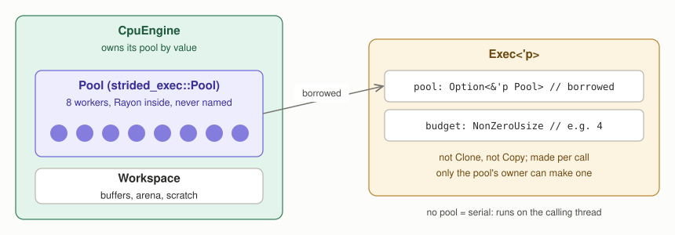
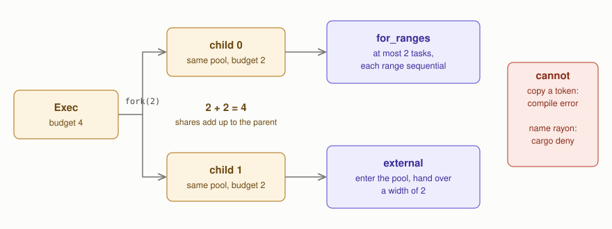
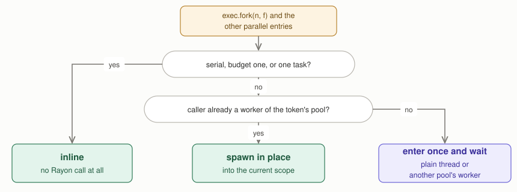
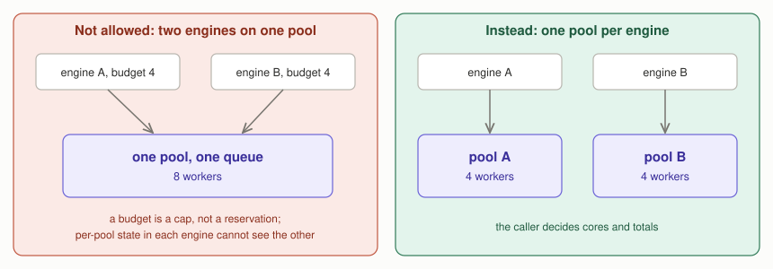

# The CPU placement token, with figures

This is a walkthrough of "Where placement is decided" in
[core-boundary-and-execution-ownership.md](./core-boundary-and-execution-ownership.md).
That document holds the rules; this one explains them with pictures. The token
lives in `strided-exec` (strided-rs, tensor4all/strided-rs#331).

## What the token is

A token is permission to run work on a pool, with a limit on how many tasks may
run at once. It holds two things: a borrowed reference to a pool, and a budget.
It does not own the pool. The engine owns the pool and makes a fresh token for
each operation.



* `Pool` is tensor4all's own type. It wraps a Rayon pool, but no Rayon type
  appears in any public signature, so the scheduler behind it can be replaced
  inside `strided-exec` alone.
* A token is neither `Clone` nor `Copy`. Holding a token with budget 4 means
  holding 4 slots of that pool, and slots can be divided but never duplicated.
* Only the pool's owner can make a token, because `Exec::new` needs the pool
  itself and a token never gives its pool back out.
* A token without a pool is serial: everything runs on the calling thread and
  no global pool is ever started.

## How one operation uses it

The engine makes the token and passes it down by value through tenferro's
dispatch to the provider crates (tcontract, strided, tlinalg). The pool itself
is never split or copied on the way; the layers pass the same reference along.
Nothing stores the token.

A kernel first looks at the problem size. A small operation runs where it is:
a 1 KiB elementwise call costs about 40 ns, and entering a pool costs
microseconds. A large one calls one of the parallel entries, and each entry
consumes the token:

| Entry | What it does |
| --- | --- |
| `fork(jobs, \|i, child\| ...)` | runs `jobs` jobs on at most `budget` tasks; each job gets a child token on the same pool holding its share |
| `for_ranges(len, grain, \|r\| ...)` | data-parallel loop: at most `budget` tasks take ranges from a shared counter; each range runs sequentially |
| `external(\|w\| ...)` | enters the pool and hands a plain width to a library outside tensor4all (faer, a vendor BLAS) |
| `broadcast(\|t\| ...)` | barrier-bearing kernels: all `budget` participants run at once, or the call is refused |

Two more operations keep the slot count without starting tasks. `reborrow`
lends the token to one phase while the caller keeps it for the next, so a
kernel that fills and then copies passes `exec.reborrow()` to each step.
`limit(max)` narrows the budget, for example to the team size a work model
picked. The cases in which `broadcast` refuses a token are listed with the API
in the main document.

Splitting can be nested to any depth, and at every level the children's budgets
add up to the parent's:



```rust
// with a token of budget 4, run two independent parts in parallel
exec.fork(2, |i, child| {                 // child.budget() == 2
    match i {
        0 => child.for_ranges(len, grain, |r| add(r)),          // at most 2 tasks
        _ => child.external(|w| matmul(.., faer::Par::Rayon(w))), // width 2
    }
});
```

Because a token cannot be copied and every entry consumes it, no code can hand
the same budget to two children. Because only `strided-exec` may depend on
Rayon (`cargo deny`), no code can start a task without a token. Together these
make "at most `budget` tasks of one token run at any moment" true by
construction.

## Entering a pool

Every parallel entry decides in the same way whether to enter the pool:



## Splitting across engines and inside one operation

There are two kinds of splitting, and they use different tools.

**Across engines, use separate pools.** A caller such as hataori that runs `k`
lanes at once builds `k` pools of `m` threads and makes one engine from each.
Each lane thread holds its engine for the whole run.


```rust
let engines: Vec<CpuEngine> = (0..k)
    .map(|_| Ok(CpuEngine::new(Pool::builder().threads(m).build()?)))
    .collect::<Result<_>>()?;
```

**Inside one operation, split the token.** An operation with independent parts
calls `fork` on its token. The children run on the same pool, within the
parent's budget.

Two engines never share one pool. A budget is a cap, not a reservation of
particular workers, so two engines on one pool would compete for the same
queue, and each engine's per-pool state could not see the other. The engine
therefore takes its pool by value.



## Rules

The rules and the check that enforces each one are in the main document,
"Where placement is decided", together with what the token does not bound.
This walkthrough does not restate them.

## faer

`strided-exec` knows nothing about faer. It hands over a pool and a width
through `external`, and t4a-faer turns the width into faer's own scheduling: a
team of that width, whose token the call consumes. A caller that runs faer for a
whole session owns a team itself and lends a sub-team per call. How a batched
caller splits its batch, and what a width alone costs, is in "faer and
threadteam" of the main document.

## Planned: one pool per cache domain

A machine with several shared-cache domains can get one Rayon pool per domain,
bundled by `Pool`, so that a `fork` splits at domain boundaries first. The plan
is under "Planned work" in the main document.
