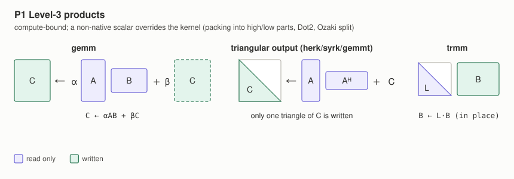
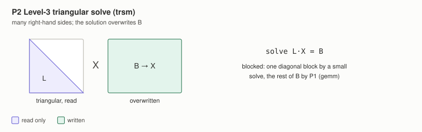
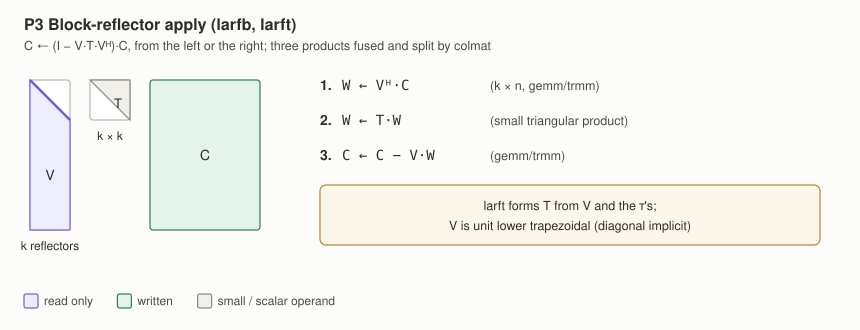
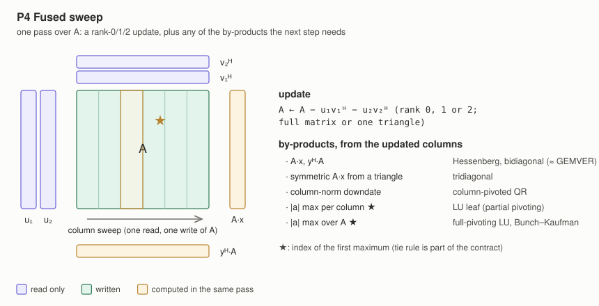
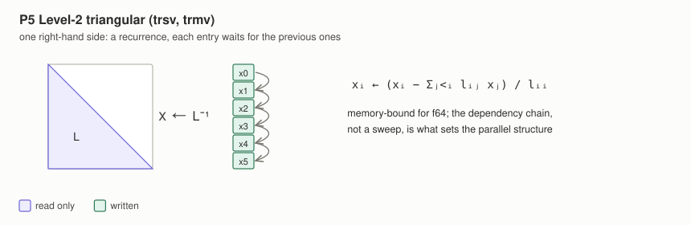
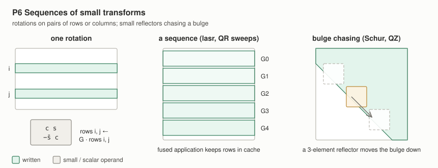
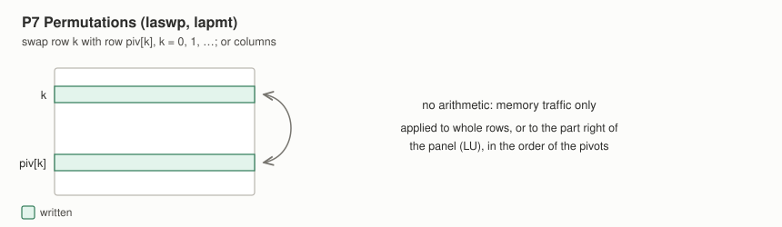
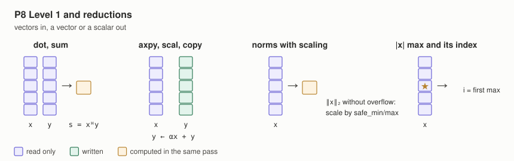
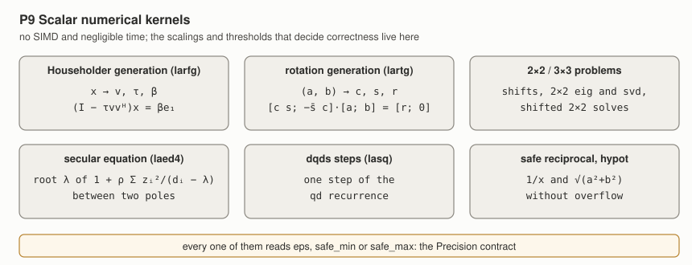
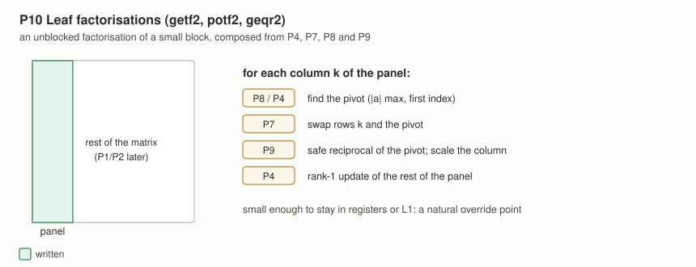

# A next generation of dense linear algebra in colmat: prior work and design direction

Status: Survey and proposal (2026-11). Not an implementation plan. Scope: [colmat](https://github.com/tensor4all/colmat-rs), the dense linear algebra library of the stack. This document covers how colmat's BLAS-like and LAPACK-like layers should be reorganised to support generic scalars (double-double first), a per-scalar cost model and a caller-owned thread token. The first step is extended precision and a redefinition of the primitives that covers the fused kernels; batched operations are deferred (section 9 keeps the survey for later). For who owns the threads, read [core-boundary-and-execution-ownership.md](./core-boundary-and-execution-ownership.md) first.

The design discussion is in [colmat-rs#171](https://github.com/tensor4all/colmat-rs/issues/171). This document records what already exists elsewhere, in papers and in code, so that colmat reuses it and does not reinvent it.

## 1. Why

Hiroshi Shinaoka and Markus Wallerberger (2026-11) asked whether colmat's linear algebra can be written on top of a trait of BLAS-like primitives, with five requirements:

1. **Primitives as a trait.** LU, QR, EVD and SVD are written against a small set of primitives that a scalar type can override.
2. **A per-scalar cost model.** Parallel width and block sizes come from a cost model that depends on the scalar. Today a non-native scalar borrows the `f64` constants.
3. **Extended precision.** Support [xprec-rs](https://github.com/tuwien-cms/xprec-rs) (`Df64`, double-double).
4. **A caller-owned thread token.** Every primitive receives the caller's team (`Par`) and never starts threads of its own.
5. **Batched operations.** Many independent small or medium problems in one call. *Deferred* (Hiroshi, 2026-11-13): extended precision and the primitives come first.

Four facts found while discussing this shape the design:

* **Inconsistent eps for double-double.** colmat's `fx128` (`qd::Quad`), xprec's `Df64` and qd itself define three different values for the same format: `8·Quad::EPSILON`, `f64::EPSILON²/2` and `f64::EPSILON²`.
* **Hard-coded eps in a downstream caller.** sparse-ir-rs selects eps by downcasting through `Any`, with `1e-15` as the fallback for other types (`sparse-ir-basis/src/tsvd.rs` at `SpM-lab/sparse-ir-rs@2ea2f23`).
* **The `fx128` SIMD hooks mix the parts of different elements.** The hooks load AoS memory into registers that the arithmetic reads as SoA (colmat-rs#173; upstream report faer-043, colmat-rs#175).
* **`fx128` matmul panics outside `cfg(test)`** (colmat-rs#174; faer-044).

## 2. Summary: what exists, what colmat adds

| Requirement | Closest prior work | What colmat takes | What is new in colmat |
| --- | --- | --- | --- |
| Generic scalars over one code base | \<T\>LAPACK (generic C++ templates with an optional optimised backend), BLAS++/LAPACK++, C++ `std::linalg` (P1673) | A generic reference body for every routine, plus a per-type fast path | Rust traits instead of templates; the fast path is chosen by the scalar type (an associated type), not by linking a BLAS |
| Machine constants of non-IEEE types | MPLAPACK's per-type `Rlamch` (double-double: eps = 2⁻¹⁰⁴, emin = −968); \<T\>LAPACK derives its constants from `numeric_limits` | A minimal per-type contract: `eps`, `safe_min`, `safe_max`, declared by the type rather than derived | A trait of three items instead of `numeric_limits` or a `Float`-like trait |
| Double-double kernels | XBLAS, QD, Dot2 (Ogita–Rump–Oishi), Ozaki scheme, DD-AVX, sparse-ir-rs `ddgemm` | SoA high/low arrays for SIMD; Dot2-style accumulation; room for an Ozaki-type gemm | AoS storage with conversion at load and at packing, as one contract for every non-native scalar |
| Coarse-grained primitives | BLIS (microkernel plus packing, five-loop structure); LAPACK on top of BLAS | Packing as the place where precision and layout are converted (BLIS mixed precision) | Primitives that take a team and return a cost estimate |
| Thread token | BLIS `rntm_t` per call and `thrinfo_t`/`thrcomm_t` trees; P1673 execution policies; Kokkos serial/team/procedure | The token is passed per call and split per loop | Already in colmat: `Par::Team` is exclusive and borrowed, and regions run at the widest width that pays |
| Cost model | OpenBLAS m·n·k thresholds, BLIS `sup` thresholds, analytical BLIS blocking, ML thread-count models | Shape-based gates; analytical block sizes | Rates per scalar and per kernel family against the dispatch cost of the token (colmat `cost.rs`) |
| Many threads in factorizations | PLASMA tiles, SLATE, static look-ahead and malleable BLIS (Catalán et al.), CALU/TSQR | Look-ahead, worker sharing, reduction-tree panels | Already planned in colmat (tensor4all/t4a-faer#168): equal-area partitions, SPMD sections, look-ahead |
| Batched operations | Batched BLAS standard (group API, `info` modes), oneMKL group/strided/compact, KokkosBatched compact kernels, LIBXSMM, BLASFEO, MAGMA batched | Group API with fixed-size and strided fast paths; per-problem error report; an interleaved family only for tiny sizes | Batches split with the caller's token (already the stack's rule) |

Not found: a Rust library that runs SIMD across a batch on CPU, a published paper on \<T\>LAPACK itself, and a reference implementation of the 2017 Next-Generation BLAS proposal beyond the batched part.

## 3. Prior proposals for a next-generation BLAS/LAPACK

* **A Proposal for a Next-Generation BLAS** (Riedy, Henry, Demmel, Gates, Li, Tang; SC17 BoF, 2017).
  * A new naming scheme that covers the current BLAS and extends it with mixed and extended precision, reproducibility, batched operations, fixed point and error handling.
  * It says a reference implementation will follow. Only the batched part has one (BBLAS, section 4).
* **BALLISTIC**, LAWN 297 (Demmel, Dongarra, Julie Langou, Julien Langou, Luszczek, Mahoney; 2020).
  * The plan for the next LAPACK and ScaLAPACK: layered software, new lower and higher precisions, mixed precision, refining XBLAS, Batched BLAS, user-controllable autotuning.
  * It names "C++ prototypes of a new templated LAPACK library", which is \<T\>LAPACK.
* **Proposed Consistent Exception Handling for the BLAS and LAPACK** (Demmel, Dongarra, Gates, Henry, Langou, Li, Luszczek, Pereira, Riedy, Rubio-González; arXiv:2207.09281, SC22 Correctness workshop).
  * Consistent NaN and Inf propagation, and new error reporting beyond `INFO`.
  * colmat's upstream reports faer-007, -010, -011, -014, -020 and -039 are defects of exactly this class.
* **C++ API for BLAS and LAPACK**, SLATE Working Note 2 (Gates, Luszczek, Kurzak, Dongarra et al.; 2017, revised 2018).
  * Argues that type-in-name interfaces (`sgemm`, `dgemm`) do not fit templated code, and proposes one generic name per routine. This became BLAS++ and LAPACK++.
  * SLATE Working Note 4 does the same for batched BLAS.
* **C++ `std::linalg`**, P1673 (Hoemmen, Hollman, Trott et al.).
  * A free-function BLAS interface over `mdspan`, voted into the C++26 working draft (P3809R0).
  * Allows user-defined value types. Each algorithm takes an optional leading execution policy, which is a per-call thread specification.
  * LAPACK-like functionality is excluded.

## 4. Test and reference implementations

Checked on 2026-11-13 with the GitHub API: language, licence and last commit.

| Implementation | What it demonstrates | Language, licence | Last commit | State |
| --- | --- | --- | --- | --- |
| [tlapack/tlapack](https://github.com/tlapack/tlapack) (\<T\>LAPACK) | Generic LAPACK over scalar and layout plugins (mdspan, Eigen, MPFR, `__float128`, half, bfloat16, StarPU); BLAS++ dispatch for native types | C++, BSD-3 | 2026-11-09 | Active, "work in progress"; no paper found |
| [icl-utk-edu/blaspp](https://github.com/icl-utk-edu/blaspp), [lapackpp](https://github.com/icl-utk-edu/lapackpp) | One generic C++ name per routine over CPU and GPU vendor libraries | C++, BSD-3 | 2026-11-12, 2026-11-11 | Active (SLATE) |
| [kokkos/stdBLAS](https://github.com/kokkos/stdBLAS) | Reference implementation of P1673 | C++, Kokkos/NTESS | 2026-07-01 | Maintained |
| [NLAFET/BBLAS](https://github.com/NLAFET/BBLAS) | Reference implementation of the Batched BLAS group API | C, no licence file | 2018-10-27 | Dormant |
| [ReproBLAS](https://bebop.cs.berkeley.edu/reproblas) | Reproducible summation and BLAS (Ahrens, Demmel, Nguyen, ACM TOMS 46(3), 2020) | C | — | Not checked on GitHub |
| [michael-lehn/cxxRefBLAS](https://github.com/michael-lehn/cxxRefBLAS) | Named "reference implementation for the next generation of BLAS" | — (almost empty) | 2014-07-11 | Dormant stub |
| [nakatamaho/mplapack](https://github.com/nakatamaho/mplapack) | All of LAPACK 3.9.1 (FABLE translation) in binary128, FP80, double-double, quad-double, GMP, MPFR; per-type `Rlamch` | C++, BSD-2 + LAPACK | 2026-11-13 | Very active |
| [flame/blis](https://github.com/flame/blis) | Microkernel plus packing; mixed domain and precision at packing; per-call `rntm_t`; `sup` path for skinny shapes | C, BSD-3 | 2026-10-06 | Mature |
| [kokkos/kokkos-kernels](https://github.com/kokkos/kokkos-kernels) (KokkosBatched) | Compact (SIMD-across-the-batch) kernels with serial/team/procedure variants | C++, Apache-2.0 + LLVM exception | 2026-11-12 | Mature |
| [libxsmm/libxsmm](https://github.com/libxsmm/libxsmm) | JIT kernels specialised per small shape, one problem per call | C, BSD-3 | 2026-11-10 | Active |
| [giaf/blasfeo](https://github.com/giaf/blasfeo) | Panel-major native format for small matrices, single-threaded | C/asm, BSD-2 | 2026-11-12 | Active |
| [icl-utk-edu/plasma](https://github.com/icl-utk-edu/plasma), [slate](https://github.com/icl-utk-edu/slate) | Tile algorithms on OpenMP tasks; distributed tiles with look-ahead | C, C++; BSD-3 | 2026-05-11, 2026-08-27 | Low activity; active |
| [icl-utk-edu/magma](https://github.com/icl-utk-edu/magma) | GPU batched factorisations and batched SVD | C/C++/CUDA/HIP, BSD-3 | 2026-10-28 | Active |
| [JuliaLinearAlgebra/GenericLinearAlgebra.jl](https://github.com/JuliaLinearAlgebra/GenericLinearAlgebra.jl) | Generic SVD, eigensolvers, blocked Cholesky/QR for `BigFloat` etc. | Julia, MIT | 2026-10-26 | A "playground" (README) |
| [t-hishinuma/DD-AVX_v3](https://github.com/t-hishinuma/DD-AVX_v3) | AVX/AVX-512 double-double level-1 BLAS and SpMV with separate `hi`/`lo` arrays | C++, Apache-2.0 | 2021-06-18 | Dormant |
| [enp1s0/ozIMMU](https://github.com/enp1s0/ozIMMU) | DGEMM on integer matrix units by the Ozaki scheme | CUDA, MIT | 2025-12-02 | Research code |
| [sarah-quinones/faer-rs](https://github.com/sarah-quinones/faer-rs) (upstream faer, JOSS 2026) | Decompositions built on matmul; generic `ComplexField` with SIMD hooks; `fx128` | Rust, MIT | 2026-10-22 | Active |
| sparse-ir-rs `sparse-ir-basis/src/ddgemm.rs` ([SpM-lab/sparse-ir-rs](https://github.com/SpM-lab/sparse-ir-rs)) | Dot2-style `Df64` gemm on separate high/low arrays, split over columns, independent of thread count; `AcaScalar` overrides `matmul` and an operation cost per scalar | Rust | `2ea2f23` | In production in sparse-ir |

The closest in spirit is \<T\>LAPACK: one generic code base whose routines a type can redirect to an optimised backend. MPLAPACK is the closest for double-double, and KokkosBatched for batched kernels under a team abstraction.

## 5. The scalar contract and machine constants

### Prior work

* **\<T\>LAPACK** (`include/tlapack/base/constants.hpp`) derives every constant from `std::numeric_limits`:
  * `ulp()` is `epsilon`;
  * `safe_min()` is `radix^max(emin−1, 1−emax)`, and `safe_max()` is its reciprocal;
  * Blue's scaling constants come from radix, digits and the exponent range.

  A custom type must therefore specialise `numeric_limits`.
* **MPLAPACK** declares double-double's constants by hand (`include/mplapack_arithmetic_params_dd.h`):
  * eps is fixed at `0x1.fffffffffffffp-105` (about 2⁻¹⁰⁴), deliberately not QD's `_eps`;
  * emin is −968, not −1021, because the low word must stay normal;
  * the header warns that QD's `numeric_limits<dd_real>` is incomplete and that `min_exponent` may return 0.
* **Proven double-word error bounds**, with u = 2⁻⁵³ (Joldes, Muller, Popescu, ACM TOMS 44(2), 2017; Muller and Rideau 2022, Coq-verified):

  | Operation | Relative error bound |
  | --- | --- |
  | `DWPlusFP` | ≤ 2u² |
  | accurate `DW + DW` | ≤ 3u²/(1−4u), attained |
  | `DW × DW` (FMA) | < 5u² |
  | sloppy `DW + DW` (QD's default) | no relative bound under cancellation |

### Current state in the stack

| Source | eps of double-double | Smallest value |
| --- | --- | --- |
| qd 0.8.0 `Quad::EPSILON` | `f64::EPSILON²` ≈ 4.9e-32 | `Quad::MIN_POSITIVE` |
| xprec 0.2.3 `Df64::EPSILON` | `f64::EPSILON²/2` ≈ 2.5e-32 | `f64::MIN_POSITIVE / f64::EPSILON` (both words normal) |
| colmat `fx128::epsilon_impl` | `8·Quad::EPSILON` ≈ 3.9e-31 | `max_positive = 1/min_positive` (not the true maximum) |
| sparse-ir-rs `get_epsilon_for_svd` | downcasts through `Any`; `1e-15` for other types | — |

colmat's production code already queries eps generically (about 56 call sites of `eps::<T>()` and 54 of `min_positive`). What is hard-coded is elsewhere:

* `nbits = 100` for `fx128`, which feeds `max(30, nbits/2)` iteration caps;
* `maxit = 30·n` in QZ;
* literal tolerance multipliers such as `128·eps`.

### Direction

* **A minimal colmat trait, `Precision`, rather than a `Float`-like trait.** `eps`, `safe_min` and `safe_max` are required and are declared by the type, as in MPLAPACK. Derived quantities (`digits`, `sqrt(safe_min)`, `safe_min/eps`) are provided methods.
* **The six `*_impl` constants of `RealField` collapse into this supertrait.**
* **Iteration caps and tolerance multipliers move into the `*Params` structs**, with defaults computed from `Precision`.
* **eps must match the arithmetic.** With eps = 2⁻¹⁰⁴, the multiply bound (5u² ≈ 1.25·2⁻¹⁰⁴) slightly exceeds eps, and sloppy addition has no bound at all. Either the kernels use the accurate addition or eps is set to at least 5u². The scalar's author decides and documents it.

## 6. Memory layout: AoS storage, SoA at load and at packing

Prior work:

* **BLIS** converts precision during packing, with no extra microkernels (Van Zee, Parikh, van de Geijn, ACM TOMS 47(2), 2021).
* **DD-AVX** keeps separate `hi` and `lo` arrays for AVX.
* **sparse-ir-rs `ddgemm`** splits its inputs into high and low arrays before the kernel.
* **GPU double-double BLAS** stores interleaved `double2` (Mukunoki and Takahashi, PARA 2010).

Decision in colmat-rs#171:

* **Storage:** `Mat<T>` stays a contiguous array of `T`, so double-double is AoS. Strides, views, zero-copy conversion and the C API stay as they are. A planar storage (the old faer `Entity` model) is rejected.
* **SIMD hooks:** the scalar's hooks deinterleave on load and interleave on store. They take an element pointer (`*const T`), not `*const SimdVec`; the latter reads as "memory already has the register layout", which is the root of colmat-rs#173.
* **Packing:** level-3 kernels pack A and B panels into separate high and low parts, which is where `ddgemm` already does it.
* **Lane order:** NEON `vld2q_f64` deinterleaves in one instruction. On x86, `unpacklo/hi_pd` permutes the lane order to `(0, 2, 1, 3)` within 256 bits. That is harmless for element-wise operations and sums when the store inverts it, but position-dependent operations (argmax pivot search, tail masks) need the full permutation or an index fix-up.

## 7. Primitives and the choice of algorithm

Prior work:

* **BLIS** builds nearly all level-2 and level-3 BLAS from a few microkernels plus packing (Van Zee and van de Geijn, ACM TOMS 41(3), 2015).
* **\<T\>LAPACK** has a generic body for every routine and a trait-gated redirect to BLAS++ for native types.
* **faer** builds its decompositions on matmul (JOSS 2026).
* **The Ozaki scheme** emulates high-precision gemm with native gemms:
  * the original (Ozaki, Ogita, Oishi, Rump, Numer. Algorithms 59, 2012);
  * binary128 gemm from DGEMMs, faster than MPLAPACK's DD and binary128 gemm on x86 (Mukunoki et al., ICPP 2021);
  * Ozaki scheme II with the Chinese Remainder Theorem (arXiv:2504.08009).

### Prior work on fused level-2 operations

colmat's fused kernels are one pass over a matrix that applies a low-rank update and computes the products or reductions that the next step needs. This class has been standardised and implemented before:

* **The BLAS Technical Forum Standard** (2001), chapter 2, added operations that bundle two calls into one pass over the data:
  * `GEMVER`: a rank-2 update `A ← A + u1·v1ᵀ + u2·v2ᵀ` followed by two matrix-vector products. In `GEMVER` the second product uses the first result; in colmat's Hessenberg and bidiagonal kernels the two products are independent.
  * `GEMVT`, `TRMVT`, `AXPY_DOT` and `GE_SUM_MV`.

  The Forum's netlib page lists reference implementations only for the legacy BLAS, the sparse BLAS and the extended and mixed precision BLAS (XBLAS). The chapter-2 extensions are still marked "in preparation" there.
* **"BLAS 2.5"** (Howell, Demmel, Fulton, Hammarling, Marmol, ACM TOMS 34(3), 2008). Bidiagonalisation with the two GEMVs done in one pass of the trailing matrix through cache. It roughly halves the main-memory traffic and cuts the run time by up to 25 %.
* **libflame's fused reductions** (Van Zee, van de Geijn, Quintana-Ortí, Elizondo, ACM TOMS 39(1), 2012). The paper extends the same fusion to the Hessenberg and tridiagonal reductions, with a model that estimates the speed-up of fusing.
  * The implementations are `FLA_Bidiag_UT_u_fus_var2–4`, `FLA_Hess_UT_fus_var2–4` and `FLA_Tridiag_UT_l_fus_var2–3`.
  * They are built on nine fused vector kernels in `src/base/flamec/blis/fused/`: `dotaxpy`, `dotsv2`, `dotsv3`, `axpyv2b`, `axpyv3b`, `axpyv2bdotaxpy`, `dotv2axpyv2b`, `axmyv2` and `dotaxmyv2`.
  * libflame has had no commit since 2024-05.
* **BLIS level-1f kernels** (`axpy2v`, `dotaxpyv`, `axpyf`, `dotxf`, `dotxaxpyf`; [KernelsHowTo](https://github.com/flame/blis/blob/master/docs/KernelsHowTo.md)).
  * The level-2 operations are built from them. For example, `hemv` uses `dotxaxpyf`, which reads a block of columns once and produces both `Aᵀy` and `Ax`.
  * A kernel works on a block of `nf` columns (the fusing factor) and is replaced per architecture; the loop around it stays generic.
* **Fused Givens rotations** (Van Zee, van de Geijn, Quintana-Ortí, ACM TOMS 40(3), 2014). Applying many sets of rotations at once, vectorised, makes the tridiagonal and bidiagonal QR algorithms competitive with divide and conquer and MRRR.
* **Delayed column-norm updates** in column-pivoted QR (Quintana-Ortí, Sun, Bischof, SISC 19(5), 1998; LAPACK `xLAQPS`).
* **Generated fusion.**
  * Build to Order BLAS (Belter, Jessup, Karlin, Siek, SC09; arXiv:1205.1098) compiles MATLAB-like sequences such as GEMVER, BiCGK and AXPYDOT into fused C.
  * Filipovič et al. (J. Supercomputing 71, 2015) fuse BLAS-1/2 map and reduce kernels on GPUs.

Not found: a standard primitive that fuses a low-rank update with a pivot search, as colmat's LU and Bunch–Kaufman kernels do. That part is colmat's own.

### Primitive kinds (decided 2026-11-13)

Before any API, the primitives are fixed as kinds: mathematical operations with a data-access pattern. The list comes from what colmat's algorithms call at `colmat-rs@4abe04d`.

| # | Kind | Operation | Used in colmat | BLAS/LAPACK counterpart |
| --- | --- | --- | --- | --- |
| P1 | Level-3 products | `C ← αAB + βC`, including a triangular-output product (a generalised herk/syrk/her2k) and products with a triangular factor (trmm) | Almost every blocked factorisation (gemm 76 call sites, triangular product 52) | gemm, gemmt, herk, her2k, trmm |
| P2 | Level-3 triangular solve | `X ← T⁻¹B`, many right-hand sides | LU, Cholesky, solves (97 call sites) | trsm |
| P3 | Block-reflector apply | `(I − V·T·Vᴴ)` from the left or the right, including forming `T` and applying a sequence of blocks | QR, Hessenberg, tridiagonal and bidiagonal reductions, back-transformations (138 call sites) | larfb, larft |
| P4 | Fused sweep | One pass that applies a rank-0, -1 or -2 update to a full matrix or a triangle and computes any of: `A·x`, `yᴴ·A`, a symmetric product from a triangle, column-norm downdates, a per-column absolute maximum, a 2-D absolute maximum | LU leaf, full-pivoting LU, column-pivoted QR, Bunch–Kaufman, Hessenberg, tridiagonal, bidiagonal | ger/syr2 + gemv/symv; BLAS 2.5 (GEMVER, GEMVT); BLIS level-1f |
| P5 | Level-2 triangular | `x ← T⁻¹x`, `x ← Tx`, one right-hand side; a recurrence, unlike P4 | Single right-hand-side solves, triangular inverse | trsv, trmv |
| P6 | Sequences of small transforms | Rotations (Givens, Jacobi) on pairs of rows or columns, applied singly or as sequences; bulge chasing with 2- or 3-element reflectors | Jacobi, real and complex Schur (`move_bulge`), QZ (`chase_bulge_2x2`), QR iterations, LLT/LDLT rank updates | rot, lasr, the laqr5 family |
| P7 | Permutations | Row and column swaps, applying a permutation | LU, Bunch–Kaufman, column pivoting | laswp, lapmt |
| P8 | Level 1 and reductions | dot, sum, norms with scaling, absolute maximum with its index, scale, axpy, copy, conjugate, layout-changing copies | Everywhere (`reductions/*`) | dot, nrm2, iamax, scal, axpy, copy |
| P9 | Scalar numerical kernels | Householder and rotation generation; 2×2 and 3×3 problems (shifts, 2×2 eigenvalues and singular values, shifted 2×2 solves); secular-equation roots; dqds steps; safe reciprocal and hypot | `make_householder`, `secular_root`, `solve_shifted_2x2_cplx`, `svd_triu_2x2`, `geigval_2x2`, dqds | larfg, lartg, lanv2, lasv2, laed4, lasq* |
| P10 | Leaf factorisations (optional) | Unblocked factorisation of a small block | LU leaf, `simd_cholesky`, QR panels | getf2, potf2, geqr2 |

What each kind does, in pictures. Purple is read only, green is written, amber is computed in the same pass, and grey is a small or scalar operand. The figures are generated by `figures/make_primitive_figures.py` (standard library only; rerun it after editing).





















What each kind needs from an extended-precision scalar, and its cost character:

| Kind | Needs from the scalar | Cost, `f64` / double-double |
| --- | --- | --- |
| P1–P3 | SoA packing, and an override such as Dot2 on packed panels or an Ozaki-type split | compute-bound / compute-bound |
| P4, P5, P7, P8 | The SIMD hooks only (AoS↔SoA conversion, compare with index); a generic implementation suffices | memory-bound / closer to compute-bound |
| P6 | The SIMD hooks; whether to fuse rotations (Van Zee et al. 2014) | memory-bound / closer to compute-bound |
| P9 | `Precision` (safe_min, eps) and scalar math (sqrt, division, hypot); no SIMD | negligible time, but every scaling and threshold that decides correctness lives here |
| P10 | Composed from P4, P8 and P9 | small; a natural override point |

Two consequences:

* **Only P1–P3 need a per-scalar override.** P4–P8 run on the generic implementation once the SIMD-hook contract (section 6) holds.
* **P9 decides the correctness of double-double.** The ad-hoc `fx128` constants and sparse-ir-rs's eps-by-downcast are both P9-level problems, and P9 is the kind most tied to the `Precision` contract.

Still open (recommendation in brackets):

1. Whether P5 is a special case of P2 [separate: a recurrence, and memory-bound].
2. Whether P3 is a composition of P1 [separate: the most call sites, and colmat's own fused splits].
3. Whether the LLT/LDLT rank updates belong to P6 or P4 [P6, as a column recurrence; the kernels have not been read in detail].
4. Whether P10 is a primitive or a composition.

### Direction (colmat-rs#171)

* **Two tiers.** A generic reference implementation for any `ComplexField`, and a per-scalar `Kernels` implementation chosen statically through an associated type. Without specialization in stable Rust, the associated type plays \<T\>LAPACK's trait-gated redirect.
* **Primitives are the kinds above, coarse-grained and team-aware.** A BLAS-granular interface would lose colmat's fused kernels and splits.
* **Every primitive pairs execution with an estimate**: serial time in the stack's work unit and the number of parallel sections. Callers compose parallel decisions from these, and a full-width path without a cost gate (the class of tensor4all/t4a-faer#94 and #399) cannot be written.
* **The gemm primitive selects an algorithm per scalar, not only a kernel**, so a double-double scalar can implement gemm as Dot2 on packed SoA panels or by an Ozaki-type split.

## 7a. Trait boundaries and API sketch (from colmat-rs#171)

This section brings over the trait boundaries, the API sketch and the crate layout written in [colmat-rs#171](https://github.com/tensor4all/colmat-rs/issues/171) (body of 2026-11-12, and the AoS/SoA comment). It maps them onto the primitive kinds above. Where the kinds now say something different from the issue, the difference is marked **Revised by the kinds**. Nothing here is implemented.

### Which trait owns which kind

| Layer (crate) | Trait or item | Kinds it carries | Overridable per scalar? |
| --- | --- | --- | --- |
| `colmat-traits` | `ComplexField` (arithmetic and the SIMD hooks); the SIMD hooks convert AoS memory to SoA registers on load and back on store (section 6) | the basis of P4–P8 | yes, the hooks themselves |
| `colmat-traits` | `Precision`: `eps`, `safe_min`, `safe_max` required, derived constants provided (section 5; proposed in this document, not yet in the issue) | P9 | yes, the constants are declared by the type |
| `colmat-core` | `LinalgScalar: ComplexField { type Kernels: Kernels<Self>; }` | selects the P1–P3 implementation | yes, by the associated type |
| `colmat-core` | `Kernels<T>`: gemm (with triangular output), trmm, trsm, block-reflector apply, each with an `estimate` | P1, P2, P3 | yes: this is the override surface |
| `colmat-core` | generic implementations on the SIMD hooks | P4, P5, P6, P7, P8 | not for now |
| `colmat-core` | `Par`/`ParShape`, team skeletons, `CostModel`/`HostClass`/`Rates`, `Mat`/`Col`/`Row`/`Diag`/`Perm`, operator impls (`Mul` calls `T::Kernels::gemm`) | all | rates per scalar, yes |
| `colmat` | factorisations (LU, QR, Cholesky, EVD, SVD, GEVD), sparse, solvers; the decomposition methods as an extension trait (`use colmat::prelude::*`) | compose P1–P10; P10 leaves live here | no |
| `colmat-xprec` | `Df64` support and `Df64` kernels (Dot2 on packed panels, Ozaki-type gemm) | P1–P3 for `Df64`, `Precision` for `Df64` | — |

### API sketch, as written in the issue

```rust
pub trait LinalgScalar: ComplexField { type Kernels: Kernels<Self>; }

pub trait Kernels<T: ComplexField>: 'static {
    fn gemm(dst: MatMut<'_, T>, beta: Accum, lhs: MatRef<'_, T>, rhs: MatRef<'_, T>, alpha: T, par: Par<'_>);
    fn trmm(/* .. */); fn trsm(/* .. */);
    fn herk_tri(/* .. */);
    fn apply_block_reflector(/* .. */);
    fn swap_rows(/* .. */);
    // fused step kernels: default = current generic code
    fn estimate(op: Op, shape: Shape) -> Estimate; // serial_ns, sections
}
```

The binding is static, through an associated type; with a CPU-only backend there is no `dyn`.

**Revised by the kinds:**

* `herk_tri` is P1 (a triangular-output product) and stays in `Kernels`.
* `swap_rows` is P7, which has no arithmetic. It moves out of `Kernels` into the generic layer.
* The fused step kernels are P4. They are generic on the SIMD hooks and are not part of the override surface for now; the issue had them in `Kernels` with a generic default.
* P5 (trsv/trmv) is separate from `trsm`, if open point 1 of section 7 is settled as recommended.

### Crate layout and dependency direction (from the issue)

```
threadteam    colmat-traits (ComplexField)    gemm (fork), pulp
      \              |                          /
       colmat-core:  Mat/Col/Row/Diag/Perm, bound, zip, layout copies,
                     Par/ParShape, team skeletons, CostModel/HostClass/Rates,
                     LinalgScalar + Kernels, Native/Generic kernels,
                     operator impls (Mul -> T::Kernels::gemm)
          /                         \
   colmat (factorisations,        colmat-xprec (Df64 support + Df64 kernels,
     sparse, solvers, prelude)      e.g. Ozaki-type gemm on f64 GEMMs)
          \                         /
            users (tensor4all-rs, colmat-ffi, ...)
```

The direction follows the issue:

* `xprec` stays a leaf scalar library. It does not depend on colmat.
* `colmat-xprec` depends on `xprec` and `colmat-core`, not on `colmat`, so algorithm experiments in `colmat` never break it.
* `colmat-xprec` gets `Par` and the team skeletons only through `colmat-core`'s re-exports. CI can deny a direct `rayon` or `threadteam` dependency, and `std::thread`, there.

What the issue checked about moving `mat/` into core:

* `mat/`, `col/`, `row/`, `diag/` and `perm/` depend on `linalg` only through `zip` and the layout copies.
* The `linalg` references in `utils/team.rs` and `utils/cost.rs` are test-only.
* The 208 operator impls of `linalg/mat_ops.rs` must move with `Mat` because of the orphan rule.
* The inherent decomposition methods become an extension trait. That is the main breaking change.

### Open questions carried over from the issue

1. **How `colmat-xprec` attaches `Df64`.** The orphan rule forbids implementing `ComplexField` or `LinalgScalar` for `xprec::Df64` from a third crate. The options:
   * (a) a `#[repr(transparent)]` newtype in `colmat-xprec`;
   * (b) the scalar impl behind features in `colmat-traits`/`colmat-core`, with kernels registered from `colmat-xprec`;
   * (c) everything inside `colmat` behind an `xprec` feature.
2. **What `xprec` would expose.** Its `Compensated { hi, lo }` fields are private and the struct is not `#[repr(C)]`. A SoA SIMD path and zero-copy conversion need a fixed layout and branch-free error-free transformations.
3. **How stable `colmat-core` is.** Either an independent release cadence, or at least `Kernels` and `CostModel` changed only rarely.
4. **`ComplexField` churn.** Whichever crate implements it for `Df64` has to follow it.

## 8. Threading: the token and the cost model

### Prior work

* **BLIS** (Smith et al., IPDPS 2014) chooses the loop to parallelise from the cache-sharing topology:
  * JC when L3 is private;
  * IC when L2 is private;
  * JR when L2 is shared;
  * the k loop (PC) is never split.

  In the code, a tree of `thrinfo_t` nodes with `thrcomm_t` communicators carries the team per loop level, and the expert API takes a per-call `rntm_t` instead of global state.
* **P1673** takes an execution policy per call.
* **KokkosBatched** offers each kernel as serial, team and procedure (whole execution space).
* **Width heuristics in use:**
  * OpenBLAS runs one thread while m·n·k ≤ 65536·4 (real types; 8192·4 for complex) and min(ncpu, m·n·k/(65536·4)) threads above that;
  * BLIS sends a gemm to `sup` when any of m, n, k is below a per-architecture threshold (201 on Haswell, double);
  * an ML model of runtime per thread count (Xia and Barca, arXiv:2406.19621) reports 1.5–3× over always using all threads.
* **Factorizations:**
  * PLASMA turns them into tile DAGs (Buttari et al., Parallel Computing 35, 2009; PLASMA 3 on OpenMP tasks, ACM TOMS 45(2), 2019);
  * static look-ahead on teams (Catalán et al., Parallel Computing 76, 2018);
  * malleable BLIS that lets panel threads join a running gemm (IEEE Access 7, 2019);
  * TSQR, CAQR and CALU turn the serial panel into a reduction (SISC 34, 2012; SIMAX 32, 2011).

### colmat today

* **The token.** `Par<'team>` is `Seq` or `Team(threadteam::TeamExec)`. It is exclusive, not `Clone`, lent with `reborrow`, and split into sub-teams. This is the BLIS team tree in token form.
* **The rule.** A region runs at the widest width at which `serial_estimate ≥ PAYS · sections · dispatch_cost`. The serial estimate is units of work times a per-family rate per host class (`faer/src/utils/cost.rs`), and the dispatch cost comes from the token.
* **The gap.** `Rate::of<T>` only distinguishes the native types, so every other scalar borrows the `f64` or `c64` rate.

### Direction

* **Rates per (host class × scalar × kernel family).** Native rows are as measured today. Non-native rows are measured, with a ratio to `f64` as the fallback.
* **Memory-bound and compute-bound families get separate ratios.**
  * Double-double level-1 work is about 2–3× `f64` because it is memory-bound (Mukunoki and Takahashi).
  * Double-double gemm is compute-bound. sparse-ir-rs weighs it at 12–16 `f64` operations per term (`sparse-ir-basis/src/cost.rs`).
* **This extends the stack's work unit.** [core-boundary-and-execution-ownership.md](./core-boundary-and-execution-ownership.md) ("Work units and rates") counts one real multiply-add as 1 and one complex multiply-add as 4. A per-scalar weight extends the same unit.
* **Block sizes follow the same model**, not only the parallel gate. The level-2/level-3 crossover moves for a compute-bound scalar.
* **No primitive starts threads.** A scalar crate gets `Par` and the team skeletons only through colmat's re-exports, and CI can deny a direct `rayon` or `threadteam` dependency.

## 9. Batched operations (deferred)

Deferred on 2026-11-13: extended precision and the redefinition of the primitives come first. The survey below is kept so that the batched API can start from it later.

### Prior work

* **The Batched BLAS standard.**
  * Dongarra et al., Procedia CS 108, 2017; the API proposal, MIMS EPrint 2016.25; Abdelfattah et al., ACM TOMS 47(3), 2021; reference implementation NLAFET/BBLAS.
  * The **group API**: `group_count`, `group_sizes[]`, and every per-matrix parameter as a per-group array. A fixed-size batch is one group, and the implementation may route a call to a style-specific routine.
  * **Per-problem error reporting** through an `info` array, with modes chosen on input: `ReportAll`, `ReportGroup`, `ReportAny`, `ReportNone`.
* **Layouts** (Dongarra et al. 2017).
  * Pointer-to-pointer, strided, and interleaved.
  * Full interleaving collapses beyond 3×3. Block interleaving (k ≈ 72–168 matrices per block) beats per-matrix approaches only up to about 12×12 to 16×16.
  * Converting P2P to interleaved inside the routine roughly halves throughput.
* **oneMKL** (Knepper, SC24 BoF) ships four styles: group, strided, SYCL spans, and **compact** (CPU only). Compact covers gemm, trsm, getrfnp, getrinp, potrf and geqrf in an interleaved format with explicit pack/unpack helpers.
* **KokkosBatched compact kernels** (Kim et al., SC17).
  * Packs of V matrices interleaved, V = SIMD width.
  * On KNL with sizes 3 to 15, speedups over an OpenMP loop of MKL calls reach 13.8× (dgemm), 45.2× (dtrsm), and 1.7–27.4× (getrf without pivoting).
  * Each kernel comes as serial, team and procedure.
* **Compact LU is non-pivoting** in both MKL and KokkosBatched.
* **One problem per thread** for the sizes above that: LIBXSMM (Heinecke et al., SC16; JIT per shape) and BLASFEO (Frison et al., ACM TOMS 44(4), 2018; a native panel-major format, because repacking cannot be amortised at small n).
* **Batched SVD uses one-sided Jacobi** (Boukaram et al., Parallel Computing 74, 2018; Abdelfattah and Fasi, arXiv:2601.17979, 2026), because it parallelises uniformly across the batch.
* **In Rust,** no crate was found that runs SIMD across a batch on CPU.

### The stack's existing rule

[core-boundary-and-execution-ownership.md](./core-boundary-and-execution-ownership.md) supports regular batches in one call and leaves irregular batches to the caller. A batched caller such as tlinalg splits the token: every slot goes to the batch with `Par::Seq` items when the batch is at least the budget; otherwise the token is forked over the items.

### A possible direction, for later (not discussed in colmat-rs#171)

* **One batch descriptor in colmat.** Either a uniform shape plus a stride, or a list of groups. Parameters are broadcast, per group or per item, as with oneMKL's spans.
* **Per-item results.** `Result` per item, or a single flag, chosen by the caller: the `info` modes in Rust form. Singular or indefinite items are expected in batched LU and Cholesky.
* **Two kernel families.**
  * Per-item calls on sub-teams, which is the existing rule and the default.
  * A compact family for tiny sizes, with explicit pack/unpack and an "already packed" batch type rather than silent conversion. It is non-pivoting where the interleaved layout forces it.
* **Batched SVD and EVD on one-sided Jacobi.** One-sided Jacobi is also built only from rotations and dot products, which suits double-double. That suitability is an inference, not a claim of the sources.

## 10. What colmat already has

Read at `tensor4all/colmat-rs@4abe04d`.

* **The token and the cost model:**
  * `Par<'team>`, the widest-width-that-pays rule;
  * `cost.rs`, with per-family rates per host class;
  * team skeletons (`run`, `for_each`, `tile_grid`, and equal-area triangle splits in Cholesky).
* **Scalars:**
  * `ComplexField`/`RealField`, with SIMD hooks per scalar;
  * `fx128` as an existing non-native scalar. It is the test bed once colmat-rs#173 and #174 are fixed.
* **Primitive calls in `linalg/` (excluding tests):** gemm 76, triangular product 52, triangular solve 97, block Householder apply 138. These are the dispatch points to route through a `Kernels` trait.
* **Column-pivoted QR with rank truncation** (`rel_tol`, `max_rank`; tensor4all/t4a-faer#303). It applies the same rule as sparse-ir-rs's TSVD front-end, so a truncated SVD for `Df64` can be composed from colmat's own parts once `Df64` is supported.

## 11. Open questions

1. **How `Df64` attaches** (colmat-rs#171): a newtype in a `colmat-xprec` crate, the scalar impl behind a feature with registered kernels, or everything inside colmat. Also where `mat/` lives (a `colmat-core` split).
2. **eps for double-double:** 2⁻¹⁰⁴ with accurate addition in every kernel, or a larger eps (≥ 5u²) that covers sloppy addition.
3. **Primitive granularity:** which fused panel kernels belong in the trait, and which stay private to a factorization.
4. **Batched API shape** (deferred):
   * group versus strided as the primary form;
   * whether a compact family is worth it for the shapes the stack runs;
   * who owns the packed format.
5. **Malleable teams:** whether a running gemm should accept members that join late (worker sharing) or stop early, as in the malleable-BLIS work. The token supports splitting, not growing.
6. **Exception handling:** whether to adopt the NaN/Inf conventions of arXiv:2207.09281 as the contract for every primitive.

## 12. References

Papers (DOIs and arXiv identifiers were checked against Crossref or the publisher page on 2026-11-13):

* Riedy, Henry, Demmel, Gates, Li, Tang. A Proposal for a Next-Generation BLAS. SC17 BoF, 2017. [document](https://docs.google.com/document/d/1DY4ImZT1coqri2382GusXgBTTTVdBDvtD5I14QHp9OE/edit), [slides](https://icl.utk.edu/bblas/sc17/files/bblas-sc17-riedy.pdf)
* Demmel, Dongarra, Julie Langou, Julien Langou, Luszczek, Mahoney. Prospectus for the Next LAPACK and ScaLAPACK Libraries (BALLISTIC). LAWN 297, 2020. [pdf](https://www.stat.berkeley.edu/~mmahoney/pubs/lawn297.pdf)
* Demmel et al. Proposed Consistent Exception Handling for the BLAS and LAPACK. [arXiv:2207.09281](https://arxiv.org/abs/2207.09281), 2022.
* Gates, Luszczek, Kurzak, Dongarra et al. C++ API for BLAS and LAPACK. SLATE Working Note 2, 2017. [pdf](https://library.eecs.utk.edu/files/ut-eecs-17-753.pdf)
* Hoemmen, Hollman, Trott et al. P1673R13, A free function linear algebra interface based on the BLAS. [paper](https://www.open-std.org/jtc1/sc22/wg21/docs/papers/2023/p1673r13.html); adoption recorded in [P3809R0](https://open-std.org/JTC1/SC22/WG21/docs/papers/2025/p3809r0.html).
* Van Zee, van de Geijn. BLIS: A Framework for Rapidly Instantiating BLAS Functionality. ACM TOMS 41(3), 2015. doi:10.1145/2764454
* Van Zee, Parikh, van de Geijn. Supporting Mixed-domain Mixed-precision Matrix Multiplication within the BLIS Framework. ACM TOMS 47(2), 2021. doi:10.1145/3402225
* Smith, van de Geijn, Smelyanskiy, Hammond, Van Zee. Anatomy of High-Performance Many-Threaded Matrix Multiplication. IPDPS 2014. doi:10.1109/IPDPS.2014.110
* Low, Igual, Smith, Quintana-Ortí. Analytical Modeling Is Enough for High-Performance BLIS. ACM TOMS 43(2), 2016. doi:10.1145/2925987
* El Kazdadi. faer: A linear algebra library for the Rust programming language. JOSS 11(123):6099, 2026. doi:10.21105/joss.06099
* Nakata. MPLAPACK version 2.0.1 user manual. [arXiv:2109.13406](https://arxiv.org/abs/2109.13406)
* Li, Demmel, Bailey, Henry et al. Design, implementation and testing of extended and mixed precision BLAS. ACM TOMS 28(2), 2002. doi:10.1145/567806.567808
* Hida, Li, Bailey. Algorithms for quad-double precision floating point arithmetic. ARITH-15, 2001. doi:10.1109/ARITH.2001.930115
* Joldes, Muller, Popescu. Tight and Rigorous Error Bounds for Basic Building Blocks of Double-Word Arithmetic. ACM TOMS 44(2), 2017. doi:10.1145/3121432. The bounds above were taken from the authors' slides ([RAIM 2025](https://raim2025.sciencesconf.org/data/program/slides_mioara_joldes.pdf), [NAC 2024](https://webusers.imj-prg.fr/~jean-claude.bajard/NAC2024/Supports/NAC2024_JMM.pdf)), because the full text was not reachable.
* Ogita, Rump, Oishi. Accurate Sum and Dot Product. SIAM J. Sci. Comput. 26(6), 2005. doi:10.1137/030601818
* BLAS Technical Forum. BLAS Technical Forum Standard, 2001. [netlib page](https://www.netlib.org/blas/blast-forum/); summary in [ICL report](https://hpcg.icl.utk.edu/files/publications/2001/icl-utk-77-2001.pdf).
* Howell, Demmel, Fulton, Hammarling, Marmol. Cache efficient bidiagonalization using BLAS 2.5 operators. ACM TOMS 34(3), 2008. doi:10.1145/1356052.1356055
* Van Zee, van de Geijn, Quintana-Ortí, Elizondo. Families of Algorithms for Reducing a Matrix to Condensed Form. ACM TOMS 39(1), 2012. [pdf](https://www.cs.utexas.edu/~flame/pubs/CondensedFormTOMS.pdf)
* Van Zee, van de Geijn, Quintana-Ortí. Restructuring the Tridiagonal and Bidiagonal QR Algorithms for Performance. ACM TOMS 40(3), 2014. doi:10.1145/2535371
* Quintana-Ortí, Sun, Bischof. A BLAS-3 Version of the QR Factorization with Column Pivoting. SIAM J. Sci. Comput. 19(5), 1998. doi:10.1137/S1064827595296732
* Belter, Jessup, Karlin, Siek. Automating the Generation of Composed Linear Algebra Kernels. SC09; Belter, Jessup, Nelson, Norris, Siek. Reliable Generation of High-Performance Matrix Algebra. [arXiv:1205.1098](https://arxiv.org/abs/1205.1098)
* Filipovič, Madzin, Fousek, Matyska. Optimizing CUDA code by kernel fusion: application on BLAS. J. Supercomputing 71(10), 2015. doi:10.1007/s11227-015-1483-z
* Ozaki, Ogita, Oishi, Rump. Error-free transformations of matrix multiplication by using fast routines of matrix multiplication and its applications. Numer. Algorithms 59, 2012. doi:10.1007/s11075-011-9478-1
* Mukunoki, Ozaki, Ogita, Imamura. Accurate Matrix Multiplication on Binary128 Format Accelerated by Ozaki Scheme. ICPP 2021. doi:10.1145/3472456.3472493
* Ootomo, Ozaki, Yokota. DGEMM on integer matrix multiplication unit. IJHPCA, 2024. doi:10.1177/10943420241239588
* Ozaki, Uchino, Imamura. Ozaki Scheme II. [arXiv:2504.08009](https://arxiv.org/abs/2504.08009), 2025.
* Mukunoki, Takahashi. Implementation and Evaluation of Quadruple Precision BLAS Functions on GPUs. PARA 2010, LNCS 7133. doi:10.1007/978-3-642-28151-8_25
* Ahrens, Demmel, Nguyen. Algorithms for Efficient Reproducible Floating Point Summation. ACM TOMS 46(3), 2020. doi:10.1145/3389360
* Dongarra, Hammarling, Higham, Relton, Valero-Lara, Zounon. The Design and Performance of Batched BLAS on Modern High-Performance Computing Systems. Procedia CS 108, 2017. doi:10.1016/j.procs.2017.05.138
* Dongarra et al. A Proposed API for Batched Basic Linear Algebra Subprograms. MIMS EPrint 2016.25. [record](https://eprints.maths.manchester.ac.uk/2464/)
* Abdelfattah et al. A Set of Batched Basic Linear Algebra Subprograms and LAPACK Routines. ACM TOMS 47(3), 2021. doi:10.1145/3431921
* Knepper. Evolution of Batched Linear Algebra in Intel oneMKL. SC24 BoF. [slides](https://icl.utk.edu/bblas/sc24/files/3-EvolutionOfBatchedLinearAlgebraInOneMKL.pdf)
* Kim, Costa, Deveci, Bradley, Hammond, Guney, Knepper, Story, Rajamanickam. Designing Vector-Friendly Compact BLAS and LAPACK Kernels. SC17. doi:10.1145/3126908.3126941
* Heinecke, Henry, Hutchinson, Pabst. LIBXSMM: Accelerating Small Matrix Multiplications by Runtime Code Generation. SC16. doi:10.1109/SC.2016.83
* Frison, Kouzoupis, Sartor, Zanelli, Diehl. BLASFEO: Basic Linear Algebra Subroutines for Embedded Optimization. ACM TOMS 44(4), 2018. doi:10.1145/3210754
* Jhurani, Mullowney. A GEMM interface and implementation on NVIDIA GPUs for multiple small matrices. JPDC 75, 2015. doi:10.1016/j.jpdc.2014.09.003
* Abdelfattah, Haidar, Tomov, Dongarra. Batched one-sided factorizations of tiny matrices using GPUs. J. Comput. Sci. 26, 2018. doi:10.1016/j.jocs.2018.01.005
* Boukaram, Turkiyyah, Ltaief, Keyes. Batched QR and SVD algorithms on GPUs with applications in hierarchical matrix compression. Parallel Computing 74, 2018. doi:10.1016/j.parco.2017.09.001
* Abdelfattah, Fasi. An Efficient Batch Solver for the SVD on GPUs. [arXiv:2601.17979](https://arxiv.org/abs/2601.17979), 2026 (preprint).
* Buttari, Langou, Kurzak, Dongarra. A class of parallel tiled linear algebra algorithms for multicore architectures. Parallel Computing 35(1), 2009. doi:10.1016/j.parco.2008.10.002
* Dongarra et al. PLASMA: Parallel Linear Algebra Software for Multicore Using OpenMP. ACM TOMS 45(2), 2019. doi:10.1145/3264491
* Gates, Kurzak, Charara, YarKhan, Dongarra. SLATE: Design of a Modern Distributed and Accelerated Linear Algebra Library. SC19. doi:10.1145/3295500.3356223
* Catalán et al. Static scheduling of the LU factorization with look-ahead on asymmetric multicore processors. Parallel Computing 76, 2018. doi:10.1016/j.parco.2018.04.006
* Catalán et al. A Case for Malleable Thread-Level Linear Algebra Libraries: The LU Factorization With Partial Pivoting. IEEE Access 7, 2019. doi:10.1109/ACCESS.2019.2895541
* Demmel, Grigori, Hoemmen, Langou. Communication-optimal parallel and sequential QR and LU factorizations. SISC 34(1), 2012. doi:10.1137/080731992
* Grigori, Demmel, Xiang. CALU: A Communication Optimal LU Factorization Algorithm. SIMAX 32, 2011. doi:10.1137/100788926
* Xia, Barca. Machine-Learning-Driven Runtime Optimization of BLAS Level 3 on Modern Multi-Core Systems. [arXiv:2406.19621](https://arxiv.org/abs/2406.19621), 2024.

Not verified, so not used above:

* a paper on \<T\>LAPACK;
* the full citations of the IAAT/IATF/LBBGEMM/IrGEMM small-GEMM papers;
* the DOIs of the 2019 OpenMP static look-ahead and the 2020 intra-routine malleability papers;
* a primary source for JAEA's QPBLAS.
