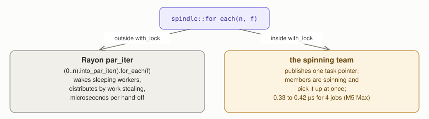
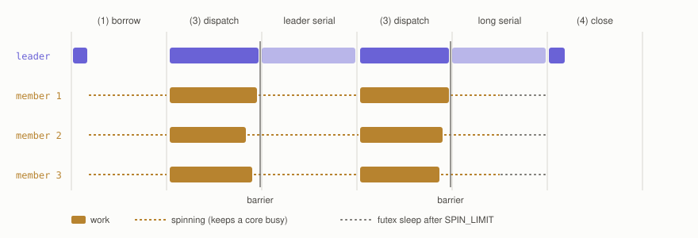
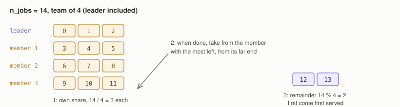
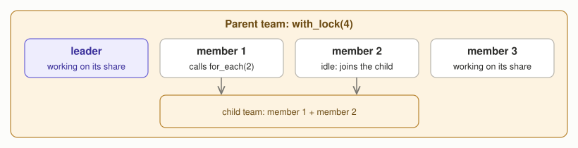
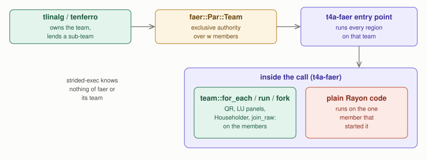

# How spindle works, and where its region is opened

[spindle](https://crates.io/crates/spindle) is the small crate behind faer's
parallelism. It borrows Rayon workers, keeps them spinning as a team, and hands
them work in a few hundred nanoseconds. faer never opens the team itself: its
kernels call `spindle::for_each`, and the caller is expected to open a region
with `spindle::with_lock`. This note explains the mechanism from the source
(spindle 0.2.6: `src/lib.rs` and `src/barrier/mod.rs`) and records measurements
on an Apple M5 Max. The rules it supports, and where the region is opened, are
in "Where placement is decided" and "faer and spindle" of
[core-boundary-and-execution-ownership.md](./core-boundary-and-execution-ownership.md).

## Two modes

faer calls `spindle::for_each(n, iter, f)` wherever it wants parallelism (LU
and QR panels, Householder applies, Bunch-Kaufman, the two-way `join_raw`).
spindle checks a thread-local to see whether a region is open.

## The life of a region

`with_lock(max, f)` runs in four steps.

1. **Borrow.** The team size is `min(rayon::current_num_threads(), max)`.
   Inside a `rayon::scope`, spindle spawns `n - 1` jobs, each running spindle's
   own loop; every Rayon worker that picks one up is a team member until the
   region closes. The calling thread becomes the leader and runs `f`.
2. **Wait.** Members spin with `spin_loop` while there is no work, up to
   `SPIN_LIMIT / PAUSE_LIMIT` rounds (65536 / 8 by default), and then sleep on a
   futex.
3. **Dispatch.** When the leader calls `for_each`, it writes the job counts,
   publishes the task pointer and wakes everyone. The leader works on its own
   share too, and a barrier collects the team at the end.
4. **Close.** When `f` returns, the leader announces the exit and wakes the
   team; the members leave the loop and the borrowed workers return to Rayon.

The members keep spinning while the leader runs serial code. That is why a
dispatch is fast, and it is also the cost: a region keeps its cores busy.

## How jobs are distributed

`for_each(n_jobs, f)` hands out jobs in three stages: each member first takes a
contiguous share of `n_jobs / n_threads`, counted down by an atomic per member;
a member that finishes takes jobs from the member with the most left, from the
far end of that member's share; the remainder `n_jobs % n_threads` is taken
first come, first served from a shared counter.

The barrier is sense-reversing: one 32-bit word holds the remaining count (low
16 bits), the participant count and a sense bit. The last thread to arrive
flips the sense and wakes the others, who spin before they sleep.

## Nesting

`join_raw` calls `for_each(2, ...)` recursively, so nesting is common. When a
team member calls `for_each`, spindle builds a child team and registers it in a
free slot of the root. Idle members of the parent notice the request and join
the child.

No thread is created: a child team is staffed from idle members of the parent,
so however deep the nesting, no more threads work than the region borrowed.

## Measurements (Apple M5 Max, a 4-thread pool)

Each call was made inside `pool.install` with `Par::Rayon(4)`, once inside a
`with_lock(4)` region and once outside. The last column is the time outside
divided by the time inside: above 1 means the region made the call faster.

| Operation | n | Outside (µs) | Inside (µs) | Outside / inside |
| --- | --- | --- | --- | --- |
| QR | 128 | 183.6 | 98.6 | 1.86 |
| QR | 512 | 2848.2 | 2031.6 | 1.40 |
| QR | 1024 | 13453.1 | 11334.3 | 1.19 |
| LU | 128 | 61.7 | 55.0 | 1.12 |
| LU | 1024 | 6368.3 | 14376.2 | 0.44 |
| matrix product | 256 | 149.0 | 575.6 | 0.26 |
| matrix product | 1024 | 9231.8 | 36188.5 | 0.26 |

Other costs measured on the same machine:

* opening and closing an empty region: 0.25 to 1.0 µs while the workers are
  awake, about 1.8 µs after 100 µs of serial work;
* a dispatch of 4 tiny jobs inside a region: 0.33 to 0.42 µs, against 0.67 to
  1.5 µs for a `rayon::scope` with 4 spawns;
* CPU time over wall time with 30 µs of serial work between dispatches: 3.9
  inside a region against 1.9 for Rayon, because the members keep spinning.

**Why the result flips.** On x86_64 faer's matrix product uses
`private-gemm-x86`, which dispatches through spindle. On other targets it uses
the `gemm` crate, which calls Rayon's `par_iter` directly
(`faer/src/linalg/matmul/mod.rs`, `gemm-common/src/gemm.rs`). Inside a region
the Rayon workers are held by spindle's loop, so the `gemm` crate finds no free
worker and runs on one thread: the 1024 product ran at its sequential time
(36 ms). QR mostly dispatches through spindle and gets faster; LU gets faster
while it is small and slower once its trailing matrix products dominate. On
x86_64 the product also goes through spindle, so a region is expected to help;
that was not measured here.

## Where the region is opened

The rule is in the main document ("faer and spindle", rules 1 and 5): only
t4a-faer opens a region, for the duration of one call, and batched callers
split their batch with the token. The mechanism above explains three properties
the rule relies on.

* **Opening inside an open region is free.** spindle runs the closure directly
  when the leader of an open region calls `with_lock` again, so a caller that
  already opened a region pays nothing extra.
* **spindle's thread-local state lasts one call.** It exists only while the
  region is open, so it never reaches tensor4all's own code.
* **Plain Rayon code inside a region runs on one thread**, as the matrix
  product above shows, which is why every parallel kernel t4a-faer runs inside
  a region has to dispatch through spindle, and why a region never spans
  `strided-exec` kernels, which use plain Rayon.

Upstream faer's `join_raw` gives both halves `n - n/2` threads, so
`Par::Rayon(3)` produces 4 leaves there. t4a-faer splits a width into halves
that add up to it
([tensor4all/faer#55](https://github.com/tensor4all/faer/pull/55)), so a
recursive split ends in exactly `w` leaves.
