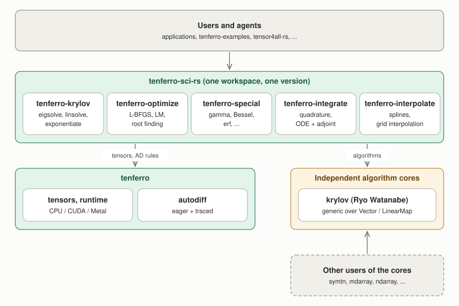

# tenferro-sci: an algorithm collection on top of tenferro

**Status:** Proposed (2026-11; special functions added 2026-11-21). The repository [tensor4all/tenferro-sci-rs](https://github.com/tensor4all/tenferro-sci-rs) exists with its rules and CI (created 2026-11-21); no crate is implemented yet.
**Scope:** a new repository `tensor4all/tenferro-sci-rs`, the existing `krylov` crate (Ryo-wtnb11/krylov-rs), and the reference data used to validate it.

NumPy became the base of Python's scientific computing partly because SciPy
was built on it: arrays alone are not enough, users also need solvers,
optimizers, special functions and integrators. tenferro is the array and
autodiff layer. This document proposes the second layer, a collection of
general numerical algorithms on top of tenferro, and fixes how it is split,
named, released and validated.

## Goals

- **CPU first.** Every algorithm runs on the CPU engine.
- **Autodiff wherever possible.** Algorithms written with tenferro operations
  get autodiff for free. Iterative solvers and optimizers get explicit rules
  by implicit differentiation, so that a gradient never has to go through the
  iterations.
- **GPU where it pays.** Elementwise special functions, large matrix-vector
  products, and many small problems solved as one batch. Adaptive or
  inherently sequential algorithms on one small problem stay on the CPU.
- **Checked against SciPy.** Reference values and derivatives are generated
  with SciPy, in the same way tensor-ad-oracles is generated with PyTorch, and
  compared numerically, not only for finiteness.
- **Easy for agents.** The crate names follow SciPy's modules, and the
  documentation carries a SciPy-to-tenferro-sci mapping table, so an agent that
  knows SciPy finds the right function.

Non-goals: a full SciPy port. Large ports exist (for example SciRS2, over four
million lines of Rust across 33 crates); breadth is not our goal. We add a
module only when it is needed, wired to autodiff where that makes sense, and
validated numerically.

## Two kinds of algorithms

* **Independent cores.** Algorithms that need only vector operations
  (Krylov methods, scalar special functions, quadrature nodes and weights,
  interpolation weights) live in pure Rust crates that do not depend on
  tenferro: krylov already exists, and the special-function core is a pure
  Rust port of SciPy's xsf (see Special functions). They
  are generic over traits such as `Vector` and `LinearMap`, so symtn, mdarray
  or ndarray users can use them too. A wider user base brings more
  contributors, as with threadteam-rs and tcontract-rs.
* **tenferro-native algorithms.** Algorithms whose value comes from autodiff
  or traced graphs (optimizers with implicit differentiation, ODE solvers with
  adjoint sensitivities, differentiable programs) are written on tenferro
  directly.

Users are drawn to tenferro by capability, not by coupling. A core works
everywhere; differentiating through it, running it on a GPU, batching it, or
compiling it once in a traced program is only available through the tenferro
crate that wraps it.

## The pattern, with krylov as the first case

[krylov](https://github.com/Ryo-wtnb11/krylov-rs) (`krylov` 0.3 on crates.io)
is modelled on KrylovKit.jl: `eigsolve`, `linsolve`, `exponentiate`,
`svdsolve`, and a preconditioned block Davidson solver. It is matrix-free and
generic over caller-defined vector types, takes a caller-held execution
context on every call, and solves its small projected problems with colmat
0.34. It already follows the tenferro conventions.

`tenferro-krylov` depends on `krylov` and adds:

1. `Vector` / `Basis` / `LinearMap` implementations for tenferro tensors, on
   CPU and GPU, with one engine per call.
2. AD rules for eigen- and linear solves by implicit differentiation, following
   the ChainRules rules of KrylovKit.jl.
3. Batched and traced use.
4. A re-export of `krylov`, so a user depends on one crate.

The other modules follow the same split when they have an independent core.

## Modules

| Crate | SciPy counterpart | Contents | Core | AD | GPU |
| --- | --- | --- | --- | --- | --- |
| `tenferro-krylov` | `sparse.linalg` (iterative part) | eigsolve, linsolve, exponentiate, svdsolve, Davidson | `krylov` | implicit differentiation | large matvecs |
| `tenferro-optimize` | `optimize` | L-BFGS, Levenberg–Marquardt, trust region, root finding | own | gradients by AD; the solution by implicit differentiation | batched problems |
| `tenferro-special` | `special` | gamma, Bessel, error functions, orthogonal polynomials | pure Rust port of SciPy's xsf | known derivative rules | xsf headers in NVRTC kernels |
| `tenferro-integrate` | `integrate` | adaptive quadrature, ODE solvers including stiff ones | own (interop with diffsol to be decided) | adjoint method | many initial values |
| `tenferro-interpolate` | `interpolate` | splines, grid interpolation, Chebyshev | own | direct | many evaluation points |

Placement notes:

* SciPy keeps its iterative solvers under `sparse.linalg`, but they are
  matrix-free and do not need sparse storage. Tensor networks use them without
  any sparse matrix, so they get their own crate, named after the method.
* Matrix functions (`expm`, `logm`, `sqrtm`, `funm`), Schur and polar
  decompositions belong in `tenferro-linalg`, not in tenferro-sci.
* FFT already lives in `tenferro-fft`. DCT/DST and signal processing can be
  added later if needed.
* Out of scope for now: `stats`, `spatial`, `ndimage`, `cluster`, `io`.

Where the material already exists:

* `tenferro-krylov`: krylov-rs; tensor4all-rs also has its own GMRES, which can
  move onto krylov later.
* `tenferro-optimize`: tenferro-examples already has Adam (`sciml-kit`),
  L-BFGS (`nonlinear-pinn`) and Levenberg–Marquardt (`pinn-gauss-newton`).
* `tenferro-integrate`: the `neural-ode` example has RK4 with a checkpointed
  discrete adjoint.

## Special functions

### Where they live

* **A few common functions in the tenferro core.** The core catalog already has
  `expm1`, `log1p` and `erf`. Candidates to join them are the functions PyTorch
  and JAX also treat as primitives, such as `erfc`, `lgamma`, `digamma` and
  `xlogy`. They follow tenferro's rule for new core ops
  (tenferro-rs `docs/design/algebra.md`, "When To Add A Core Op"): repeatedly
  useful, costly as a composition, and kept AD-closed in the catalog. In
  return they fuse with other elementwise ops and get GPU kernels in
  t4a-gpu-kernels. Their CPU kernels come from elem-simd-math (next
  subsection).
* **The long tail in `tenferro-special`.** Bessel, Airy, hypergeometric,
  elliptic, zeta and orthogonal polynomials are an operation family
  registered through `ExtensionOp`, like linalg and FFT, with their AD rules
  in the same crate. Derivatives are mostly in the same family (for example
  J'ₙ = (Jₙ₋₁ − Jₙ₊₁)/2), so higher-order AD composes.
* This mirrors JAX: `jax.lax` has erf, lgamma, digamma, igamma and a few Bessel
  functions as primitives, and `jax.scipy.special` builds the rest.

**Fusion.** An `ExtensionOp` is opaque to the elementwise fuser today, so a
chain like `bessel_j0(x) * exp(-x²) + 1` runs as two steps with one extra
intermediate array (and one extra GPU launch). This matters little for
expensive functions and more for cheap ones in long chains, which is why the
cheap ones go to the core. The longer-term fix is for an `ExtensionOp` to
declare optional capabilities that the compiler can use: "elementwise, with
this scalar body" (spliced into a fused CPU loop or GPU kernel), a
decomposition into core ops, and properties such as purity. Extensions that
declare nothing keep working as opaque ops. A public program-transform hook
(`SemanticTransform`, design tenferro-rs#1449) existed for whole-program
rewrites and was removed as unused in tenferro-rs#2689; it can come back
together with that capability design.

### The common functions: elem-simd-math

[elem-simd-math](https://github.com/tensor4all/elem-simd-math-rs) (`elem-simd-math`
0.1.2 on crates.io) is tensor4all's vectorized elementary-function library: a
port of SLEEF (through sleef-rs) to stable-Rust SIMD (`fearless_simd`), for
`f64` and `f32`, with the SLEEF license and provenance shipped. Every kernel
carries its SLEEF accuracy tier (0.5 to 3.5 ULP), asserted against MPFR in its
tests. `tenferro-cpu` already uses it (`simd_math.rs`, `activation.rs`).

It already has `erf`, `erfc`, `lgamma` and `tgamma`, besides the exponential,
logarithmic, trigonometric, hyperbolic and power functions and fused
activations. So the common functions of the core list live there, not in the
xsf port:

* **Add to elem-simd-math:** `digamma`, the exponentially scaled Bessel
  functions `i0e` and `i1e` (JAX primitives), and `xlogy`. They are used
  elementwise and often, have few branches, so they vectorize, and the MPFR ULP
  harness already exists. Their source can be xsf's Cephes code, recorded as a
  port.
* **Keep out of elem-simd-math:** the long tail (Bessel functions of general
  order, hypergeometric, elliptic, Mathieu). They take parameters such as the
  order, branch a lot, vectorize poorly, are validated against SciPy rather
  than by ULP bounds, and would blur elem-simd-math's role as the SIMD
  elementary-function crate. They go to the xsf port below, which can use
  elem-simd-math for its elementary building blocks.
* elem-simd-math also carries SLEEF's internal double-double layer
  (`doubled.rs`); its experience may be useful for colmat's double-double
  work ([next-generation-dense-linear-algebra.md](./next-generation-dense-linear-algebra.md)).

### Implementation source for the long tail: a pure Rust port of xsf

[xsf](https://github.com/scipy/xsf) is SciPy's special-function code extracted
into a header-only C++ library (BSD-3-Clause, about 50,000 lines). It contains
the Cephes, AMOS, specfun and Faddeeva implementations SciPy uses, ships
SciPy's special-function reference test data, and is written to compile for
both host and CUDA device (CuPy uses it).

* **CPU: port to pure Rust.** An independent crate, with no tenferro
  dependency, holds the scalar functions.
  - No C++ toolchain at build time, in line with tenferro's no build-time
    native dependency policy; it also runs on WASM.
  - The code can be generic over the scalar type: f32, f64 and complex first,
    later dual numbers or double-double where the algorithm allows.
  - Rust has no comprehensive special-function crate today (`special` and
    `puruspe` cover a few families, f64 only), so the crate is useful outside
    tenferro.
  - It covers what elem-simd-math does not: functions that elem-simd-math
    already has are not ported twice.
* **GPU: use the xsf headers directly.** t4a-gpu-kernels already compiles
  CUDA C++ source at run time with NVRTC, so the device code can include xsf
  unchanged, and the same should work for HIP. Metal cannot take C++ headers;
  functions are ported to MSL only when needed.
* **Port the tests first.** Move xsf's reference data, then port families in
  order of use: gamma family, error-function family, Bessel, orthogonal
  polynomials, `hyp2f1`, zeta, elliptic integrals.
* **Provenance.** A function-by-function translation is a derived work under
  the shared provenance rules: each file names its xsf source file and the xsf
  commit it was ported from (so later upstream fixes can be diffed), the
  BSD-3-Clause text ships with the crate, and the crate license is declared
  accordingly, for example `(MIT OR Apache-2.0) AND BSD-3-Clause`.
  Independently written implementations from DLMF are marked as such.
* **Other sources.** Boost.Math (BSL-1.0) for gaps, Bessels.jl (MIT) for fast
  real-order Bessel functions, the Faddeeva package (MIT). Not usable: GSL
  (GPL) and Numerical Recipes (restrictive license).
* **Reference values.** mpmath (BSD-3-Clause, arbitrary precision) as the
  ground truth, and SciPy for parity.
* **Name.** "xsf-rs" would read as a SciPy project. Use it only after asking
  the xsf maintainers, which is also a chance to coordinate with them;
  otherwise pick an independent name.

## Repository and release

* **One repository, separate crates.** [`tensor4all/tenferro-sci-rs`](https://github.com/tensor4all/tenferro-sci-rs) is one
  Cargo workspace with one crate per module. Separate crates keep compile time
  and dependencies small (only `tenferro-krylov` pulls in krylov and colmat)
  and give each module an owner. There is no facade crate, as in tenferro.
* **One version.** All crates are bumped and published together, and the
  tenferro version is set once in `[workspace.dependencies]`. Releasing crates
  one by one across repositories is what stalls dependency moves today
  (tenferro-rs#2597).
* **Separate from tenferro-rs.** tenferro-rs CI is heavy and includes the paid
  GPU gate. tenferro-sci-rs runs its own CI against released tenferro crates,
  and daily against tenferro-rs `main`, as tenferro-examples does.
* **Naming.** `tenferro-<module>`, matching `tenferro-linalg`, `tenferro-fft`
  and `tenferro-einsum`. The repository is `tenferro-sci-rs`.

## Validation

* Reference values and derivatives come from SciPy (and from finite
  differences for derivatives SciPy does not provide), stored with provenance
  as in tensor-ad-oracles.
* Every check compares values against a stated tolerance. A test that only
  checks that a result is finite does not count as validation.
* Results feed the public correctness matrix proposed in tenferro-rs#2633.
* Tests stay small and fast: fixed seeds, minimal cases.

## Order of work

1. `tenferro-krylov`: the core exists; needed by tensor networks now.
2. `tenferro-optimize`: mostly extraction from tenferro-examples.
3. `tenferro-special`: elementwise functions and their derivative rules; the
   clearest GPU case.
4. `tenferro-integrate` and `tenferro-interpolate`.

Each module is sized for one owner, for example krylov with Ryo Watanabe. New
contributors can own a module without learning tenferro's internals.

## Open questions

1. Whether `tenferro-integrate` wraps diffsol for stiff ODEs or implements its
   own solvers.
2. The capability API that lets an `ExtensionOp` take part in fusion (scalar
   body, decomposition, properties), and whether `SemanticTransform` returns
   with it.
3. Where the independent cores other than krylov live: in tenferro-sci-rs as
   tenferro-free crates, or in their own repositories.
4. The name of the pure Rust xsf port, and whether the xsf maintainers want
   to be involved.
5. How the SciPy reference data is generated and versioned: a separate
   repository like tensor-ad-oracles, or a directory in tenferro-sci-rs.
