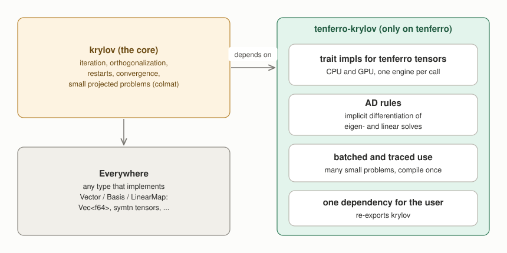
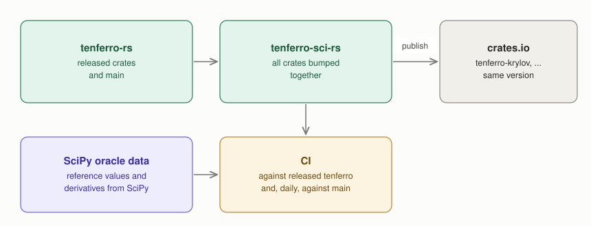

# tenferro-sci: an algorithm collection on top of tenferro

**Status:** Proposed (2026-11). Nothing is implemented yet; the repository `tenferro-sci-rs` does not exist.
**Scope:** a new repository `tensor4all/tenferro-sci-rs`, the existing `krylov` crate (Ryo-wtnb11/krylov-rs), and the reference data used to validate it.

NumPy became the base of Python's scientific computing partly because SciPy
was built on it: arrays alone are not enough, users also need solvers,
optimizers, special functions and integrators. tenferro is the array and
autodiff layer. This document proposes the second layer, a collection of
general numerical algorithms on top of tenferro, and fixes how it is split,
named, released and validated.

## Goals

- **CPU first.** Every algorithm runs on the CPU engine.
- **Autodiff wherever possible.** Algorithms written with tenferro operations
  get autodiff for free. Iterative solvers and optimizers get explicit rules
  by implicit differentiation, so that a gradient never has to go through the
  iterations.
- **GPU where it pays.** Elementwise special functions, large matrix-vector
  products, and many small problems solved as one batch. Adaptive or
  inherently sequential algorithms on one small problem stay on the CPU.
- **Checked against SciPy.** Reference values and derivatives are generated
  with SciPy, in the same way tensor-ad-oracles is generated with PyTorch, and
  compared numerically, not only for finiteness.
- **Easy for agents.** The crate names follow SciPy's modules, and the
  documentation carries a SciPy-to-tenferro-sci mapping table, so an agent that
  knows SciPy finds the right function.

Non-goals: a full SciPy port. Large ports exist (for example SciRS2, over four
million lines of Rust across 33 crates); breadth is not our goal. We add a
module only when it is needed, wired to autodiff where that makes sense, and
validated numerically.

## Two kinds of algorithms

* **Independent cores.** Algorithms that need only vector operations
  (Krylov methods, scalar special functions, quadrature nodes and weights,
  interpolation weights) live in crates that do not depend on tenferro. They
  are generic over traits such as `Vector` and `LinearMap`, so symtn, mdarray
  or ndarray users can use them too. A wider user base brings more
  contributors, as with threadteam-rs and tcontract-rs.
* **tenferro-native algorithms.** Algorithms whose value comes from autodiff
  or traced graphs (optimizers with implicit differentiation, ODE solvers with
  adjoint sensitivities, differentiable programs) are written on tenferro
  directly.

Users are drawn to tenferro by capability, not by coupling. A core works
everywhere; differentiating through it, running it on a GPU, batching it, or
compiling it once in a traced program is only available through the tenferro
crate that wraps it.

## The pattern, with krylov as the first case

[krylov](https://github.com/Ryo-wtnb11/krylov-rs) (`krylov` 0.3 on crates.io)
is modelled on KrylovKit.jl: `eigsolve`, `linsolve`, `exponentiate`,
`svdsolve`, and a preconditioned block Davidson solver. It is matrix-free and
generic over caller-defined vector types, takes a caller-held execution
context on every call, and solves its small projected problems with colmat
0.34. It already follows the tenferro conventions.

`tenferro-krylov` depends on `krylov` and adds:

1. `Vector` / `Basis` / `LinearMap` implementations for tenferro tensors, on
   CPU and GPU, with one engine per call.
2. AD rules for eigen- and linear solves by implicit differentiation, following
   the ChainRules rules of KrylovKit.jl.
3. Batched and traced use.
4. A re-export of `krylov`, so a user depends on one crate.

The other modules follow the same split when they have an independent core.

## Modules

| Crate | SciPy counterpart | Contents | Core | AD | GPU |
| --- | --- | --- | --- | --- | --- |
| `tenferro-krylov` | `sparse.linalg` (iterative part) | eigsolve, linsolve, exponentiate, svdsolve, Davidson | `krylov` | implicit differentiation | large matvecs |
| `tenferro-optimize` | `optimize` | L-BFGS, Levenberg–Marquardt, trust region, root finding | own | gradients by AD; the solution by implicit differentiation | batched problems |
| `tenferro-special` | `special` | gamma, Bessel, error functions, orthogonal polynomials | own scalar core | known derivative rules | elementwise |
| `tenferro-integrate` | `integrate` | adaptive quadrature, ODE solvers including stiff ones | own (interop with diffsol to be decided) | adjoint method | many initial values |
| `tenferro-interpolate` | `interpolate` | splines, grid interpolation, Chebyshev | own | direct | many evaluation points |

Placement notes:

* SciPy keeps its iterative solvers under `sparse.linalg`, but they are
  matrix-free and do not need sparse storage. Tensor networks use them without
  any sparse matrix, so they get their own crate, named after the method.
* Matrix functions (`expm`, `logm`, `sqrtm`, `funm`), Schur and polar
  decompositions belong in `tenferro-linalg`, not in tenferro-sci.
* FFT already lives in `tenferro-fft`. DCT/DST and signal processing can be
  added later if needed.
* Out of scope for now: `stats`, `spatial`, `ndimage`, `cluster`, `io`.

Where the material already exists:

* `tenferro-krylov`: krylov-rs; tensor4all-rs also has its own GMRES, which can
  move onto krylov later.
* `tenferro-optimize`: tenferro-examples already has Adam (`sciml-kit`),
  L-BFGS (`nonlinear-pinn`) and Levenberg–Marquardt (`pinn-gauss-newton`).
* `tenferro-integrate`: the `neural-ode` example has RK4 with a checkpointed
  discrete adjoint.

## Repository and release

* **One repository, separate crates.** `tensor4all/tenferro-sci-rs` is one
  Cargo workspace with one crate per module. Separate crates keep compile time
  and dependencies small (only `tenferro-krylov` pulls in krylov and colmat)
  and give each module an owner. There is no facade crate, as in tenferro.
* **One version.** All crates are bumped and published together, and the
  tenferro version is set once in `[workspace.dependencies]`. Releasing crates
  one by one across repositories is what stalls dependency moves today
  (tenferro-rs#2597).
* **Separate from tenferro-rs.** tenferro-rs CI is heavy and includes the paid
  GPU gate. tenferro-sci-rs runs its own CI against released tenferro crates,
  and daily against tenferro-rs `main`, as tenferro-examples does.
* **Naming.** `tenferro-<module>`, matching `tenferro-linalg`, `tenferro-fft`
  and `tenferro-einsum`. The repository is `tenferro-sci-rs`.

## Validation

* Reference values and derivatives come from SciPy (and from finite
  differences for derivatives SciPy does not provide), stored with provenance
  as in tensor-ad-oracles.
* Every check compares values against a stated tolerance. A test that only
  checks that a result is finite does not count as validation.
* Results feed the public correctness matrix proposed in tenferro-rs#2633.
* Tests stay small and fast: fixed seeds, minimal cases.

## Order of work

1. `tenferro-krylov`: the core exists; needed by tensor networks now.
2. `tenferro-optimize`: mostly extraction from tenferro-examples.
3. `tenferro-special`: elementwise functions and their derivative rules; the
   clearest GPU case.
4. `tenferro-integrate` and `tenferro-interpolate`.

Each module is sized for one owner, for example krylov with Ryo Watanabe. New
contributors can own a module without learning tenferro's internals.

## Open questions

1. Whether `tenferro-integrate` wraps diffsol for stiff ODEs or implements its
   own solvers.
2. Whether `tenferro-special` adds its functions as tenferro operations
   (traced, GPU kernels) or as a separate elementwise layer.
3. Where the independent cores other than krylov live: in tenferro-sci-rs as
   tenferro-free crates, or in their own repositories.
4. How the SciPy reference data is generated and versioned: a separate
   repository like tensor-ad-oracles, or a directory in tenferro-sci-rs.
