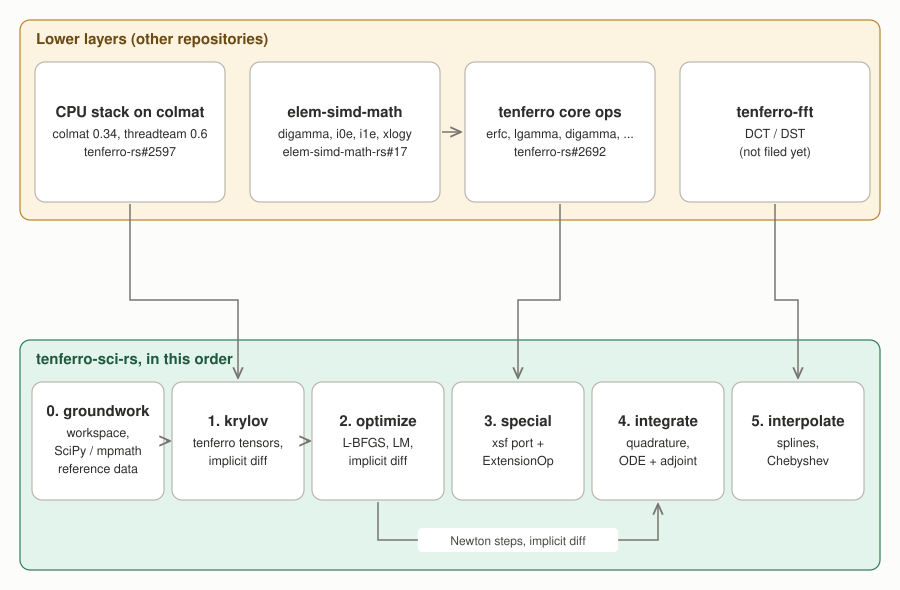

# tenferro-sci: an algorithm collection on top of tenferro

**Status:** Proposed (2026-11; special functions added 2026-11-21; optimizers added 2026-11-25; optimizer core named `minimize` 2026-11-27). The repository [tensor4all/tenferro-sci-rs](https://github.com/tensor4all/tenferro-sci-rs) exists with its rules and CI (created 2026-11-21). The first crate, the special-function core `specials` (gamma family, `f64` and double-double), is in review in [tenferro-sci-rs#6](https://github.com/tensor4all/tenferro-sci-rs/pull/6).
**Scope:** a new repository `tensor4all/tenferro-sci-rs`, the existing `krylov` crate (Ryo-wtnb11/krylov-rs), and the reference data used to validate it.

NumPy became the base of Python's scientific computing partly because SciPy
was built on it: arrays alone are not enough, users also need solvers,
optimizers, special functions and integrators. tenferro is the array and
autodiff layer. This document proposes the second layer, a collection of
general numerical algorithms on top of tenferro, and fixes how it is split,
named, released and validated.

## Goals

- **CPU first.** Every algorithm runs on the CPU engine.
- **Autodiff wherever possible.** Algorithms written with tenferro operations
  get autodiff for free. Iterative solvers and optimizers get explicit rules
  by implicit differentiation, so that a gradient never has to go through the
  iterations.
- **GPU where it pays.** Elementwise special functions, large matrix-vector
  products, and many small problems solved as one batch. Adaptive or
  inherently sequential algorithms on one small problem stay on the CPU.
- **Checked against SciPy.** Reference values and derivatives are generated
  with SciPy, in the same way tensor-ad-oracles is generated with PyTorch, and
  compared numerically, not only for finiteness.
- **Easy for agents.** The crate names follow SciPy's modules, and the
  documentation carries a SciPy-to-tenferro-sci mapping table, so an agent that
  knows SciPy finds the right function.

Non-goals: a full SciPy port. Large ports exist (for example SciRS2, over four
million lines of Rust across 33 crates); breadth is not our goal. We add a
module only when it is needed, wired to autodiff where that makes sense, and
validated numerically.

## Two kinds of algorithms


* **Independent cores.** Algorithms that need only vector operations
  (Krylov methods, scalar special functions, quadrature nodes and weights,
  interpolation weights) live in pure Rust crates that do not depend on
  tenferro: krylov already exists, the special-function core is a pure
  Rust port of SciPy's xsf (see Special functions), and the quasi-Newton
  iterations (line search, BFGS, L-BFGS) form a core too, `minimize` (see Optimizers). They
  are generic over traits such as `Vector` and `LinearMap`, so symtn, mdarray
  or ndarray users can use them too. A wider user base brings more
  contributors, as with threadteam-rs and tcontract-rs.
* **tenferro-native algorithms.** Algorithms whose value comes from autodiff
  or traced graphs (implicit differentiation of an optimizer's solution, ODE solvers with
  adjoint sensitivities, differentiable programs) are written on tenferro
  directly.

Users are drawn to tenferro by capability, not by coupling. A core works
everywhere; differentiating through it, running it on a GPU, batching it, or
compiling it once in a traced program is only available through the tenferro
crate that wraps it.

## The pattern, with krylov as the first case


[krylov](https://github.com/Ryo-wtnb11/krylov-rs) (`krylov` 0.3 on crates.io)
is modelled on KrylovKit.jl: `eigsolve`, `linsolve`, `exponentiate`,
`svdsolve`, and a preconditioned block Davidson solver. It is matrix-free and
generic over caller-defined vector types, takes a caller-held execution
context on every call, and solves its small projected problems with colmat
0.34. It already follows the tenferro conventions.

`tenferro-krylov` depends on `krylov` and adds:

1. `Vector` / `Basis` / `LinearMap` implementations for tenferro tensors, on
   CPU and GPU, with one engine per call.
2. AD rules for eigen- and linear solves by implicit differentiation, following
   the ChainRules rules of KrylovKit.jl.
3. Batched and traced use.
4. A re-export of `krylov`, so a user depends on one crate.

The other modules follow the same split when they have an independent core.

## Modules

| Crate | SciPy counterpart | Contents | Core | AD | GPU |
| --- | --- | --- | --- | --- | --- |
| `tenferro-krylov` | `sparse.linalg` (iterative part) | eigsolve, linsolve, exponentiate, svdsolve, Davidson | `krylov` | implicit differentiation | large matvecs |
| `tenferro-optimize` | `optimize` | L-BFGS, Levenberg–Marquardt, trust region, root finding | `minimize`, own pure Rust core (see Optimizers) | gradients by AD; the solution by implicit differentiation | batched problems |
| `tenferro-special` | `special` | gamma, Bessel, error functions, orthogonal polynomials | pure Rust port of SciPy's xsf | known derivative rules | xsf headers in NVRTC kernels |
| `tenferro-integrate` | `integrate` (quadrature part) | adaptive quadrature, integration of samples, Gauss nodes and weights | own | through the integrand | many integrals at once |
| `tenferro-diffsol` (deferred, see below) | `integrate` (`solve_ivp`, `odeint`) | ODE and DAE solvers, stiff and non-stiff | [diffsol](https://github.com/martinjrobins/diffsol) | adjoint (VJP), forward sensitivities (JVP) | many initial values or parameters |
| `tenferro-interpolate` | `interpolate` | splines, grid interpolation, Chebyshev | own | direct | many evaluation points |
| `tenferro-fft` (moves here from tenferro-rs, see below) | `fft` | FFT, real FFT, DCT/DST | RustFFT, RealFFT; cuFFT on GPU | linear (transpose rules) | cuFFT |
| `tenferro-einsum` (moves here from tenferro-rs, see below) | — (NumPy's `einsum`) | einsum, tensordot, contraction-order planning | `dot_general` of tenferro | linear in each operand | through `dot_general` |
| `tenferro-ext-tropical` (moves here from tenferro-rs) | — | tropical semiring tensors and einsum | own kernels | tropical AD rules | none |
| `tenferro-sparse` (deferred, see below) | `sparse` (BSR) | sector-free block-sparse tensors over a dense payload | cpueinsum's block-sparse contraction (cpueinsum-rs#81) | block-sparse contractions with exchanged patterns | cuTENSOR block-sparse (later) |

Placement notes:

* SciPy keeps its iterative solvers under `sparse.linalg`, but they are
  matrix-free and do not need sparse storage. Tensor networks use them without
  any sparse matrix, so they get their own crate, named after the method.
* Matrix functions (`expm`, `logm`, `sqrtm`, `funm`), Schur and polar
  decompositions belong in `tenferro-linalg`, not in tenferro-sci.
* FFT moves from tenferro-rs into this repository as `tenferro-fft`, the
  counterpart of `scipy.fft` (see "Public API only" below). DCT/DST is added
  there; signal processing can follow if needed.
* `tenferro-einsum` also moves here, once it is written on the public API
  (decided 2026-11-23, replacing the earlier decision to keep it in
  tenferro-rs). The reasons given for keeping it did not hold: `tenferro-xla`
  uses it only in three integration tests (a dev-dependency), which move to
  `tenferro-einsum`, and `ext/tropical` moves here as well. Being close to the
  core is not a reason by itself: einsum is planning plus `dot_general`, which
  is public.
* `ext/tropical` (`tenferro-ext-tropical`) moves here with einsum. It uses only
  einsum's public API (`Subscripts`, `ContractionTree`, `lowering::GemmPlan`,
  `Error`).
* `tenferro-sparse` (decided 2026-11-25, deferred) holds a block-sparse tensor
  type without quantum numbers: section extents and non-zero block coordinates
  in cuTENSOR's model, over a dense tenferro payload. It is built only after
  cpueinsum-rs#81 exists and a user needs it; quantum numbers stay in symtn or
  other tensor network libraries. See
  [symmetric tensors](./symmetric-tensors-and-symtn.md) §3.2.
* Out of scope for now: `stats`, `spatial`, `ndimage`, `cluster`, `io`.

Where the material already exists:

* `tenferro-krylov`: krylov-rs; tensor4all-rs also has its own GMRES, which can
  move onto krylov later.
* `tenferro-optimize`: tenferro-examples already has Adam (`sciml-kit`),
  L-BFGS (`nonlinear-pinn`) and Levenberg–Marquardt (`pinn-gauss-newton`).
* `tenferro-diffsol`: the `neural-ode` example has RK4 with a checkpointed
  discrete adjoint, a reference to compare against.

Placement of the ODE solvers. SciPy keeps `solve_ivp`, `odeint` and
`solve_bvp` in `scipy.integrate` next to quadrature. Here they go to their own
crate named after its core, as `tenferro-krylov` is named after krylov
(`scipy.sparse.linalg` in SciPy). `tenferro-integrate` stays quadrature only,
so a user of quadrature does not pull in diffsol and its linear algebra; the
SciPy-to-tenferro-sci table points `solve_ivp` to `tenferro-diffsol`.

## Special functions

### Where they live

* **A few common functions in the tenferro core.** The core catalog already has
  `expm1`, `log1p` and `erf`. Candidates to join them are the functions PyTorch
  and JAX also treat as primitives, such as `erfc`, `lgamma`, `digamma` and
  `xlogy`. They follow tenferro's rule for new core ops
  (tenferro-rs `docs/design/algebra.md`, "When To Add A Core Op"): repeatedly
  useful, costly as a composition, and kept AD-closed in the catalog. In
  return they fuse with other elementwise ops and get GPU kernels in
  t4a-gpu-kernels. Their CPU kernels come from elem-simd-math (next
  subsection).
* **The long tail in `tenferro-special`.** Bessel, Airy, hypergeometric,
  elliptic, zeta and orthogonal polynomials are an operation family
  registered through `ExtensionOp`, like linalg and FFT, with their AD rules
  in the same crate. Derivatives are mostly in the same family (for example
  J'ₙ = (Jₙ₋₁ − Jₙ₊₁)/2), so higher-order AD composes.
* This mirrors JAX: `jax.lax` has erf, lgamma, digamma, igamma and a few Bessel
  functions as primitives, and `jax.scipy.special` builds the rest.

**Fusion.** An `ExtensionOp` is opaque to the elementwise fuser today, so a
chain like `bessel_j0(x) * exp(-x²) + 1` runs as two steps with one extra
intermediate array (and one extra GPU launch). This matters little for
expensive functions and more for cheap ones in long chains, which is why the
cheap ones go to the core. The longer-term fix is for an `ExtensionOp` to
declare optional capabilities that the compiler can use: "elementwise, with
this scalar body" (spliced into a fused CPU loop or GPU kernel), a
decomposition into core ops, and properties such as purity. Extensions that
declare nothing keep working as opaque ops. A public program-transform hook
(`SemanticTransform`, design tenferro-rs#1449) existed for whole-program
rewrites and was removed as unused in tenferro-rs#2689; it can come back
together with that capability design.

### The common functions: elem-simd-math

[elem-simd-math](https://github.com/tensor4all/elem-simd-math-rs) (`elem-simd-math`
0.1.2 on crates.io) is tensor4all's vectorized elementary-function library: a
port of SLEEF (through sleef-rs) to stable-Rust SIMD (`fearless_simd`), for
`f64` and `f32`, with the SLEEF license and provenance shipped. Every kernel
carries its SLEEF accuracy tier (0.5 to 3.5 ULP), asserted against MPFR in its
tests. `tenferro-cpu` already uses it (`simd_math.rs`, `activation.rs`).

It already has `erf`, `erfc`, `lgamma` and `tgamma`, besides the exponential,
logarithmic, trigonometric, hyperbolic and power functions and fused
activations. So the common functions of the core list live there, not in the
xsf port:

* **Add to elem-simd-math:** `digamma`, the exponentially scaled Bessel
  functions `i0e` and `i1e` (JAX primitives), and `xlogy`. They are used
  elementwise and often, have few branches, so they vectorize, and the MPFR ULP
  harness already exists. Their source can be xsf's Cephes code, recorded as a
  port.
* **Keep out of elem-simd-math:** the long tail (Bessel functions of general
  order, hypergeometric, elliptic, Mathieu). They take parameters such as the
  order, branch a lot, vectorize poorly, are validated against SciPy rather
  than by ULP bounds, and would blur elem-simd-math's role as the SIMD
  elementary-function crate. They go to the xsf port below, which can use
  elem-simd-math for its elementary building blocks.
* elem-simd-math also carries SLEEF's internal double-double layer
  (`doubled.rs`); its experience may be useful for colmat's double-double
  work ([next-generation-dense-linear-algebra.md](./next-generation-dense-linear-algebra.md)).

### Implementation source for the long tail: a pure Rust port of xsf

[xsf](https://github.com/scipy/xsf) is SciPy's special-function code extracted
into a header-only C++ library (BSD-3-Clause, about 50,000 lines). It contains
the Cephes, AMOS, specfun and Faddeeva implementations SciPy uses, ships
SciPy's special-function reference test data, and is written to compile for
both host and CUDA device (CuPy uses it).

* **CPU: port to pure Rust.** An independent crate, with no tenferro
  dependency, holds the scalar functions.
  - No C++ toolchain at build time, in line with tenferro's no build-time
    native dependency policy; it also runs on WASM.
  - The code is generic over the scalar type, and double-double
    (`xprec::Df64`) is supported from the start (see below).
  - Rust has no comprehensive special-function crate today (`special` and
    `puruspe` cover a few families, f64 only), so the crate is useful outside
    tenferro.
  - It covers what elem-simd-math does not: functions that elem-simd-math
    already has are not ported twice.
* **GPU: use the xsf headers directly.** t4a-gpu-kernels already compiles
  CUDA C++ source at run time with NVRTC, so the device code can include xsf
  unchanged, and the same should work for HIP. Metal cannot take C++ headers;
  functions are ported to MSL only when needed.
* **Port the tests first.** Move xsf's reference data, then port families in
  order of use: gamma family, error-function family, Bessel, orthogonal
  polynomials, `hyp2f1`, zeta, elliptic integrals.
* **Provenance.** A function-by-function translation is a derived work under
  the shared provenance rules: each file names its xsf source file and the xsf
  commit it was ported from (so later upstream fixes can be diffed), the
  BSD-3-Clause text ships with the crate, and the crate license is declared
  accordingly, for example `(MIT OR Apache-2.0) AND BSD-3-Clause`.
  Independently written implementations from DLMF are marked as such.
* **Other sources.** Boost.Math (BSL-1.0) for gaps, Bessels.jl (MIT) for fast
  real-order Bessel functions, the Faddeeva package (MIT). Not usable: GSL
  (GPL) and Numerical Recipes (restrictive license).
* **Reference values.** mpmath (BSD-3-Clause, arbitrary precision) as the
  ground truth, and SciPy for parity.
* **Name.** The crate is `specials`, a neutral name that does not read as a
  SciPy project ("xsf-rs" would). It lives in tenferro-sci-rs as a
  tenferro-free crate (`crates/specials`) and shares the workspace's single
  version and reference-data machinery.

### Double-double: two strategies chosen by the scalar type

Cephes' rational approximations are fitted to `f64`: their coefficients are
good to about 1e-16 and no further, so making the ported code generic does not
give double-double accuracy. `specials` therefore has one public API,
`fn f<T: Real>(x: T) -> T`, and two implementations, selected at compile time
by `Real::STRATEGY`:

* **`f64` (`F64Kernels`)**: the close port of xsf. Results agree with
  `scipy.special` to within a few ulp.
* **`xprec::Df64` (`Adaptive`)**: algorithms written independently from DLMF
  (series, asymptotic expansions and recurrences truncated at the type's
  epsilon), with double-double constant tables (Bernoulli numbers, ζ(k)−1,
  Taylor coefficients of ψ about its zeros) generated by mpmath. Where a
  function has a zero, a series about that zero keeps the result relatively
  accurate.

Both strategies return the same non-finite values (SciPy's conventions at
poles, signed zeros and infinities), and both are tested against the same
mpmath points; `f64` also against SciPy. In the gamma family the double-double
path reaches relative errors of 1e-29 to 1e-31. A new scalar type (f32, a
dual number) picks a strategy: `F64Kernels` evaluates in `f64` and rounds,
`Adaptive` needs only `num_traits::Float` and the tables.

Two properties of `xprec::Df64` shape the code: an infinite operand turns
arithmetic into NaN (the error term computes inf − inf), so overflow and pole
paths go through IEEE-correct helpers; and below about 1e-292 the low word is
subnormal, so double-double precision degrades to `f64` there.

### Side by side with few_special_functions

[few_special_functions](https://github.com/MartinMikkelsen/few_special_functions)
(f64 only, MIT) has families that xsf does not: Fermi-Dirac and Bose-Einstein,
Clausen, Debye, Coulomb, Whittaker and Marcum Q. It overlaps xsf for Dawson,
Fresnel, Voigt and the parabolic cylinder functions. The two crates stay
independent and `tenferro-special` depends on both:

* **No edge between the two libraries.** The target: `few_special_functions`
  stays independent, and the `specials` core does not depend on it. Each crate
  is then usable on its own, and no core -> few edge blocks the other
  direction: few_special_functions can reuse the core's gamma, digamma, zeta
  and Kummer functions, which it carries as `pub(crate)` copies today. Until
  `tenferro-special` exists, `specials` re-exports the few_special_functions
  families itself (tenferro-sci-rs#22); `specials` drops that dependency when
  `tenferro-special` lands.
* **One name per function.** For an overlapping function, `tenferro-special`
  picks one implementation after an mpmath comparison and exposes one name.
  The other stays available in its own crate. (While `specials` carries the
  re-export, the few_special_functions copy is reachable there too; the one
  name rule applies from `tenferro-special` on.)
* **The pin.** `few_special_functions = "=0.2.1"` in `[workspace.dependencies]`,
  for every family. 0.2.1 is source-compatible with 0.2.0: `phi_dot`, `psi`
  and `i` keep their `step` argument and ignore it. So one pin covers every
  family, with no per-function feature sets. Some families have
  `num_complex::Complex64` in their signatures, so `tenferro-special` keeps to
  the same `num-complex` 0.4.
* **Error conventions.** A plain function returns NaN when a numerical
  failure (non-convergence) occurs; an infinite value stays infinite. Each function that
  iterates also has a `*_checked` form, which returns `Result` with a
  `#[non_exhaustive]` `SpecialError`. The error stays numeric (non-convergence
  today; overflow or underflow only if a family needs them). `NoConvergence` carries no
  payload, or only the family and the iteration cap. Variant parameters are
  types (an enum for Clausen order), so "invalid parameter" is not an error variant. A NaN at a point the docs call
  in-domain is a test failure; each iterating family also has a test with a
  small iteration cap that returns `NoConvergence`, with the plain function
  returning NaN on the same input.
* **Accuracy evidence.** The PR that wraps a family carries one small
  precision table (the mpmath comparison), so the pin and the accuracy claim
  land together. Known state for Coulomb: `F`, `G` and `H±` reach 4.7e-13
  (1092 points); `phi_dot`, `psi` and `i` have median 2e-14 and worst 2e-10 at
  rho = 5, from cancellation in the Kummer series. The complex `psi` and `i`
  have mpmath tables; the complex-argument `f`, `g` and `h±` do not yet; that is a follow-up,
  not a blocker.
  The f64-only limit (no `Df64`) is also a follow-up.

## Optimizers

**Proposed (2026-11-25).** The first algorithms are a line search, L-BFGS and
BFGS. Levenberg–Marquardt, trust region and Newton–CG come after
`tenferro-krylov`, because they need Hessian-vector products and a matrix-free
linear solve.

### First algorithms

| Order | Algorithm | Why |
| --- | --- | --- |
| 1 | Line search for the strong Wolfe conditions (More–Thuente or Hager–Zhang) | How robust a quasi-Newton method is depends mostly on its line search; the BFGS update itself is a few dozen lines |
| 2 | L-BFGS (two-loop recursion) | The main target: large n and tensor-valued parameters |
| 3 | BFGS (dense inverse Hessian, O(n²) memory) | Small problems, and a reference for L-BFGS tests: with memory m at least the number of iterations, both take the same path |

### Split into a core and a tenferro crate

The iteration needs only vector operations, so it lives in an independent
core that does not depend on tenferro, like krylov. It is generic over a
`Vector` trait with the operations krylov uses (axpy, scale, dot, norm) and
takes a caller-held execution context on every call. Workspace is allocated
when the state is created; an iteration allocates nothing.

The core is `minimize` (decided 2026-11-27), a tenferro-free crate in this
workspace (`crates/minimize`), as `specials` is. The name follows
`scipy.optimize.minimize`: the core covers unconstrained minimization, and
`tenferro-optimize` covers the rest of `scipy.optimize`. The convenience driver
is then `minimize::minimize`, as in SciPy.

* **The line search is a module, not a crate.** `minimize::linesearch` works on
  the scalar φ(α) and φ'(α) only and does not use the `Vector` trait, so it
  lands first ([tenferro-sci-rs#38](https://github.com/tensor4all/tenferro-sci-rs/issues/38),
  a port of SciPy's Moré–Thuente `DCSRCH`) before the trait is settled.
* **No crate of its own for the line search.** Few users want a line search
  without the optimizer around it, and its value (parity with SciPy's
  `DCSRCH`, and the committed reference data) reaches them through `minimize`
  just as well. A module with no dependencies splits out cheaply if that demand
  appears.

`tenferro-optimize` adds the tenferro parts:

* `Vector` for tenferro tensors, and gradients by AD.
* L-BFGS in the compact representation (Byrd, Nocedal and Schnabel 1994):
  the stored pairs are two n×m tensors S and Y, so the two-loop recursion
  becomes matrix-vector products plus an m×m problem. It goes through tenferro
  instead of handwritten loops, and runs on the GPU.
* Implicit differentiation of the solution. For x\*(θ) = argmin f(x, θ),
  dx\*/dθ = −H⁻¹ ∂²f/∂x∂θ, solved with `tenferro-krylov`'s `linsolve` on
  Hessian-vector products (forward over reverse). The L-BFGS pairs from the
  forward solve can precondition that solve. Gradients never go through the
  iterations.
* Batched and traced use (below).

### Configuration and state

* **Configuration is separate and immutable.** Memory length, tolerances,
  iteration limits and line-search parameters are a `Config` passed to every
  call. The state holds none of them.
* **The state owns the iterate.** It holds x, f(x), ∇f(x), the (s, y) pairs
  and the line search in progress. Optax's form, where the parameters are
  passed in from outside (`update(grad, state, params)`), fits first-order
  methods such as Adam but not L-BFGS: a line search evaluates the objective
  several times per step, and a curvature pair is valid only if x and the
  gradient belong together. Keeping them in one place removes the bug of
  updating x without its gradient.
* **The state is plain data.** It contains no closure and no reference to the
  objective, can be cloned for checkpoints, and has a fixed layout (the pairs
  are a ring buffer of m preallocated vectors, or the n×m tensors S and Y).
  When tenferro has `while_loop` (tenferro-rs#2691), the same state becomes the
  loop carry of a traced optimizer without redesign.

### Interface: ask and tell

The primary interface hands every evaluation back to the caller (reverse
communication), not a closure the optimizer calls:

```rust
pub enum Step<'a, V> {
    Evaluate { x: &'a V },      // caller computes f(x) and the gradient, then calls tell
    Converged(Termination),     // GradTol, FTol, MaxIter, LineSearchFailed, ...
}

impl<V: Vector> LbfgsState<V> {
    pub fn new(cfg: &LbfgsConfig<V::Real>, ctx: &mut V::Ctx, x0: V) -> Self;
    pub fn ask(&self) -> Step<'_, V>;
    pub fn tell(&mut self, cfg: &LbfgsConfig<V::Real>, ctx: &mut V::Ctx, f: V::Real, grad: &V);
}

// A convenience driver is a thin loop over ask and tell.
pub fn minimize<V, F>(f: F, x0: V, cfg: &LbfgsConfig<V::Real>, ctx: &mut V::Ctx) -> Report<V>
where
    F: FnMut(&mut V::Ctx, &V, &mut V) -> V::Real;
```

* The caller evaluates however it wants: a tenferro program on the GPU, a
  batch of problems, an MPI reduction, or an asynchronous job. The optimizer
  never borrows the objective.
* Each transition can be tested on its own with fixed inputs, and the reason
  for stopping is an enum in the returned report, never a panic.
* For agents: names follow SciPy and Optim.jl, and doc comments cite the
  algorithm numbers of Nocedal and Wright, *Numerical Optimization*, so an
  implementation can be checked line by line against its source.

### Material and validation

* L-BFGS starts from the `nonlinear-pinn` example in tenferro-examples, with
  provenance recorded.
* Solutions are compared with `scipy.optimize.minimize` (`BFGS`, `L-BFGS-B`)
  on small fixed problems (Rosenbrock, quadratics) with a stated tolerance.
  Iteration counts are not compared with SciPy, since they depend on line
  search details. Exact properties are asserted instead, for example that BFGS
  with an exact line search finishes a quadratic in n steps.
* The derivative of the solution is checked against finite differences of the
  solution with respect to θ.

## Public API only

Every crate in tenferro-sci-rs is written against tenferro's public API, and
so is every operation family in tenferro-rs outside the core, including
`tenferro-einsum` and `tenferro-fft`. Dependencies on tenferro's internal
crates (`tenferro-internal-*`, implementation crates such as
`tenferro-cpu-basic`) and on `#[doc(hidden)]` items are forbidden, and checked
mechanically: `scripts/check-crate-boundaries.py` in tenferro-rs, and a
`cargo tree` check in tenferro-sci-rs's CI. An exception names its reason in
the check.

The rule decides where a family lives: a family that can be written with the
public API (plus extension ops with sub-programs, tenferro-rs#2691) does not
need to be in tenferro-rs. Random numbers are an exception, kept in tenferro-rs because they are
generated by kernels on the device and appear as primitives in traced programs
(see [`random.md`](./random.md)). It also makes the standard families the first
external users of the extension API, so its gaps appear there first.

Today the standard families still step outside the public API
([tenferro-rs#2694](https://github.com/tensor4all/tenferro-rs/issues/2694),
checked at tenferro-rs `dda23f4b`):

| What | Used by | Why it is used |
| --- | --- | --- |
| `tenferro-internal-ops` in `Cargo.toml` | einsum, fft, `ext/sparse`, `ext/tropical` | only to enable its `autodiff` and `cuda` features; no source file uses the crate |
| `tenferro_cpu_basic::PooledUninitOutput` | einsum | an uninitialized output from the engine's buffer pool |
| hidden `CudaEngine`, `CudaRuntime`, `CudaRuntimeIdentity`, `cuda::raw` | fft (8 files), einsum (2 files) | calling cuFFT on the engine's stream with device pointers, keying the plan cache, recognizing a CUDA engine |

tenferro-rs#2694 fixes them in order: public crates forward the `autodiff` and
`cuda` features; extensions get pooled outputs from a public surface; a public
**GPU window** lets an extension call a vendor library (cuFFT, cuBLAS,
cuSOLVER) on the engine's stream with device pointers and a cache key, without
breaking the explicit-device rules; then the ban is enforced. The GPU window is
also what tenferro-sci-rs's own GPU paths (`tenferro-krylov`,
`tenferro-special`) need.

**Moving `tenferro-einsum` and `ext/tropical`.** The same steps apply
(einsum uses `PooledUninitOutput` and the hidden CUDA items too). Before the
move, in tenferro-rs:

* The `tenferro-xla` integration tests that build an n-ary einsum
  (`stablehlo_lowering.rs`, `pjrt_execution.rs`, `xla_tool_execution.rs`)
  move to `tenferro-einsum`, which takes `tenferro-xla` as a dev-dependency.
  `tenferro-xla` keeps a test with an extension op defined in the test, to
  check that extension ops lower to standard StableHLO ops.
* tenferro-rs guides and tutorial code that use einsum (about 40 files under
  `docs/`, including the tropical-extension tutorial) either move with the
  crates or switch to `dot_general`; tenferro-rs keeps one extension example
  of its own.

Then `tenferro-einsum` and `tenferro-ext-tropical` move with their names
unchanged, so downstream users (tensor4all-rs, tenferro-examples) only see a
new repository. Their GPU path needs the same GPU validation in
tenferro-sci-rs as cuFFT.

**Moving `tenferro-fft`.** After those steps, and once tenferro-sci-rs can
validate cuFFT on a GPU (tenferro-rs's local A100 gate has no counterpart here
yet), `tenferro-fft` moves to tenferro-sci-rs. The crate name stays, so its
users (tenferro-examples `nonlinear-pinn` and `ipt-dmft`) only see a new
repository; its version joins tenferro-sci-rs's single version, and the FFT
guide moves with it. DCT/DST
([tenferro-rs#2693](https://github.com/tensor4all/tenferro-rs/issues/2693))
lands after the move.

## Repository and release


* **One repository, separate crates.** [`tensor4all/tenferro-sci-rs`](https://github.com/tensor4all/tenferro-sci-rs) is one
  Cargo workspace with one crate per module. Separate crates keep compile time
  and dependencies small (only `tenferro-krylov` pulls in krylov and colmat)
  and give each module an owner. There is no facade crate, as in tenferro.
* **One version.** All crates are bumped and published together, and the
  tenferro version is set once in `[workspace.dependencies]`. Releasing crates
  one by one across repositories is what stalls dependency moves today
  (tenferro-rs#2597).
* **Separate from tenferro-rs.** tenferro-rs CI is heavy and includes the paid
  GPU gate. tenferro-sci-rs runs its own CI against released tenferro crates,
  and daily against tenferro-rs `main`, as tenferro-examples does.
* **Naming.** `tenferro-<module>`, matching `tenferro-linalg` and
  `tenferro-einsum`; `tenferro-fft`, `tenferro-einsum` and
  `tenferro-ext-tropical` keep their names when they move here. The repository is `tenferro-sci-rs`.

## Validation

* Reference values and derivatives come from SciPy (and from finite
  differences for derivatives SciPy does not provide), stored with provenance
  as in tensor-ad-oracles.
* Every check compares values against a stated tolerance. A test that only
  checks that a result is finite does not count as validation.
* Results feed the public correctness matrix proposed in tenferro-rs#2633.
* Tests stay small and fast: fixed seeds, minimal cases.

## Order of work

The order follows the dependencies: a crate starts when what it stands on is
ready, both inside tenferro-sci-rs and in the layers below it.



### Prerequisites in other repositories

| Prerequisite | Where | Needed by | Why |
| --- | --- | --- | --- |
| Sub-programs in traced graphs: recorded programs, extension ops that run a sub-program, AD through them, then `cond` / `scan` / `while_loop` | [tenferro-rs#2691](https://github.com/tensor4all/tenferro-rs/issues/2691) (its order: F5 recording API; F1–F3 with extension ops as first consumer; F4 AD; then `scan`, `cond`, `while_loop`) | `tenferro-krylov` from its second step on ([tenferro-sci-rs#3](https://github.com/tensor4all/tenferro-sci-rs/issues/3)): recording needs F5, solve ops F1–F3, AD rules F4; then optimize and integrate | a solver calls a user-supplied operator many times; that operator is a recorded tenferro program the solver op must carry, run on the caller's engine, and differentiate |
| The CPU stack on colmat 0.34 and threadteam 0.6 | [tenferro-rs#2597](https://github.com/tensor4all/tenferro-rs/issues/2597): publish tcontract 0.13, move tlinalg, then tenferro-rs | the first release of `tenferro-krylov` and everything after (development can start before it) | krylov already uses colmat 0.34 while tenferro-rs still pins `t4a-faer` 0.33 and threadteam 0.5.1. Two copies would build, but the stack is meant to have one faer and one threadteam, and threadteam 0.5.1 also pins every worker of a second engine on one CPU. |
| `digamma`, `i0e`, `i1e`, `xlogy` in elem-simd-math | [elem-simd-math-rs#17](https://github.com/tensor4all/elem-simd-math-rs/issues/17), then a release | tenferro core ops | the CPU kernels of the core ops |
| Core ops `erfc`, `lgamma`, `digamma`, `i0e`, `i1e`, `xlogy` | [tenferro-rs#2692](https://github.com/tensor4all/tenferro-rs/issues/2692) (`erfc` and `lgamma` can go first) | `tenferro-special` | the AD rules of the long tail are written with these functions, and losses and distributions use them directly |
| Extensions on the public API only; a public GPU window; then `tenferro-fft`, `tenferro-einsum` and `ext/tropical` move here | [tenferro-rs#2694](https://github.com/tensor4all/tenferro-rs/issues/2694) | every crate here (the ban), GPU paths of krylov and special (the GPU window), `tenferro-fft` and DCT/DST, `tenferro-einsum`, `tenferro-ext-tropical` | see "Public API only" |
| DCT / DST in `tenferro-fft` | [tenferro-rs#2693](https://github.com/tensor4all/tenferro-rs/issues/2693), landing after the move | `tenferro-interpolate` (Chebyshev) | Chebyshev coefficients are a DCT of the samples; tenferro-fft has none today |

### Inside tenferro-sci-rs

0. **Groundwork.** The root `Cargo.toml` (workspace, tenferro pins, MSRV) and
   the reference-data machinery: the committed script that generates SciPy and
   mpmath values and derivatives, and the test helpers that compare against
   them with a stated tolerance. Every later crate depends on this, so it comes
   first, even before the first algorithm.
1. **`tenferro-krylov`.** The design is in tenferro-sci-rs#3: the operator is
   a closure recorded once with symbolic shapes, each solve is one extension op
   that carries it, and implicit differentiation is written with tenferro ops
   so jvp, vjp and higher order compose. Its steps wait for different things:

   | Step | Waits for |
   | --- | --- |
   | No-AD path: tenferro tensors as krylov vectors, forward tests | nothing: krylov 0.4.0 (colmat 0.34, no `lapack`, MSRV 1.96) is released |
   | Recording the operator | tenferro-rs#2691 F5 |
   | Solve ops running the operator | tenferro-rs#2691 F1–F3 |
   | AD rules | tenferro-rs#2691 F4 |
   | First release | tenferro-rs#2597, so the graph has one faer (colmat) and one threadteam |

   Until tenferro-rs#2597 lands, `tenferro-krylov` carries both colmat (through
   krylov) and `t4a-faer` (through tenferro). That builds, and the two never
   exchange types, since krylov uses colmat only for its small projected
   problems.
2. **`tenferro-optimize`.** After krylov: differentiating the solution of an
   optimization problem by the implicit function theorem needs a linear solve
   with the Hessian, which `tenferro-krylov` provides matrix-free. The
   optimizers themselves (L-BFGS, Levenberg–Marquardt) are mostly extracted
   from tenferro-examples. The pure Rust core (line search, BFGS, L-BFGS; see
   Optimizers) depends on nothing in tenferro and can start now; only the
   implicit differentiation waits for krylov.
3. **`tenferro-special`.** Needs the core ops (tenferro-rs#2692). The pure
   Rust xsf port can start earlier, tests first, because it does not depend on
   tenferro. Martin Mikkelsen's existing special-function code (Rust and Julia)
   is a candidate to merge or port (tenferro-sci-rs#2).
4. **`tenferro-integrate`.** Quadrature. Gauss quadrature nodes come from an
   eigenproblem (Golub–Welsch), which `tenferro-linalg` already provides.
   The ODE solvers are not in this step: `tenferro-diffsol` is deferred (see
   "ODE solvers: tenferro-diffsol, deferred").
5. **`tenferro-interpolate`.** Splines need only banded solves from
   `tenferro-linalg`; Chebyshev interpolation waits for DCT in `tenferro-fft`.

Steps 1 and 3 do not depend on each other and can run in parallel with
different owners, as can the xsf port and anything that waits only on a lower
layer.

### Sub-programs in tenferro are a prerequisite

Today tenferro's traced programs are one flat, acyclic list: there is no
`cond`, `scan` or `while_loop`, and an extension op cannot run another program
from inside its execution. tenferro-sci-rs is designed on the assumption that
[tenferro-rs#2691](https://github.com/tensor4all/tenferro-rs/issues/2691)
removes both limits:

* **Solvers as extension ops with sub-programs.** A Krylov solve, an optimizer
  or an ODE solver is one `ExtensionOp` that carries the user's operator or
  right-hand side as a recorded sub-program, runs it on the caller's engine
  without allocating per call, and differentiates through it. This is the
  tenferro counterpart of JAX's `custom_linear_solve` / `custom_root`.
* **Implicit differentiation, not differentiation through iterations.** The AD
  rule of a solver op is written with tenferro operations (the solve itself and
  the sub-program's own jvp/vjp programs), so jvp, vjp and higher order
  compose; tenferro's linearize/transpose AD has no place for an opaque custom
  VJP.
* **Control flow for the rest.** Algorithms with a fixed number of steps (a
  fixed-step ODE integrator, a fixed number of optimizer iterations) can be
  written with `scan` once it exists, and stay reverse-differentiable.

Until the needed parts of tenferro-rs#2691 land, a crate that depends on them
waits or stays on its branch, following tenferro-sci-rs's rule that
tenferro's gaps are fixed in tenferro-rs, not worked around here.

Each module is sized for one owner, for example krylov with Ryo Watanabe. New
contributors can own a module without learning tenferro's internals.

## ODE solvers: tenferro-diffsol, deferred

**Decision (2026-11-25).** ODE solvers come from
[diffsol](https://github.com/martinjrobins/diffsol) (MIT), wrapped by a crate
`tenferro-diffsol`, following the krylov pattern. diffsol already has BDF,
SDIRK (TR-BDF2, ESDIRK34), Tsit5, DAEs with a mass matrix, events, forward
sensitivities and a checkpointed adjoint; writing and validating stiff solvers
and an adjoint ourselves would cost far more. **The crate is not started
now.** Checked at diffsol `8b0012c` (2026-11-24).

**Conditions to start.** Both:

* colmat is usable as diffsol's linear algebra (below). diffsol-la depends on
  faer, which is slower than colmat for the dense LU of a stiff solve.
* A user needs it. This follows the tenferro-sci rule of adding a module when
  it is needed, not porting an ODE suite in advance.

**Changes needed in diffsol (upstream).**

1. Make the linear-algebra dependencies optional. diffsol-la has `nalgebra` and
   `faer` features, but depends on `nalgebra` and `faer-traits`
   unconditionally, and on `faer` with its `rayon` feature on every non-wasm
   target. tenferro-diffsol wants neither nalgebra nor a second thread pool
   next to threadteam.
2. A colmat backend in diffsol-la (`Matrix`, `LinearSolver`), contributed
   upstream, sequential only (see "Parallelism").
3. Fallible callbacks. The closures given to `OdeBuilder` return `()`; a
   tenferro program returns `Result`, so an error could only leave by panic.
4. Later, if needed: a dense Jacobian callback, so that a batched JVP (one
   vmap) replaces the n JVP calls of the coloring path; complex scalars
   (`Scalar` requires `Signed + PartialOrd` today; until then a complex ODE is
   split into real and imaginary parts).

**Boundary.** diffsol's closure API works on host slices
(`Fn(&[T] y, &[T] p, T t, ..., &mut [T])`), so tenferro tensors do not
implement diffsol's `Vector` trait (about 40 methods, many element-wise). The
state stays in diffsol's own vectors and is copied at the op boundary. The
user writes the right-hand side `f(y, t, p)` with tenferro; it is recorded
once (tenferro-rs#2691) together with its JVP and its VJPs in `y` and `p`, and
the four programs are handed to diffsol (`rhs_adjoint_implicit`). Calling a
recorded program from the host many times must be cheap, since a small ODE
evaluates `f` tens of thousands of times; if it is not, that is fixed in
tenferro-rs.

**Minimal scope.** `odeint(f, y0, p, ts, method, rtol, atol) -> Y[ts]` with
BDF (stiff) and Tsit5 (non-stiff), `f64`, dense LU. SDIRK, DAEs, events,
output functions and DiffSL come later. Validation against SciPy `solve_ivp`
and closed forms (exponential decay, Robertson), with stated tolerances.

**Differentiation.** One solve is one `ExtensionOp` with inputs `y0`, `p` and
output `Y[ts]`. Its linearization is a forward-sensitivity op (diffsol's
`solve_dense_sensitivities`), linear in the tangents of `y0` and `p`; the
transpose of that op is the adjoint solve (`solve_with_checkpointing`, then
`solve_adjoint_backwards_pass(t_eval, dgdu_eval)`, which takes a cotangent at
each output time and so matches the op's cotangent `Ȳ[ts]` directly). The
gradient is that of the continuous adjoint, accurate to the solver tolerances,
which the docs state. Out of scope: higher order, derivatives with respect to
`t0` and `ts`.

**Parallelism.** colmat passes parallelism explicitly: `Par<'team>` is a
borrowed, exclusive token, neither `Copy` nor `Clone`. diffsol stores its
backend state in a `Context: Clone + Default` that every vector and matrix
copies, `Matrix` is `'static` (so the context cannot borrow a team), and
`LinearSolver` has no argument for an execution context; faer and CUDA fit
because their contexts hold a `Copy` `Par` or an `Arc` stream. So:

* Inside one ODE solve, linear algebra runs `Par::Seq`. Only stiff systems
  with a large dense Jacobian would gain from more.
* Parallelism is at the problem level: many initial values or parameters,
  split over a threadteam team, each solve with `Par::Seq`. The right-hand
  side is parallel inside tenferro when it is large.
* Parallel linear algebra inside one solve waits for a need. The options then
  are an explicit execution argument through diffsol's step and linear solver
  (a large upstream API change), or an owned team in the context behind a
  lock (against colmat's explicit style); neither is chosen now.
* Batched GPU solves (diffsol-la's `Context::nbatch` and CUDA backend) come
  after the CPU path.

## Open questions

1. ~~Whether `tenferro-integrate` wraps diffsol for stiff ODEs or implements
   its own solvers.~~ Decided 2026-11-25: wrap diffsol, in a crate of its own,
   `tenferro-diffsol`; deferred until the conditions in "ODE solvers:
   tenferro-diffsol, deferred" hold.
2. The capability API that lets an `ExtensionOp` take part in fusion (scalar
   body, decomposition, properties), and whether `SemanticTransform` returns
   with it.
3. ~~Where the independent cores other than krylov and `specials` (for example
   the optimizer core) live: in tenferro-sci-rs as tenferro-free crates (as
   `specials` does), or in their own repositories; and what they are called.~~
   Decided 2026-11-27 for the optimizer core: `minimize`, a tenferro-free crate
   in tenferro-sci-rs, with the line search as a module (see Optimizers). The
   other cores (quadrature rules, interpolation weights) stay open until they
   start.
4. Whether the xsf maintainers want to be involved in the port (the name is
   settled: `specials`).
5. Reference data: `specials` generates it with a committed script
   (`scripts/gen_specials_reference.py`, mpmath and SciPy) into a directory of
   the crate. Whether other crates share that machinery or a separate
   repository like tensor-ad-oracles is still open.
